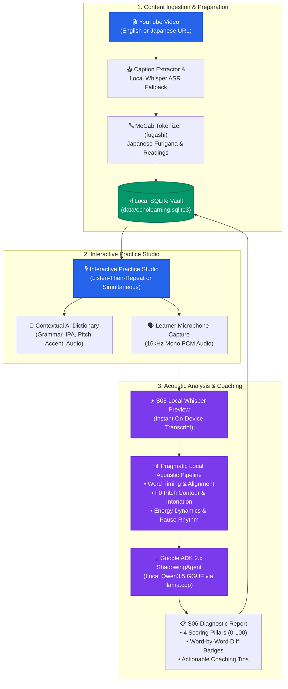
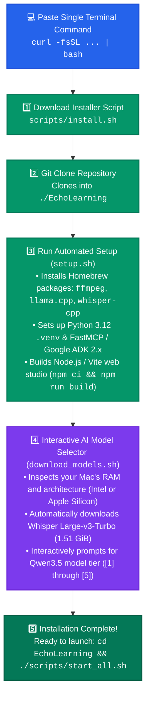
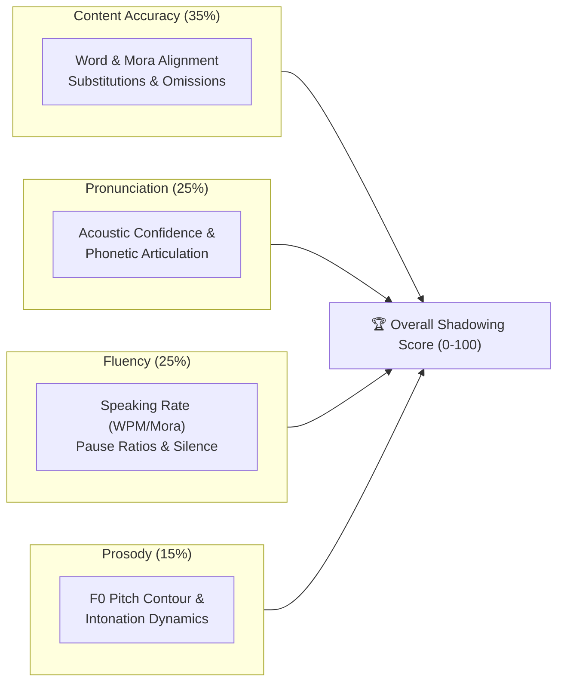
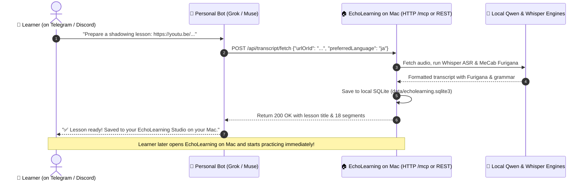
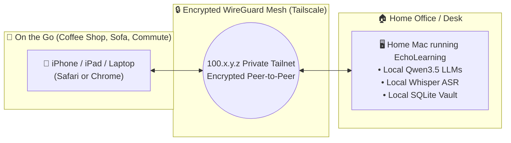
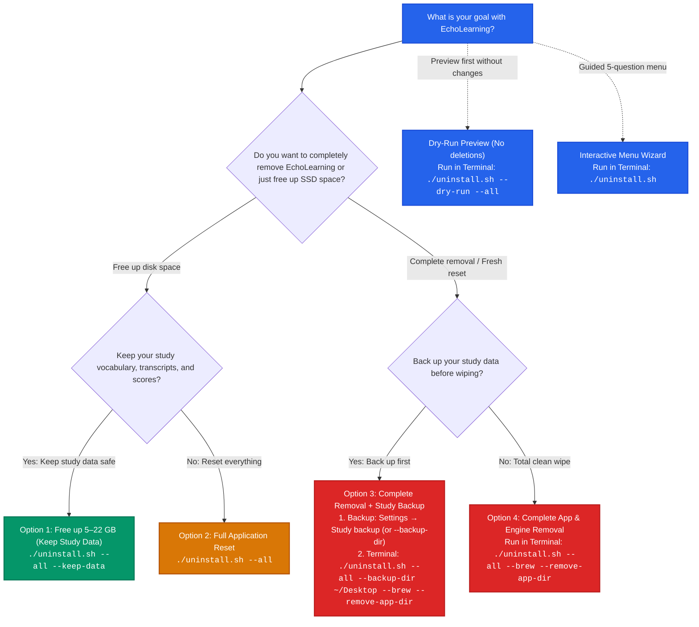

# 🎧 EchoLearning V2 — 100% Private, Zero-Cloud-Cost YouTube Shadowing Studio

> **Speak English & Japanese with Native Fluency.** Powered by Google ADK 2.x, Local Qwen3.5 LLMs, Whisper Large-v3-Turbo, MeCab Furigana, and FastMCP.

[](https://github.com/google/adk-python)
[](https://github.com/ggml-org/llama.cpp)
[](https://github.com/ggml-org/whisper.cpp)
[](https://modelcontextprotocol.io/)
[](https://tailscale.com/)
[](LICENSE)

---

## 📑 Table of Contents

1. [🌟 What is EchoLearning V2?](#-what-is-echolearning-v2)
2. [🏗️ Visual Architecture & How It Works](#️-visual-architecture--how-it-works)
3. [🧠 Choosing Your Local AI Model (Hardware Guide & Decision Table)](#-choosing-your-local-ai-model-hardware-guide--decision-table)
4. [🚀 Step-by-Step Local Installation & Quick Start](#-step-by-step-local-installation--quick-start)
5. [🎙️ How to Practice Shadowing (User Guide)](#-how-to-practice-shadowing-user-guide)
   - [1. Generate Transcripts Now & Practice Later](#1-generate-transcripts-now--practice-later)
   - [2. Inline Transcript Editing & Japanese Furigana](#2-inline-transcript-editing--japanese-furigana)
   - [3. Contextual AI Dictionary & Pitch Accent](#3-contextual-ai-dictionary--pitch-accent)
   - [4. Recording Your Voice & Instant Whisper Speech Preview (S05)](#4-recording-your-voice--instant-whisper-speech-preview-s05)
   - [5. AI Shadowing & Acoustic Prosody Evaluation (S06)](#5-ai-shadowing--acoustic-prosody-evaluation-s06)
6. [🔌 Connecting AI Coding Tools via MCP (Claude Code, OpenAI Codex, Antigravity)](#-connecting-ai-coding-tools-via-mcp)
   - [What is MCP?](#what-is-mcp-in-plain-english)
   - [Complete Table of EchoLearning MCP Tools](#complete-table-of-echolearning-mcp-tools)
   - [Setup Guide for Claude Code, Codex & Antigravity](#setup-guide-for-ai-assistants)
7. [🤖 Connecting Personal AI Bots (Grok Bot, Muse Bot, Custom Agents)](#-connecting-personal-ai-bots)
8. [📱 Remote Access via Tailscale (Practice Anywhere on iPhone or iPad)](#-remote-access-via-tailscale)
   - [3-Minute Tailscale Setup Guide](#3-minute-tailscale-setup-guide)
   - [Instant Tailscale Security & Access Control](#instant-tailscale-security--access-control)
9. [🗑️ Uninstalling EchoLearning & Reclaiming Disk Space](#-uninstalling-echolearning--reclaiming-disk-space)
   - [Why an Uninstaller?](#why-an-uninstaller)
   - [Decision Flowchart: Choosing the Right Cleanup Option](#decision-flowchart-choosing-the-right-cleanup-option)
   - [Comparison Table of Uninstall Modes & CLI Flags](#comparison-table-of-uninstall-modes--cli-flags)
   - [Step-by-Step Terminal Uninstaller Guide](#step-by-step-terminal-uninstaller-guide)
   - [Safety Guarantees & Study Vault Protection](#safety-guarantees--study-vault-protection)
10. [📖 Plain-English Glossary](#-plain-english-glossary)
11. [🧪 Running Tests & Code Verification](#-running-tests--code-verification)
12. [❓ Troubleshooting & Frequently Asked Questions](#-troubleshooting--faq)

---

## 🌟 What is EchoLearning V2?

**EchoLearning V2** is your personal, 100% private language coach designed to help you master spoken **English** and **Japanese** through authentic YouTube videos. 

Shadowing—the practice of repeating speech immediately after hearing it—is widely recognized by polyglots and speech scientists as the single most effective technique for mastering native pronunciation, rhythm, and intonation. However, traditional shadowing can be frustrating: you cannot easily see where your accent drifted, whether your pauses were natural, or what words you missed.

EchoLearning solves this by bringing together **cutting-edge open-source AI** running entirely on your own Mac:

```text
┌────────────────────────────────────────────────────────────────────────────────────────┐
│                                 THE ECHOLEARNING PROMISE                               │
├────────────────────────────────────────────────────────────────────────────────────────┤
│  🔒 100% Private & Local     Zero voice recordings or transcripts leave your machine.  │
│  💸 Zero Cloud Costs          No monthly AI subscriptions, no OpenAI/Google API bills.  │
│  ⚡ Sub-Second Audio Analysis Instant Whisper ASR + local pitch & rhythm evaluation.   │
│  🇯🇵 Deep Japanese Support     Automatic MeCab Furigana (<ruby>), romaji, & pitch accent.│
│  🗄️ Local SQLite Vault        Generate lessons now, save them safely, practice anytime. │
│  🔌 Universal MCP Support     Control your study sessions directly from Claude or Codex.│
└────────────────────────────────────────────────────────────────────────────────────────┘
```

> [!NOTE]
> **Why 100% Local?**  
> Speaking aloud and making mistakes is a vulnerable learning process. In EchoLearning, your microphone audio is processed directly in your Mac's RAM and stored in your local SQLite database (`data/echolearning.sqlite3`). No voice samples are ever uploaded to cloud servers, third-party analytics, or commercial speech APIs.

---

## 🏗️ Visual Architecture & How It Works

EchoLearning orchestrates specialized local engines using **Google ADK (Agent Development Kit) 2.x**. Here is the complete data flow from YouTube video to personalized acoustic coaching:



### How the Pipeline Operates Step-by-Step

1. **Caption & ASR Ingestion:** When you paste a YouTube link, EchoLearning downloads the authentic subtitle tracks. If no subtitles exist, it downloads audio using `yt-dlp` and runs local `whisper-server` to generate verbatim transcripts automatically.
2. **Grammar & Furigana Tokenization:** Japanese text is tokenized into morphemes using `fugashi` (MeCab + UniDic). Every Kanji character receives accurate Hiragana Furigana (`<ruby>` annotations) and mora counts.
3. **Studio Practice & Voice Capture:** In the Practice Studio, you practice sentence-by-sentence. When you click **Finish Recording**, the app converts your microphone audio into 16kHz Mono PCM WAV.
4. **S05 Local Whisper Speech Preview:** Before you even submit for grading, the local Whisper model transcribes your take on-device in under a second so you can review what speech was detected.
5. **Pragmatic Local Acoustic Analysis:** EchoLearning extracts fundamental pitch frequency ($F_0$), pauses ($\ge 350\text{ ms}$), speaking rate (WPM in English / Moras/min in Japanese), and volume dynamics.
6. **ADK 2.x Coaching:** The Google ADK `ShadowingAgent` combines acoustic telemetry with local Qwen3.5 intelligence to deliver an encouraging, constructive evaluation in your preferred interface language.

---

## 🧠 Choosing Your Local AI Model (Hardware Guide & Decision Table)

EchoLearning V2 is designed to run efficiently on everything from an entry-level **2018 Intel Core i5 Mac mini (16 GB RAM)** up to high-end **Apple Silicon M-series Macs (24 GB–64 GB+ RAM)**. 

### Decision Table: Available Qwen3.5 Model Tiers

All models belong to the state-of-the-art **Qwen3.5** family and use optimized GGUF quantization. Speech recognition is always handled by **Whisper Large-v3-Turbo**:

| Tier | Model Profile ID | Display Name in App | Download Size | RAM Needed (`ctx=8192`) | Best Suited Hardware | Strengths & Trade-offs |
| :---: | :--- | :--- | :---: | :---: | :--- | :--- |
| **1** | `qwen3.5-4b-q6_k` | `Qwen3.5-4B-GGUF:Q6_K` | **3.28 GiB** | ~4.2 GB | 16 GB Intel Core i5 Mac mini or 8 GB–16 GB MacBook Air | **Fastest CPU response.** ~2.2× faster than 9B on Intel CPUs. Excellent for quick dictionary definitions and basic coaching. |
| **1+** | `qwen3.5-9b-q4_k_m` | `Qwen3.5-9B-GGUF:Q4_K_M` | **5.29 GiB** | ~6.2 GB | 16 GB Intel Macs or 16 GB Apple Silicon (M1–M4) | **Balanced 16 GB Choice.** Full 9B bilingual reasoning power with a 25% smaller RAM footprint than Q6_K. |
| **2** | `qwen3.5-9b-q6_k`<br/>*(Default)* | `Qwen3.5-9B-GGUF:Q6_K` | **6.95 GiB** | ~7.8 GB | 16 GB–24 GB Intel or Apple Silicon Macs | **Standard Recommended.** Near-lossless 6-bit quantization. Outstanding Japanese Furigana, pitch accent nuance, and grammar explanations. |
| **3** | `qwen3.5-27b-q4_k_m` | `Qwen3.5-27B-GGUF:Q4_K_M` | **15.59 GiB** | ~17.2 GB | 32 GB+ Apple Silicon (M1/M2/M3/M4 Pro/Max) | **Pro Dense Model.** Near-frontier bilingual understanding. Exceptionally detailed nuance for polite Japanese (*Keigo*) and complex phonetics. |
| **4** | `qwen3.5-35b-a3b-q4_k_m` | `Qwen3.5-35B-A3B-GGUF:Q4_K_M` | **20.50 GiB** | ~22.0 GB | 32 GB–64 GB+ Apple Silicon Macs | **Ultra Mixture-of-Experts (MoE).** 35B total parameters with only **3B active parameters per token**. Combines 35B intelligence with blazingly fast generation! |
| **ASR** | `whisper-large-v3-turbo` | `ggml-large-v3-turbo.bin` | **1.51 GiB** | ~1.6 GB | *Installed on all systems* | High-speed multilingual speech recognition engine (English & Japanese). |

> [!TIP]
> **Which model should I choose?**
> - If you are on a **16 GB Intel Mac mini**: choose `[3] Qwen3.5-9B-Q6_K` (Default) or `[2] Qwen3.5-9B-Q4_K_M` for maximum stability.
> - If you are on an **M-series Mac with 32 GB+ RAM**: install `[3]` and `[4]` or `[5]`. You can switch between them anytime!

### Interactive Multi-Model Downloader

When you run `./setup.sh` (or `./scripts/download_models.sh`), EchoLearning inspects your Mac's hardware:

```text
Detected Hardware: Apple M3 Pro (arm64) · 36 GB RAM · 245 GB free disk
Mandatory STT Engine: Whisper Large-v3-Turbo (1.51 GiB) [Ready]

Select one or more local LLM models to install (comma-separated, e.g. "1,3" or press Enter for default [3]):
  [1] Qwen3.5-4B-GGUF:Q6_K        (3.28 GiB | ~4.2 GB RAM) — Fast CPU response; great for 16 GB Intel Macs
  [2] Qwen3.5-9B-GGUF:Q4_K_M      (5.29 GiB | ~6.2 GB RAM) — Balanced 9B quality & lower RAM for 16 GB Macs
* [3] Qwen3.5-9B-GGUF:Q6_K        (6.95 GiB | ~7.8 GB RAM) — Default high-precision bilingual model [Recommended]
  [4] Qwen3.5-27B-GGUF:Q4_K_M     (15.59 GiB | ~17.2 GB RAM) — Pro dense model (Requires 32 GB+ RAM)
  [5] Qwen3.5-35B-A3B-GGUF:Q4_K_M (20.50 GiB | ~22.0 GB RAM) — Fast 35B MoE model (Requires 32 GB+ RAM)
```

Downloads are **fully resumable** (`curl -C -`) with verified SHA-256 checksums. If your connection drops, re-running the script resumes right where it stopped.

### Runtime Model Switching on the Home Page

You do not need to restart any terminal processes or edit configuration files to test different models. On the **Home Page**, select any installed model from the **Model Selection** dropdown:

```text
┌─────────────────────────────────────────────────────────────┐
│  Model Selection:  [ Qwen3.5-9B-GGUF:Q6_K (Active)        ▼]│
│                    • Qwen3.5-4B-GGUF:Q6_K [Installed]       │
│                    • Qwen3.5-9B-GGUF:Q6_K [Active]          │
│                    • Qwen3.5-35B-A3B-GGUF [Installed]       │
└─────────────────────────────────────────────────────────────┘
```

The FastAPI backend cleanly swaps the model in `llama-server` on port `8080`, verifies readiness, and activates it in under 5 seconds!

---

## 🚀 Step-by-Step Local Installation & Quick Start

### Prerequisites
- **Operating System:** macOS 12+ (tested on Intel Core i5/i7 and Apple Silicon M1/M2/M3/M4).
- **Homebrew:** Install from [brew.sh](https://brew.sh) if not already installed.
- **Git:** Available via Xcode Command Line Tools (`xcode-select --install`).

---

### Method A: One-Line Installer (Recommended for New Users)

The fastest and easiest way to install EchoLearning on your Mac is our automated one-line installer. It completely automates the setup from start to finish—cloning the repository, configuring Homebrew dependencies, creating the Python environment, building the frontend, and downloading your chosen local AI models.

#### 🔄 Visual Installation Flowchart



#### The Single Command

Open your macOS Terminal in whatever folder you want EchoLearning installed (for example, your home folder `~` or projects directory) and run:

```bash
curl -fsSL https://raw.githubusercontent.com/NinjaRoboticsEducation/EchoLearning/HEAD/scripts/install.sh | bash
```

*(Alternatively, you can also run the multi-line curl script via GitHub's raw API:)*

```bash
bash -c '
  set -euo pipefail
  installer=$(mktemp)
  cleanup() { rm -f -- "$installer"; }
  trap cleanup EXIT
  curl --fail --silent --show-error --location \
    -H "Accept: application/vnd.github.raw+json" \
    https://api.github.com/repos/NinjaRoboticsEducation/EchoLearning/contents/scripts/install.sh \
    -o "$installer"
  bash "$installer"
'
```

#### Optional Non-Interactive & Custom Model Options

If you want a non-interactive installation (ideal for automated environments or if you want to skip interactive prompts), pass flags directly into the installer using `bash -s --`:

```bash
# Option 1: Automatic Default — Installs recommended Qwen3.5-9B-Q6_K without prompts
curl -fsSL https://raw.githubusercontent.com/NinjaRoboticsEducation/EchoLearning/HEAD/scripts/install.sh | bash -s -- --default

# Option 2: Pre-Select Specific Model Tier (e.g. Tier [3] 9B-Q6_K or Tier [1] 4B for 16 GB Intel Macs)
curl -fsSL https://raw.githubusercontent.com/NinjaRoboticsEducation/EchoLearning/HEAD/scripts/install.sh | bash -s -- --models 3

# Option 3: Install Multiple Models at Once (e.g. Tier 1 and Tier 3)
curl -fsSL https://raw.githubusercontent.com/NinjaRoboticsEducation/EchoLearning/HEAD/scripts/install.sh | bash -s -- --models 1,3

# Option 4: Custom Destination Folder
curl -fsSL https://raw.githubusercontent.com/NinjaRoboticsEducation/EchoLearning/HEAD/scripts/install.sh | bash -s -- ~/MyApps/EchoLearning
```

Once the installer finishes, start EchoLearning:
```bash
cd EchoLearning
./scripts/start_all.sh
```

---

### Method B: Manual Clone & Setup (For Developers)

If you prefer to clone and inspect the code before setting up:

#### Step 1: Clone the Repository
```bash
git clone https://github.com/NinjaRoboticsEducation/EchoLearning.git
cd EchoLearning
```

#### Step 2: Run Automated Setup
```bash
./setup.sh
```
*`setup.sh` automatically executes 8 structured environment preparation steps:*
1. **Operating System Check:** Confirms macOS architecture (`arm64` Apple Silicon or `x86_64` Intel).
2. **Package Manager Check:** Confirms Homebrew is installed.
3. **Core Dependencies:** Installs `ffmpeg`, `python3` (3.12+), and `node` (Node >= 20.19.0).
4. **Local AI Inference Engines:** Installs Homebrew formulas `llama.cpp` (`llama-server`) and `whisper-cpp` (`whisper-server`).
5. **Python Virtual Environment:** Creates `adk_backend/.venv` and installs Google ADK 2.x, FastMCP, `fugashi` (MeCab UniDic Japanese tokenizer), and FastAPI dependencies.
6. **Frontend Web Studio Build:** Runs `npm ci` and compiles the React 19 / Vite frontend (`npm run build`).
7. **Interactive AI Model Downloader:** Automatically launches `download_models.sh`! It inspects your Mac's RAM and GPU, downloads **Whisper Large-v3-Turbo** (`1.51 GiB`), and prompts you to choose your **Qwen3.5 LLM tier** (`[1]`–`[5]`).
8. **Runtime Directory Preparation:** Prepares `.pids/`, `logs/`, and `data/audio/`.

> [!TIP]
> **Need to download additional models later?**  
> You do NOT need to re-run `./setup.sh` to get other models. Simply run:
> ```bash
> ./scripts/download_models.sh
> ```
> This opens the model selector anytime so you can install lighter or larger Qwen3.5 tiers as your hardware or study needs change!

#### Step 3: Start All Services
```bash
./scripts/start_all.sh
```
*`start_all.sh` (which invokes `./scripts/start.sh`) launches all four coordinated background services:*
- 🧠 **`llama-server`** (:8080) — Local Qwen3.5 LLM engine with Apple Metal GPU offload or AVX2 CPU acceleration.
- 🎙️ **`whisper-server`** (:8081) — Local Whisper Large-v3-Turbo speech recognition engine.
- 🚀 **FastAPI + Google ADK Backend** (:3000) — Studio REST API, SQLite persistence, and Streamable HTTP MCP endpoint.
- ⚡ **Vite Dev Server** (:5173) — Interactive React 19 UI with hot-module reloading (opens automatically in your browser).

#### Step 4: Open in Your Browser
If your browser does not open automatically, navigate to either:
👉 **[http://localhost:5173](http://localhost:5173)** *(Vite Interactive UI)*  
👉 **[http://127.0.0.1:3000](http://127.0.0.1:3000)** *(FastAPI Production Server)*

---

### 🖥️ Desktop Double-Click Launcher (`EchoLearning.command`)

To launch EchoLearning with a single click without opening Terminal:

1. Create a file named `EchoLearning.command` on your Desktop (or inside the project root):
   ```bash
   cat << 'EOF' > ~/Desktop/EchoLearning.command
   #!/bin/bash
   cd "/path/to/EchoLearning"
   ./scripts/start_all.sh
   EOF
   chmod +x ~/Desktop/EchoLearning.command
   ```
2. Double-click **`EchoLearning.command`** anytime you want to practice! It starts the background AI engines and opens your default browser automatically.

---

### 🛑 Clean Shutdown

You do not need to hunt down process IDs or force-close terminal windows:
1. Click the **Shut down** button in the top-right header of the web app.
2. Confirm the prompt in the dialog.
3. EchoLearning cleanly terminates `llama-server`, `whisper-server`, and the backend, freeing all RAM and GPU resources.

Alternatively, you can run `./scripts/stop.sh` from the project directory.

---

## 🎙️ How to Practice Shadowing (User Guide)

### 1. Generate Transcripts Now & Practice Later

You don't have to practice immediately when you find an interesting video. EchoLearning features a **Local SQLite Vault**:

1. On the **Home Page**, paste any YouTube URL (e.g. `https://www.youtube.com/watch?v=...`) or 11-character video ID.
2. Select your content language: **English** or **Japanese**.
3. Click **Generate Learning Transcript**.
4. EchoLearning downloads captions, runs MeCab tokenization, and saves the material to `data/echolearning.sqlite3`.
5. Under **Saved Shadowing Materials** on the Home page, you can see all your generated lessons with video thumbnails, titles, and creation dates. Click any card to resume practicing instantly—even weeks later or without internet access!

```text
┌────────────────────────────────────────────────────────────────────────┐
│ 📚 Saved Shadowing Materials (Generate Now, Practice Later)           │
├────────────────────────────────────────────────────────────────────────┤
│ [🎬 Thumbnail]  Easy Japanese Conversation for Beginners              │
│                 Language: Japanese · 24 Segments · Saved 2 hours ago   │
│                 [ Open Practice Studio → ]                             │
├────────────────────────────────────────────────────────────────────────┤
│ [🎬 Thumbnail]  Steve Jobs Stanford Commencement Speech (English)      │
│                 Language: English · 42 Segments · Saved Yesterday      │
│                 [ Open Practice Studio → ]                             │
└────────────────────────────────────────────────────────────────────────┘
```

---

### 2. Inline Transcript Editing & Japanese Furigana

Real-world YouTube subtitles sometimes contain typos or misheard words. EchoLearning lets you edit transcripts directly:

- **Toggle Furigana:** For Japanese lessons, click the **Furigana** toggle to show or hide phonetic Hiragana readings above Kanji (`<ruby>` annotations).
- **Edit Any Sentence:** Click the **✏️ Edit** button on any transcript row. You can correct words, adjust start/end timestamps, or fix punctuation.
- **Instant Retokenization:** When you save your edit, EchoLearning re-runs MeCab tokenization in the background, updating all Furigana hints and dictionary boundaries immediately.

---

### 3. Contextual AI Dictionary & Pitch Accent

Language is contextual—a word's meaning depends on the sentence it appears in.

```text
┌─────────────────────────────────────────────────────────────┐
│ 📖 行く (iku / iku)                           [🔊 Native Audio]│
│ Part of Speech: Verb, Godan · JLPT N5 · Tokyo Pitch: [0] 平板 │
│                                                             │
│ Meaning in this sentence:                                   │
│ "To proceed or advance toward a destination."               │
│                                                             │
│ Sentence: 明日は東京へ行きます。                                │
│                                                             │
│ [ 💾 Save to Vocabulary Vault ]                             │
└─────────────────────────────────────────────────────────────┘
```

- **Click Any Word:** Click any word in the transcript reader to open the popover.
- **Context-Aware Definition:** Powered by local Qwen3.5, the dictionary explains what the word means *in this exact sentence*, not just a generic dictionary dump.
- **Pronunciation & Pitch Accent:** Inspect the International Phonetic Alphabet (IPA) for English, or Hiragana readings with Tokyo pitch-accent patterns (Atamadaka, Nakadaka, Odaka, Heiban) for Japanese.
- **Offline Audio Pronunciation:** Click the speaker icon to hear crisp, natural offline pronunciation synthesized natively in under 150ms.
- **Save to Vocabulary Vault:** Click **Save to Vocabulary**. Tricky words are saved with their sentence context and timestamp so you can review or export them to Anki later!

---

### 4. Recording Your Voice & Instant Whisper Speech Preview (S05)

When you are ready to shadow:

1. Select your shadowing mode:
   - **Listen-Then-Repeat Mode:** The video plays one sentence, pauses automatically, and activates your microphone. Ideal for beginners focusing on phonetic precision.
   - **Simultaneous Mode:** The video plays continuously while you speak along in real time with the speaker. Ideal for intermediate and advanced learners mastering cadence and rhythm.
2. Speak into your microphone. You will see a live **60fps audio waveform** reflecting your volume.
3. Click **Finish Recording**.
4. **The S05 Speech Preview Card appears immediately!** Local `whisper-server` transcribes your recorded take in under a second. You can read exactly what the AI heard before requesting the full acoustic breakdown:

```text
┌────────────────────────────────────────────────────────────────────────┐
│ ⚡ AI Recognized Speech (Local Whisper Speech Preview)                  │
├────────────────────────────────────────────────────────────────────────┤
│ Target:     "The only way to do great work is to love what you do."    │
│ You Spoke:  "The only way to do great work is to love what you do."    │
│                                                                        │
│ [ 🔊 Listen to My Recording ]               [ 📊 Analyze Shadowing Result ]│
└────────────────────────────────────────────────────────────────────────┘
```

> [!NOTE]
> **No Cloud Audio Transfer:**  
> Unlike other language apps that stream your microphone audio to browser cloud speech APIs, EchoLearning's speech preview runs **100% locally** via `whisper-server`. Your voice never leaves your Mac.

---

### 5. AI Shadowing & Acoustic Prosody Evaluation (S06)

Click **Analyze Shadowing Result** to unlock your comprehensive performance report:



#### The 4 Pillars of Speaking Mastery
1. **Content Accuracy (35%):** Deterministic lexical alignment measuring matched words against the target. Identifies skipped words, substitutions, and extra inserted words.
2. **Pronunciation (25%):** Whisper acoustic token probabilities combined with phonetic edit distance to pinpoint articulation lapses.
3. **Fluency (25%):** Speech rate measured in **Words per Minute (WPM)** for English or true **Moras per Minute (Moras/min)** for Japanese, plus mid-phrase hesitation detection.
4. **Prosody & Intonation (15%):** Fundamental frequency ($F_0$) pitch contour tracking. Evaluates whether your voice naturally rises and falls with native musicality rather than sounding robotic or monotone.

#### Visual Word-by-Word Diff Badges
Each word is color-coded so you know exactly where to improve:
- <span style="color:#10b981;font-weight:bold;">Green (`✓ correct`)</span>: Native-level match and pronunciation.
- <span style="color:#ef4444;font-weight:bold;">Red (`omitted`)</span>: Word was skipped or swallowed.
- <span style="color:#f59e0b;font-weight:bold;">Yellow (`substituted`)</span>: Different word spoken or pronunciation unclear.
- <span style="color:#6366f1;font-weight:bold;">Blue (`uncertain`)</span>: Close acoustic homophone.

#### Encouraging AI Coach Tips
The Google ADK `ShadowingAgent` provides 2–3 actionable, encouraging tips tailored to your specific mistake (e.g., *"Great rhythm! Pay attention to the pitch drop on '東京' (Heiban pattern)—keep your tone steady across all three moras."*).

Click **Retry Difficult Phrase** to re-record immediately and watch your score climb!

---

## 🔌 Connecting AI Coding Tools via MCP

### What is MCP in Plain English?

**Model Context Protocol (MCP)** is an open standard created by Anthropic that allows AI assistants (like **Claude Code**, **OpenAI Codex**, or **Google Antigravity**) to securely connect to external tools and data sources.

Think of MCP as giving your AI assistant **hands and eyes**: instead of you manually copy-pasting vocabulary or lesson transcripts, your AI assistant can directly interact with EchoLearning on your Mac to:
- Generate new shadowing lessons from YouTube links while you chat.
- Query your saved vocabulary and quiz you on difficult words.
- Export your study history or create custom spaced-repetition flashcards.

---

### Complete Table of EchoLearning MCP Tools

EchoLearning provides **13 full-featured MCP tools** available over both `stdio` and `Streamable HTTP` (`http://127.0.0.1:3000/mcp`):

| Tool Name | What It Does (Plain English) | Key Arguments | Return Value |
| :--- | :--- | :--- | :--- |
| `get_capabilities` | Checks EchoLearning system status, active LLM model, and supported languages. | *None* | System info, version, active model name, language list. |
| `fetch_transcript` | Fetches, transcribes, and tokenizes a YouTube video synchronously. | `url_or_id` (str), `preferred_language` (`en`\|`ja`, default `en`) | Complete material metadata and tokenized sentence segments. |
| `start_transcript_job` | Starts an asynchronous background job to transcribe a long video. | `url_or_id` (str), `preferred_language` (`en`\|`ja`, default `en`) | `{"jobId": "...", "status": "running"}`. |
| `get_job_status` | Checks progress and status of a background transcription job. | `job_id` (str) | Job status (`running`\|`succeeded`\|`failed`\|`cancelled`) and result. |
| `cancel_job` | Cancels an ongoing background transcription job cleanly. | `job_id` (str) | Cancellation status (`cancelled: true|false`). |
| `retokenize_text` | Splits English or Japanese text into grammatical tokens and Furigana. | `text` (str), `language` (`en`\|`ja`, default `en`) | Array of token objects with surface, reading, and romaji. |
| `lookup_word` | Contextual dictionary lookup for a word inside a given sentence. | `word` (str), `sentence` (str, optional), `language` (`en`\|`ja`, default `en`) | Meaning, part of speech, IPA, Furigana, pitch accent. |
| `save_vocabulary` | Saves a new vocabulary item to the local SQLite study vault. | `word` (str), `definition` (str), `language` (`en`\|`ja`), `context` (str, opt), `phonetic` (str, opt) | Created vocabulary record with unique ID. |
| `list_vocabulary` | Lists your saved vocabulary cards with optional language filter. | `language` (`""`\|`en`\|`ja`, optional) | Array of saved vocabulary cards (`items`) and count. |
| `list_materials` | Lists all saved shadowing lessons stored in your local SQLite vault. | *None* | Array of study materials (`materials`) and count. |
| `list_history` | Lists past shadowing practice sessions and scoring reports. | *None* | Array of practice session summaries (`reports`) and count. |
| `pronounce_text` | Generates high-quality offline spoken audio for any word or sentence. | `text` (str), `language` (`en`\|`ja`, default `en`) | Base64-encoded audio WAV data and MIME type. |
| `export_study_data` | Exports your study materials, vocabulary, or history as JSON or safe CSV. | `format` (`json`\|`csv`, default `json`) | Structured JSON or CSV export content string. |

---

### Setup Guide for AI Assistants

#### 1. Claude Code
Run this command in your terminal to register EchoLearning with Claude Code:

```bash
claude mcp add echolearning /path/to/EchoLearning/scripts/start_mcp.sh
```

Or connect via Streamable HTTP if EchoLearning is already running:
```bash
claude mcp add --transport http echolearning http://127.0.0.1:3000/mcp
```

#### 2. OpenAI Codex CLI (`~/.codex/config.toml`)
Add the following snippet to your `~/.codex/config.toml`:

```toml
[mcp_servers.echolearning]
command = "/path/to/EchoLearning/scripts/start_mcp.sh"

# Or via HTTP if EchoLearning is running:
# url = "http://127.0.0.1:3000/mcp"
```

#### 3. Google Antigravity (`mcp_config.json`)
Add EchoLearning to your Antigravity project configuration:

```json
{
  "mcpServers": {
    "echolearning": {
      "command": "/path/to/EchoLearning/scripts/start_mcp.sh"
    }
  }
}
```

---

## 🤖 Connecting Personal AI Bots (Grok Bot, Muse Bot, Custom Agents)

Do you use a personal AI bot on Telegram, Discord, or Slack (such as a **Grok bot**, **Muse bot**, or your own custom Python script)? You can easily connect your personal bot to EchoLearning!

Imagine sending a YouTube link to your Telegram bot while browsing on your phone:
> *"Hey Grok, turn this video into a Japanese shadowing lesson for tonight: https://youtu.be/..."*

Your bot talks to EchoLearning on your Mac, prepares the transcript and Furigana, and when you sit down at your desk, the lesson is waiting for you in your saved materials!



### Integration Method 1: Via Streamable HTTP MCP (`/mcp`)
If your bot framework supports MCP (such as LangChain, LlamaIndex, or AutoGen):
- **MCP Endpoint URL:** `http://<your-mac-ip>:3000/mcp`
- Your bot can call `fetch_transcript`, `lookup_word`, or `list_vocabulary` as native tool calls.

### Integration Method 2: Via Direct REST API
Any script can call EchoLearning's straightforward HTTP REST endpoints:

```bash
# Example: Tell EchoLearning to prepare a Japanese shadowing lesson
curl -X POST http://127.0.0.1:3000/api/transcript/fetch \
  -H "Content-Type: application/json" \
  -d '{
    "urlOrId": "https://www.youtube.com/watch?v=dQw4w9WgXcQ",
    "preferredLanguage": "ja"
  }'
```

```python
# Example: Minimal Python Bot integration
import requests

def create_lesson(youtube_url: str, language: str = "en"):
    response = requests.post(
        "http://127.0.0.1:3000/api/transcript/fetch",
        json={"urlOrId": youtube_url, "preferredLanguage": language}
    )
    data = response.json()
    print(f"Lesson created: {data.get('title')} ({len(data.get('segments', []))} sentences)")

create_lesson("https://youtu.be/example", "ja")
```

---

## 📱 Remote Access via Tailscale (Practice Anywhere on iPhone or iPad)

Want to practice shadowing on your **iPhone**, **iPad**, or **laptop** while lounging on the sofa, relaxing in bed, or studying at a coffee shop—without moving your Mac?

With **Tailscale**, you can access EchoLearning securely from any device on your private Tailnet. **Zero ports opened to the public internet, zero SSL certificate hassle, 100% encrypted WireGuard protection.**



### 3-Minute Tailscale Setup Guide

#### Step 1: Install Tailscale on Your Mac
If you haven't installed Tailscale yet:
```bash
brew install --cask tailscale
```
Or download it directly from the macOS App Store. Launch Tailscale and sign in.

#### Step 2: Find Your Mac's Tailscale IP
Open Terminal and run:
```bash
tailscale ip -4
```
*(You will see a private IP address starting with `100.`, for example `100.64.0.10`).*

You can also view this directly in the EchoLearning **Settings tab**, which detects and displays your live Tailscale connection status automatically!

#### Step 3: Connect from Your iPhone or iPad
1. Download **Tailscale** from the iOS App Store on your iPhone or iPad and log into the same account.
2. Open **Safari** on your iPhone and navigate to:
   ```text
   http://<your-mac-tailscale-ip>:3000
   ```
   *(For example: `http://100.64.0.10:3000`)*
3. **That's it!** EchoLearning's responsive mobile interface loads instantly. You can speak into your phone's microphone, use the dictionary, and shadow lessons powered by your home Mac's desktop-class AI!

> [!TIP]
> **Queue Lessons from Your Phone:**  
> When you stumble upon a great English or Japanese YouTube video on your phone, open Safari, paste the link into your EchoLearning instance, and generate the transcript. The heavy AI processing runs on your Mac, and the lesson is saved to your vault immediately!

### Instant Tailscale Security & Access Control

EchoLearning includes built-in network security controls so you can manage remote access with a single click without touching macOS firewall rules or terminal configurations:

- **One-Click Tailscale Toggle:** In the web studio under **Settings → Private connections & MCP**, you can toggle **Tailscale access** between `ON` and `OFF` at any time.
- **Immediate Remote Lockdown (HTTP 403):** When switched to **`OFF`**, EchoLearning's security middleware immediately blocks all incoming Tailscale and non-loopback network requests to both the REST API (`/api/*`) and the FastMCP server (`/mcp`) with `HTTP 403 Forbidden` (`{"detail": "Tailscale remote access is disabled in Settings."}` or JSON-RPC `-32001`).
- **Local Mac Access Remains Active:** Local connections on your host Mac (`127.0.0.1` and `localhost:3000` / `localhost:5173`) remain 100% active, uninterrupted, and fully functional. You can continue practicing locally on your Mac while external devices are securely shut out.
- **Instant Re-enable:** When you are ready to practice on your iPhone or iPad again, simply flip the toggle back to **`ON`** in Settings. Remote access is restored immediately without needing to restart background services.

---

## 🗑️ Uninstalling EchoLearning & Reclaiming Disk Space

### Why an Uninstaller?

Local AI gives you unmatched superpowers: **100% privacy, zero latency, and zero recurring cloud subscription fees**. However, running cutting-edge models locally means keeping substantial files on your Mac's internal drive:
- **Local AI Models (`models/`):** Whisper Large-v3-Turbo (`1.51 GiB`) plus Qwen3.5 LLMs (`3.28 GiB` up to `20.5 GiB` per model). A typical setup uses **5 GB to 22+ GB** of SSD space.
- **Python Virtual Environments & Node Packages:** `adk_backend/.venv`, `node_modules`, and compiled frontend assets take approximately **2.5 GB to 4.5 GB**.
- **Study Vault & Audio Recordings (`data/`):** Your SQLite database (`data/echolearning.sqlite3`) and user audio recordings (`data/audio/`) grow naturally as you practice.

Whether you need to reclaim disk space while keeping your hard-earned vocabulary cards and shadowing scores safe, reset the app to a clean state for troubleshooting, or completely remove EchoLearning and its Homebrew AI engines from your Mac, the **EchoLearning Uninstaller** (`./uninstall.sh` or `./scripts/uninstall.sh`) makes the process safe, transparent, and completely reversible.

---

### Decision Flowchart: Choosing the Right Cleanup Option

Use this flowchart to find the exact command for your needs:



---

### Comparison Table of Uninstall Modes & CLI Flags

The uninstaller provides both an interactive terminal wizard and direct non-interactive CLI flags for automation:

| Command / Flag | Mode / Purpose | What It Removes | What It Keeps Safe | Typical Space Reclaimed |
| :--- | :--- | :--- | :--- | :--- |
| **`./uninstall.sh`** | **Interactive Wizard** | Guided prompt allowing you to pick Options `[1]` through `[5]`. | You choose interactively. | Depends on selection (up to 25+ GB). |
| **`--dry-run`**<br/>*(e.g. `./uninstall.sh --dry-run --all`)* | **Safe Preview** | **Nothing deleted.** Previews sizes and actions via `du -sh`. | **Everything.** Services and files remain untouched. | 0 GB *(preview only)* |
| **`--deps-only`** | **Dependency Clean** | Python `.venv`, `node_modules`, `dist`, `.pytest_cache`, `logs/`, `.pids/`. | **Keeps AI models (`models/`) AND study data (`data/`).** | ~2.5 GB – 4.5 GB |
| **`--all --keep-data`**<br/>*(Recommended for freeing space)* | **Model & Dependency Cleanup** | All AI models (`*.gguf`, `*.bin`), Python `.venv`, `node_modules`, `dist/`, logs. | **Keeps `data/echolearning.sqlite3` & `data/audio/` safe!** | **7 GB – 25+ GB** |
| **`--all --keep-models`** | **Data & Dependency Reset** | Python `.venv`, `node_modules`, `dist/`, study database & audio in `data/`. | **Keeps downloaded AI models (`models/`).** | ~3 GB – 6 GB |
| **`--all`** | **Full Application Reset** | Dependencies, caches, all local AI models, and study data. | Keeps project folder, Git repo, and scripts intact. | 7.5 GB – 25+ GB |
| **`--all --backup-dir <dir>`**<br/>*(e.g. `--backup-dir ~/Desktop`)* | **Safe Reset with Backup** | Dependencies, models, and study data inside the workspace. | **Creates timestamped `.tar.gz` archive of `data/` in `<dir>` before deletion.** | 7.5 GB – 25+ GB |
| **`--all --brew --remove-app-dir`** | **Complete Clean Uninstall** | Dependencies, models, data, Homebrew `llama.cpp` and `whisper-cpp`, and the EchoLearning folder. | Nothing inside EchoLearning. (Shared tools like `ffmpeg`, `node`, `python` are kept safe). | **Total footprint reclaimed (up to 26+ GB)** |
| **`-y`, `--yes`** | **Skip Prompts** | Automatically confirms planned actions. | Respects all `--keep-*` flags. | — |
| **`--non-interactive`** | **Headless / CI Mode** | Runs without TTY prompts (requires `--all` or `--deps-only`). | Respects all `--keep-*` flags. | — |
| **`--project-root <dir>`** | **Target Specific Directory** | Specifies the root path to uninstall (or use `ECHO_UNINSTALL_ROOT`). | Validated by strict safety guards against system paths. | — |

> [!NOTE]
> **Homebrew Safety Guarantee:**  
> When the `--brew` flag is passed, the uninstaller ONLY removes `llama.cpp` and `whisper-cpp` formulas. It **never** uninstalls shared macOS developer tools like `ffmpeg`, `node`, `git`, or `python3` that other applications on your Mac might rely upon.

---

### Step-by-Step Terminal Uninstaller Guide

To prevent accidental deletions and ensure complete transparency, uninstallation and deep disk cleanup are performed directly in your macOS Terminal via the `./uninstall.sh` script.

> [!TIP]
> **Back Up Your Study Vault Before Cleanup:**  
> Before running the uninstaller, you can preserve your vocabulary cards, transcript corrections, and shadowing performance history in two convenient ways:
> - **In Web UI Settings:** Go to **Settings → Study backup** and click **Generate Backup** to download your complete study vault as a JSON archive.
> - **In Terminal via CLI:** Pass `--backup-dir <directory>` (e.g. `./uninstall.sh --all --backup-dir ~/Desktop`) to automatically generate a compressed `.tar.gz` archive before any files are removed.

#### Step 1: Preview Disk Space with a Dry Run (`--dry-run`)
Before deleting anything, inspect exactly how much space each component occupies without stopping any running services or touching any files:

```bash
cd EchoLearning
./uninstall.sh --dry-run --all
```

Example output:
```text
================================================================================
  EchoLearning — Disk Usage & Uninstall Summary
  Target: /path/to/EchoLearning
================================================================================
  Running services & PIDs (.pids/, logs/):   48K
  Local AI Models (models/*.gguf, *.bin):    8.5G
  Python/Node Deps & Build (.venv, dist):    3.8G
  Study Data & Recordings (data/):           180M
  Homebrew AI Engines (llama/whisper):       420M (llama.cpp whisper-cpp)
================================================================================

[DRY-RUN] Previewing uninstall actions (no files or services will be modified):
  • Stop running EchoLearning services (.pids/ & scripts/stop.sh)
  • Remove dependencies & caches (.venv, node_modules, dist, logs, .pids, .pytest_cache): true
  • Remove local AI models (models/*.gguf, *.bin, manifest.json): true
  • Remove study data (data/): true
  • Uninstall Homebrew llama.cpp & whisper-cpp: false
  • Remove EchoLearning directory: false
```

#### Step 2: Run the Guided Interactive Wizard (`./uninstall.sh`)
If you prefer answering step-by-step prompts without remembering CLI flags, launch the interactive menu:

```bash
./uninstall.sh
```

You will be presented with a clear 5-option interactive menu:
- `[1] Clean Dependencies & AI Models (Keep Study Data in data/)` — Frees up 5–22+ GB of SSD space while preserving your SQLite database and recordings.
- `[2] Full Application Reset (Remove Dependencies, AI Models & Study Data)` — Returns the repository to a clean clone state.
- `[3] Complete Uninstall (Remove Everything + Homebrew llama.cpp/whisper-cpp + Optional App Folder)` — Complete removal of all models, data, Homebrew inference formulas, and optionally the app folder.
- `[4] Custom Selection (Choose each component interactively)` — Granular checkboxes for each component.
- `[5] Cancel` — Aborts cleanly with zero changes.

#### Step 3: Common Non-Interactive One-Line Recipes

For automation, CI, or quick execution, run any of these direct one-line commands:

- **Free Up Maximum Disk Space While Keeping Study Data Safe (Recommended):**
  ```bash
  ./uninstall.sh --all --keep-data
  ```
  *Removes heavy AI models, Python `.venv`, `node_modules`, and build caches, while preserving `data/echolearning.sqlite3` and `data/audio/`.*

- **Full Application Reset with an Automated Desktop Backup:**
  ```bash
  ./uninstall.sh --all --backup-dir ~/Desktop
  ```
  *Safely archives your study database and recordings into `~/Desktop/echolearning-study-backup-YYYYMMDD-HHMMSS.tar.gz` before deleting local project data.*

- **Clean Build Dependencies & Python Environment Only (Keep Models & Data):**
  ```bash
  ./uninstall.sh --deps-only
  ```
  *Cleans `.venv`, `node_modules`, and build caches (~2.5–4.5 GB) without touching downloaded GGUF models or study history.*

- **Complete App & Engine Removal (Wipe Everything):**
  ```bash
  ./uninstall.sh --all --brew --remove-app-dir
  ```
  *Shuts down services, removes dependencies, AI models, study vault, Homebrew `llama.cpp` and `whisper-cpp`, and deletes the application folder.*

> [!TIP]
> **Terminal Directory Tip After `--remove-app-dir`:**  
> If you run `./uninstall.sh` from inside the `EchoLearning` folder and choose to delete the application folder itself (via `--remove-app-dir` or Menu Option `[3]`/`[4]`), your current Terminal shell will point to a directory that has just been deleted. Before running the [Method A One-Line Installer](#method-a-one-line-installer-recommended-for-new-users) again or running new commands, always step back into your parent folder:
> ```bash
> cd ..
> ```
> *(The uninstaller script also displays a friendly reminder in your Terminal output right before finishing).*

---

### Safety Guarantees & Study Vault Protection

EchoLearning implements multiple layers of automated safety guards to prevent accidental file deletion:

```text
┌────────────────────────────────────────────────────────────────────────┐
│                     UNINSTALLER SAFETY GUARANTEES                      │
├────────────────────────────────────────────────────────────────────────┤
│ 🛡️ Protected Path Refusal     Refuses to run on /, /System, /usr,      │
│                               /Applications, /Volumes, or $HOME.       │
│ 🔍 Signature Verification     Verifies adk_backend, package.json, and  │
│                               scripts/start.sh before executing.       │
│ 🛑 Safe Service Termination   Cleanly shuts down llama-server, whisper │
│                               server, and FastAPI before removing PIDs.│
│ 📦 Study Vault Isolation      data/ is only removed if explicitly      │
│                               requested, with built-in backup support. │
│ 🍺 Non-Destructive Homebrew   Only uninstalls llama.cpp & whisper-cpp; │
│                               never touches ffmpeg, node, git, python. │
└────────────────────────────────────────────────────────────────────────┘
```

#### Reinstalling or Re-Activating After Cleanup

- **If you kept the application directory** (e.g. after `./uninstall.sh --all --keep-data` or `./uninstall.sh --deps-only`):
  ```bash
  ./setup.sh
  ./scripts/start_all.sh
  ```
  *`setup.sh` will re-create the Python virtual environment, install node dependencies, and download your chosen AI models. All your previous vocabulary cards and shadowing scores in `data/` will be immediately available in the studio!*

- **If you removed the entire EchoLearning directory** (`--remove-app-dir`):
  Remember to run `cd ..` first, then run the one-line installer:
  ```bash
  cd ..
  curl -fsSL https://raw.githubusercontent.com/NinjaRoboticsEducation/EchoLearning/HEAD/scripts/install.sh | bash
  ```

---

## 📖 Plain-English Glossary

Here is a clear guide to key concepts and acronyms used in EchoLearning:

| Term / Acronym | What It Means in Plain English |
| :--- | :--- |
| **Shadowing** | An evidence-based language learning technique where you repeat spoken speech immediately after hearing it, matching rhythm, speed, and intonation as closely as possible. |
| **ADK (Agent Development Kit)** | Google's official open-source framework for building AI applications out of organized "agents" (workers that reason about goals) and "tools" (code functions that calculate math, query databases, or analyze audio). |
| **`LlmAgent`** | A Google ADK worker powered by a Large Language Model (e.g. `Qwen3.5`) that receives instructions, decides which tool to run, and crafts coaching feedback. |
| **`FunctionTool` & `ToolContext`** | A Python function that an ADK agent can execute. `ToolContext` is a "backstage pass" in ADK that lets tools read heavy data (like your audio recording) directly from memory (`session.state`) without bloating the AI's context window. |
| **`llama.cpp` / `llama-server`** | An ultra-fast C++ software engine created by Georgi Gerganov that runs large language models directly on your Mac's CPU or graphics card (Metal) with zero cloud connection. |
| **GGUF & Quantization** | **GGUF** is a single-file packaging format for local AI models. **Quantization** compresses the model's numbers from 16 bits down to 4 or 6 bits (`Q4_K_M`, `Q6_K`) so a 9-billion-parameter AI model runs in ~7.5 GB of RAM with virtually zero loss in understanding. |
| **`whisper.cpp` / `whisper-server`** | A local speech-to-text (STT) engine that listens to spoken audio in English or Japanese and transcribes the exact words with sub-second latency. |
| **Furigana (振り仮名) & `<ruby>`** | Small phonetic Hiragana reading hints displayed above Japanese Kanji characters (e.g. displaying `ことば` above `言葉`). In web browsers, this is rendered using native HTML `<ruby>` and `<rt>` tags. |
| **IPA (International Phonetic Alphabet)** | A universal alphabet where each symbol represents a distinct speech sound (e.g. `/əˈproʊtʃ/` for *"approach"*). |
| **Mora (モーラ)** | The rhythmic beat unit of spoken Japanese (e.g. `とうきょう` has 4 moras: `と・う・きょ・う`). Japanese speech speed is measured in **Moras per minute (Moras/min)**, while English is measured in **Words per minute (WPM)**. |
| **$F_0$ Pitch Contour** | The fundamental frequency of your voice over time. Pitch contour analysis visualizes whether your voice rises and falls naturally (intonation) or sounds flat and monotone. |
| **MCP (Model Context Protocol)** | An open standard that allows AI assistants (Claude, Codex, Antigravity) to call tools and access databases securely. |
| **SQLite WAL Mode** | **Write-Ahead Logging** is a high-performance database mode in SQLite that ensures concurrent reads and writes are safe, ultra-fast, and crash-resilient. |

---

## 🧪 Running Tests & Code Verification

EchoLearning includes automated test suites to ensure system integrity:

### 1. Run Python Backend & Acoustic Pipeline Tests
```bash
./adk_backend/.venv/bin/pytest tests/ -v
```
*Verifies database persistence, MeCab Furigana tokenization, offline TTS audio generation, acoustic pitch contour extraction, and MCP tools.*

### 2. Run TypeScript Linting
```bash
npm run lint
```
*Ensures zero TypeScript compile errors or strict type violations across the React frontend.*

### 3. Build Production Frontend Bundle
```bash
npm run build
```
*Verifies that the React 19 web application bundles cleanly into `dist/`.*

### 4. Check System Health via CLI
```bash
curl -s http://127.0.0.1:3000/api/health | jq .
```
Expected output:
```json
{
  "status": "ok",
  "ready": true,
  "llama": true,
  "whisper": true,
  "database": true,
  "activeModel": "qwen3.5-9b-q6_k"
}
```

---

## ❓ Troubleshooting & FAQ

### 1. My microphone isn't recording in the browser. What should I do?
- **macOS Permissions:** Open **System Settings → Privacy & Security → Microphone** and make sure your browser (Chrome, Safari, Brave, or Firefox) has permission to access your microphone.
- **Browser Site Permissions:** Look at the URL bar in your browser. Click the lock or settings icon next to `http://127.0.0.1:3000` and ensure **Microphone** is set to **Allow**.
- **HTTPS vs HTTP:** On macOS, browsers allow microphone access on `http://127.0.0.1` and `http://localhost`. If accessing remotely via Tailscale, ensure your browser does not block insecure origins, or configure Tailscale Serve for private HTTPS.

---

### 2. How do I fix "Port 3000, 8080, or 8081 already in use"?
If an earlier session did not exit cleanly:
```bash
./scripts/stop.sh
```
If a port remains occupied, check which process is holding it:
```bash
lsof -i :3000 -i :8080 -i :8081
```
And terminate the specific stale process, or restart your Mac.

---

### 3. My model download was interrupted. Do I have to start over?
**No!** The model downloader uses `curl -C - --retry 5`, which supports byte-level resumable downloads. Simply run:
```bash
./scripts/download_models.sh
```
It will automatically verify existing bytes, pick up right where it stopped, and verify the SHA-256 checksum when complete.

---

### 4. Can I use EchoLearning on a Mac with only 8 GB of RAM?
**Yes!** If you have an 8 GB Mac (e.g. M1/M2/M3 MacBook Air):
1. In `./setup.sh` or `./scripts/download_models.sh`, select **`[1] Qwen3.5-4B-GGUF:Q6_K`**.
2. The 4B model uses only ~4.2 GB of RAM during inference, leaving plenty of memory for macOS and Whisper Large-v3-Turbo.
3. Close heavy browser tabs while practicing to ensure smooth performance.

---

### 5. Why are Japanese videos without subtitles showing an error?
When a YouTube video lacks official captions, EchoLearning uses `yt-dlp` to download the audio stream and transcribes it locally using Whisper Large-v3-Turbo. 
- Ensure `ffmpeg` and `yt-dlp` are installed via Homebrew:
  ```bash
  brew install ffmpeg yt-dlp
  ```
- Some music videos or DRM-protected live streams restrict audio downloads. For the best shadowing experience, choose standard conversational videos, podcasts, news clips, or interviews.

---

### 6. Where is my study data stored? How do I back it up?
All your saved study materials, inline transcript edits, vocabulary cards, and shadowing performance history are stored in:
- Database: `data/echolearning.sqlite3`
- Audio Recordings: `data/audio/`

To create a complete backup, simply go to the **Settings** tab in the web app and click **Generate Backup** (JSON), or make a copy of the `data/` folder. You can also generate an automated, timestamped archive directly via the uninstaller CLI:
```bash
./uninstall.sh --all --backup-dir ~/Desktop
```
*(See [🗑️ Uninstalling EchoLearning & Reclaiming Disk Space](#-uninstalling-echolearning--reclaiming-disk-space) for details on preserving or archiving your study vault).*

---

## 📄 License & Open-Source Acknowledgments

EchoLearning is free and open-source software licensed under the **Apache License 2.0**.

Built with gratitude on the shoulders of giants:
- **[Google ADK (Agent Development Kit)](https://github.com/google/adk-python)** — Agent coordination and tool orchestration.
- **[llama.cpp](https://github.com/ggml-org/llama.cpp)** by Georgi Gerganov — High-performance local GGUF inference on Apple Metal & CPU.
- **[whisper.cpp](https://github.com/ggml-org/whisper.cpp)** by Georgi Gerganov — High-speed local speech recognition.
- **[Qwen3.5](https://github.com/QwenLM/Qwen2.5)** by Alibaba Cloud & Unsloth AI — State-of-the-art multilingual language models.
- **[Fugashi](https://github.com/polm/fugashi)** & **[UniDic](https://ccd.ninjal.ac.jp/unidic/)** — High-precision Japanese MeCab morphological analysis.
- **[FastAPI](https://fastapi.tiangolo.com/)** & **[Uvicorn](https://www.uvicorn.org/)** — Asynchronous Python web framework.
- **[React 19](https://react.dev/)** & **[Tailwind CSS](https://tailwindcss.com/)** — Responsive interactive user interface.
- **[Model Context Protocol (FastMCP)](https://modelcontextprotocol.io/)** — Universal tool integration for AI coding assistants.
- **[Tailscale](https://tailscale.com/)** — Zero-config private mesh networking for mobile study.

---
<p align="center">Made with ❤️ for language learners around the world. Happy Shadowing! 🎧</p>
