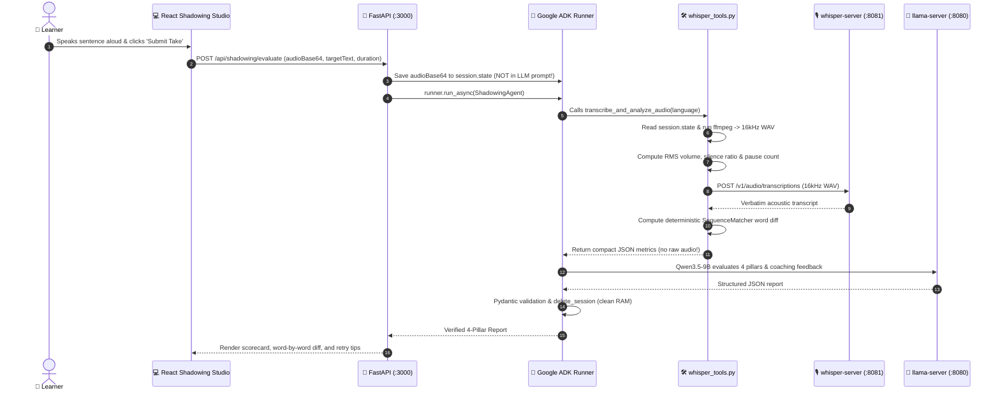

# 🎧 EchoLearning — Local Google ADK Language Learning Studio

Welcome to **EchoLearning (Echo Language Learning)**! This project transforms authentic English and Japanese YouTube videos into an interactive speaking and shadowing studio.

Originally designed around cloud-based Gemini APIs, this version has been completely migrated to a **100% local AI architecture powered by Google ADK (Agent Development Kit) 2.x**, running entirely on your computer with custom local open-weights AI models (`Qwen3.5-9B` via `llama.cpp`, `Whisper Large-v3-Turbo` via `whisper.cpp`, and native offline speech synthesis). **Every single feature, interactive button, Furigana reading, and visual design element remains exactly the same as the original application.**

---

## 📑 Table of Contents

1. [Plain-English Glossary (Key Terms & Concepts)](#-plain-english-glossary)
2. [How EchoLearning Works (System Architecture & Flow)](#-how-EchoLearning-works)
3. [Prerequisites & System Requirements](#-prerequisites--system-requirements)
4. [Step-by-Step Installation Guide](#-step-by-step-installation-guide)
5. [How to Run the Application Locally](#-how-to-run-the-application-locally)
6. [Core Features & Study Workflows](#-core-features--study-workflows)
7. [Running Tests & Code Validation](#-running-tests--code-validation)
8. [Troubleshooting & Frequently Asked Questions](#-troubleshooting--faq)

---

## 📖 Plain-English Glossary

If you are new to local AI or agent architectures, here is a quick guide to terms and acronyms used throughout this project:

| Term / Acronym | What It Means in Plain English |
| :--- | :--- |
| **ADK (Agent Development Kit)** | Google's official open-source framework for building AI applications out of organized "agents" (AI workers that reason about tasks) and "tools" (regular code functions that compute math, read files, or call local programs). |
| **`LlmAgent`** | An ADK agent powered by a Large Language Model (in our case, `Qwen3.5-9B`) that receives instructions, decides which tool to run, and crafts a helpful response. |
| **`FunctionTool` & `ToolContext`** | A Python function that an ADK agent is allowed to execute. `ToolContext` is a "backstage pass" in ADK that lets a tool read heavy data (like your recorded voice) directly from computer memory (`session.state`) without dumping millions of raw letters into the AI model's reading window. |
| **`InMemorySessionService`** | An in-RAM temporary notepad inside ADK that stores session information during a user's request and automatically deletes it when finished to prevent memory leaks. |
| **LiteLLM** | A universal adapter library inside ADK that translates ADK's agent requests into the standard OpenAI-compatible web format used by local model engines. |
| **`llama.cpp` / `llama-server`** | A C++ software engine created by Georgi Gerganov that runs large language models directly on your computer processor (CPU) or graphics card without any cloud connection. |
| **GGUF & Quantization (`Q6_K`)** | **GGUF** is a single-file packaging format for local AI models. **Quantization** shrinks the model's numbers from 16 bits down to 6 bits (`Q6_K`) so a 9-billion-parameter AI model uses only ~7.5 GB of RAM with almost zero loss in understanding. |
| **`whisper.cpp` / `whisper-server`** | A local speech-to-text (STT) engine that listens to spoken audio in English or Japanese and writes down the exact words. |
| **NDJSON (Newline-Delimited JSON)** | A web streaming format where the server sends one small JSON message per line (`\n`) over a single live connection. EchoLearning uses this to show a live progress bar while preparing transcripts for long videos. |
| **PCM WAV (`16kHz Mono`)** | Clean, uncompressed digital sound sampled 16,000 times per second in a single channel. This is the format required by speech-to-text models like Whisper. |
| **Furigana (振り仮名) & `<ruby>`** | Small Hiragana reading hints displayed above Japanese Kanji characters (for example, displaying `ことば` above `言葉`). In web pages, this is displayed using HTML `<ruby>` and `<rt>` tags. |
| **IPA (International Phonetic Alphabet)** | A standardized alphabet where each symbol represents a distinct human speech sound (e.g., `/əˈproʊtʃ/` for *"approach"*). |
| **Mora (モーラ)** | The rhythmic beat unit of spoken Japanese (e.g., `とうきょう` has 4 moras: `と・う・きょ・う`). Japanese speaking speed is measured in **Moras per minute (Moras/min)**, while English is measured in **Words per minute (WPM)**. |

---

## 🏗️ How EchoLearning Works

EchoLearning connects an untouched React 19 web frontend to a local Python FastAPI backend powered by Google ADK 2.x and local C++ inference engines.

### High-Level Architecture Diagram

```
┌────────────────────────────────────────────────────────────────────────────────────────┐
│                        CLIENT BROWSER (React 19 + Tailwind CSS)                        │
│                                                                                        │
│  [Top Bar]  EchoLearning Brand · Studio · Curated Library · Vocabulary Vault · History   │
│  [Left 60%] YouTube IFrame Player · Transport Controls · Mic Waveform · Shadowing Deck │
│  [Right 40%] Interactive Transcript Reader · Furigana Toggle · Contextual Dictionary   │
│  [Drawer]   4-Pillar Scorecard · Word-by-Word Diff Overlay · Targeted Retry            │
└───────────────────────────────────────────┬────────────────────────────────────────────┘
                                            │ HTTP REST & NDJSON Streams (/api/*)
                                            ▼
┌────────────────────────────────────────────────────────────────────────────────────────┐
│                   LOCAL BACKEND (FastAPI + Google ADK 2.x — Port 3000)                 │
│                                                                                        │
│  ┌──────────────────────────────────────────────────────────────────────────────────┐  │
│  │ FastAPI Router (adk_backend/routes/)                                             │  │
│  │ • POST /api/transcript/fetch (Streaming NDJSON: InnerTube Captions + Whisper)    │  │
│  │ • POST /api/transcript/retokenize (Fast fugashi MeCab JA + Regex EN)            │  │
│  │ • POST /api/dictionary/lookup (LRU In-Memory Cache + ADK DictionaryAgent)         │  │
│  │ • POST /api/shadowing/evaluate (ToolContext State + ADK ShadowingAgent)          │  │
│  │ • POST /api/tts/pronounce (Offline macOS Native 'say' WAV Synthesizer)           │  │
│  └────────────────────────────────────────┬─────────────────────────────────────────┘  │
│                                           │                                            │
│                                           ▼                                            │
│  ┌──────────────────────────────────────────────────────────────────────────────────┐  │
│  │ Google ADK 2.x Agent Layer (adk_backend/agents/)                                 │  │
│  │ • InMemorySessionService (Audio stored in session.state; ephemeral auto-cleanup) │  │
│  │ • <think> Tag Stripper + Pydantic JSON Self-Correction Retry                     │  │
│  │ • DictionaryAgent · ShadowingAgent · TranscriptAgent                             │  │
│  └────────────────────┬───────────────────────────────────────┬─────────────────────┘  │
└───────────────────────┼───────────────────────────────────────┼────────────────────────┘
                        │ LiteLLM (OpenAI Format)               │ HTTP / ffmpeg WAV
                        ▼                                       ▼
┌─────────────────────────────────────────────────┐   ┌──────────────────────────────────┐
│ LOCAL LLM SERVER (llama-server — Port 8080)     │   │ LOCAL STT (whisper-server :8081) │
│ • Model: Qwen3.5-9B-Q6_K.gguf (~7.5 GB RAM)     │   │ • Model: ggml-large-v3-turbo.bin │
│ • Hardware: 6 CPU Cores, AVX2 + Accelerate BLAS │   │ • Input: 16kHz Mono 16-bit WAV   │
└─────────────────────────────────────────────────┘   └──────────────────────────────────┘
```

### Shadowing Evaluation Flowchart

How your voice recording is evaluated without ever overflowing local AI context limits:



---

## 💻 Prerequisites & System Requirements

EchoLearning is tuned to run smoothly on standard local hardware (e.g. **Mac mini 2018 with 3.0 GHz 6-Core Intel Core i5 and 32 GB RAM**, as well as any modern Apple Silicon or x86_64 Mac/Linux PC):

- **Operating System:** macOS (macOS 12+ recommended) or Linux.
- **Python:** Python 3.12 (`python3.12 --version`).
- **Node.js:** Node.js 18 or newer (`node --version` and `npm --version`).
- **FFmpeg:** Required for instant browser audio conversion (`ffmpeg -version`).
  - *If missing on macOS, run:* `brew install ffmpeg cmake`
- **RAM:** Minimum 16 GB of system RAM (approx. 7.8 GB used by `llama-server`, 1.6 GB by `whisper-server`, 0.4 GB by Python, leaving plenty of free RAM).

---

## 🛠️ Installation & Setup

You can set up EchoLearning automatically using our one-click environment script, or follow the step-by-step manual guide below.

### Option A: One-Click Automated Setup (Recommended)

Run our automated configuration script. It will check system dependencies (`brew`, `python3`, `node`, `ffmpeg`, `llama-server`, `whisper-server`), create the Python virtual environment with macOS Root CA certs, install backend and frontend packages, and verify model files:

```bash
cd /Volumes/NINJA_EXT/PersonalApplications/ADKApplications/EchoLearningV1
chmod +x scripts/*.sh
./scripts/setup.sh
```

---

### Option B: Step-by-Step Manual Setup

If you prefer manual control, follow these steps:

#### Step 1: Open the Project Directory
```bash
cd /Volumes/NINJA_EXT/PersonalApplications/ADKApplications/EchoLearningV1
```

#### Step 2: Install Frontend Dependencies
```bash
npm install --legacy-peer-deps
```
*(Installs React 19, Tailwind CSS, Lucide icons, and Motion.)*

#### Step 3: Set Up the Python Virtual Environment
```bash
# 1. Create the virtual environment
python3 -m venv adk_backend/.venv

# 2. Upgrade pip and install certifi Root CA certificates
./adk_backend/.venv/bin/pip install --upgrade pip certifi

# 3. Install required libraries
./adk_backend/.venv/bin/pip install -r adk_backend/requirements.txt
```

#### Step 4: Make Scripts Executable
```bash
chmod +x scripts/*.sh
```

#### Step 5: Download Local AI Models
EchoLearning uses two local open-source AI models placed in the `models/` directory:
1. **Speech-to-Text Model:** `models/ggml-large-v3-turbo.bin` (~1.6 GB)
2. **Language & Coaching Model:** `models/Qwen3.5-9B-Q6_K.gguf` (~7.5 GB)

Download them using:
```bash
./scripts/download_models.sh
```

> [!TIP]
> **Already have Qwen or Whisper models?** You don't need to re-download! Simply copy or symlink them into `./models/` or set `LLAMA_MODEL_PATH` and `WHISPER_MODEL_PATH` in `.env`.

---

## 🚀 How to Run the Application Locally

### Method 1: One-Click Unified Launcher (Recommended)

To start all 4 local servers (Local LLM, Local Whisper, Google ADK Backend, and React Frontend) and open the browser automatically:

```bash
./scripts/start.sh
```

This script:
1. Starts `llama-server` (Port 8080), `whisper-server` (Port 8081), `uvicorn` (Port 3000), and `vite` (Port 5173).
2. Performs automated health checks on `http://127.0.0.1:3000/api/health`.
3. Automatically opens `http://localhost:5173` in your default browser once all models are warm.
4. Cleanly shuts down all background processes when you press `Ctrl+C`.

---

### Method 2: Multi-Terminal Manual Launch

If you prefer inspecting logs in individual terminal tabs:

- **Terminal 1 (Local LLM Server):**
  ```bash
  ./scripts/start_llama.sh
  ```
  *Launches `llama-server` on `http://127.0.0.1:8080` with Qwen3.5-9B.*

- **Terminal 2 (Local Whisper STT Server):**
  ```bash
  ./scripts/start_whisper.sh
  ```
  *Launches `whisper-server` on `http://127.0.0.1:8081` for local speech-to-text.*

- **Terminal 3 (Python Google ADK Backend):**
  ```bash
  npm run dev:backend
  ```
  *(Or: `./adk_backend/.venv/bin/python -m uvicorn adk_backend.main:app --host 127.0.0.1 --port 3000 --reload`)*

- **Terminal 4 (React Frontend):**
  ```bash
  npm run dev
  ```
  *Starts Vite on `http://localhost:5173` and proxies `/api` requests to port 3000.*

---

## 🛑 How to Shut Down the Application & Release RAM

When you have finished practicing and want to release your computer's RAM (~9.5 GB) and GPU resources:

1. **Via the Web UI (Easiest):**
   - Click the red **"Shut Down"** button in the top-right header next to *"Export Study Data"*.
   - A confirmation dialog will appear. Click *"Shut Down"*.
   - All 4 local servers will be gracefully terminated and a confirmation screen will appear letting you know it is safe to close the tab.

2. **Via the Terminal (CLI):**
   - If using `./scripts/start.sh`, press `Ctrl+C`.
   - Or run the dedicated shutdown script from any terminal:
     ```bash
     ./scripts/stop.sh
     ```

---

## 🌟 Core Features & Study Workflows

| Feature | How It Works in EchoLearning |
| :--- | :--- |
| **Bilingual Curated Library** | Pre-loaded with verified English TED talks, interviews, Japanese NHK news clips, and anime dialogue so you can begin practicing immediately without hunting for URLs. |
| **YouTube URL Ingestion** | Paste any 11-character YouTube video URL or ID. The backend extracts public English and Japanese caption tracks, aligns sentences, and computes Furigana. |
| **Interactive Furigana `<ruby>`** | Toggle Japanese Furigana reading hints above Kanji characters with one click. Powered by local Cython `fugashi` (MeCab) tokenization. |
| **Contextual Dictionary Popover** | Click any English or Japanese word in the transcript to inspect its exact meaning in *that specific sentence*, grammatical part of speech, IPA phonetic transcription, and Tokyo pitch accent notes. |
| **Offline Reference Audio** | Click the speaker icon in the dictionary or performance report to hear clear reference pronunciation synthesized natively offline in `< 150ms`. |
| **Dual Shadowing Studio** | Switch between **Listen-Then-Repeat Mode** (video plays one sentence, pauses automatically, and activates your microphone) and **Simultaneous Mode** (continuous video playback while you speak along in real time). |
| **Live Microphone Waveform & Interim STT** | 60fps audio waveform visualizer with live interim recognized words streamed directly as you speak. |
| **4-Pillar Diagnostic Report** | Evaluates your take across **Content Accuracy** (word match %), **Pronunciation & Articulation** (phoneme/mora clarity), **Fluency & Pacing** (words/moras per minute & pause continuity), and **Prosody & Intonation** (rhythm and stress). |
| **Word-by-Word Diff & Retry** | Clear visual badges showing words that were matched (`✓ correct`), skipped (`omitted`), replaced (`substituted`), or homophones (`stt_uncertain`). Click **Retry Difficult Phrase** to immediately re-record problem areas. |
| **Vocabulary Vault & Export** | Save tricky words with their original video timestamp and contextual sentence. Export your personal vocabulary deck to **Anki-ready CSV** or JSON backup with one click. |

---

## 🧪 Running Tests & Code Validation

EchoLearning includes automated test suites and code linters to verify system integrity:

### 1. Run Python Integration Tests (Pytest)

Verifies health checks, Japanese Furigana tokenization, English sentence parsing, offline TTS audio generation, dictionary lookups, and shadowing evaluation:

```bash
PYTHONPATH=. ./adk_backend/.venv/bin/pytest adk_backend/tests/ -v
```

Expected output:
```
adk_backend/tests/test_integration.py::test_health_endpoint PASSED
adk_backend/tests/test_integration.py::test_retokenize_japanese_furigana PASSED
adk_backend/tests/test_integration.py::test_retokenize_english PASSED
adk_backend/tests/test_integration.py::test_tts_pronounce_wav PASSED
adk_backend/tests/test_integration.py::test_dictionary_lookup PASSED
adk_backend/tests/test_integration.py::test_shadowing_evaluate_simulated PASSED
adk_backend/tests/test_integration.py::test_shadowing_evaluate_with_audio_payload PASSED
adk_backend/tests/test_integration.py::test_youtube_caption_helpers PASSED
======================== 8 passed in 13.60s ========================
```

### 2. Run Python Linting & Formatting (Ruff)

```bash
./adk_backend/.venv/bin/ruff check adk_backend/
```

### 3. Run Frontend TypeScript Type Checking

```bash
npm run lint
```

### 4. Build Production Frontend Bundle

```bash
npm run build
```

---

## ❓ Troubleshooting & FAQ

### 1. What happens if `llama-server` or `whisper-server` is not running yet?
EchoLearning is built with **graceful deterministic fallbacks**. If the local LLM server is temporarily offline:
- Dictionary lookups still extract grammatical lemmas, Furigana readings, and Romaji using deterministic `fugashi` tokenization.
- Shadowing evaluation calculates objective SequenceMatcher word diffs, silence ratios, and speech rate metrics without throwing error alerts in the browser.
- You can check server status anytime at `http://127.0.0.1:3000/api/health`.

### 2. Why does Whisper need 16kHz Mono WAV?
Speech recognition neural networks are trained on 16,000 samples per second single-channel audio. Browsers record microphone input in compressed `.webm` (Opus) or `.mp4` containers. EchoLearning automatically converts incoming browser audio into temporary 16kHz mono PCM WAV via `ffmpeg` in `< 50ms` before sending it to `whisper-server`.

### 3. Does EchoLearning send my voice or transcript data to external cloud APIs?
**No.** All speech recognition, language model scoring, dictionary lookup, tokenization, and audio synthesis happen locally on your computer (`127.0.0.1`). Your practice recordings and saved vocabulary remain 100% private.

### 4. Can I practice with third-party YouTube videos that have no captions?
**Yes.** When a user enters a video without public creator captions, EchoLearning automatically downloads the audio using `yt-dlp` and transcribes the entire video locally using `whisper.cpp` while streaming real-time NDJSON progress updates directly to the browser UI! You can also paste your own custom script in the built-in Fallback Transcript Editor.

---

## 📄 License & Credits

EchoLearning is built with:
- [Google ADK (Agent Development Kit)](https://github.com/google/adk-python)
- [FastAPI](https://fastapi.tiangolo.com/) & [Uvicorn](https://www.uvicorn.org/)
- [llama.cpp](https://github.com/ggml-org/llama.cpp) & [whisper.cpp](https://github.com/ggml-org/whisper.cpp)
- [React 19](https://react.dev/) & [Tailwind CSS](https://tailwindcss.com/)
- [Fugashi](https://github.com/polm/fugashi) & [UniDic](https://ccd.ninjal.ac.jp/unidic/)
