<a id="english"></a><a id="en"></a>
# 🎧 EchoLearning — Your Private AI Language Coach
> **Master spoken English & Japanese with real YouTube videos — 100% offline, 100% free, 100% private.**

[](https://github.com/google/adk-python)
[](https://github.com/ggml-org/llama.cpp)
[](https://github.com/ggml-org/whisper.cpp)
[](https://modelcontextprotocol.io/)
[](https://tailscale.com/)
[](LICENSE)

---
<center><a href="#english">English</a> ｜ <a href="#japanese">日本語版</a> ｜ <a href="#traditional-chinese">繁體中文版</a> ｜ <a href="#simplified-chinese">简体中文版</a></center>

---

## 📑 Table of Contents

- [Part 1: What is EchoLearning?](#part-1-what-is-echolearning)
  - [The Idea Behind EchoLearning](#the-idea-behind-echolearning)
  - [What Makes EchoLearning Special](#what-makes-echolearning-special)
  - [How It Works — The Big Picture](#how-it-works--the-big-picture)
- [Part 2: Quick Start Guide](#part-2-quick-start-guide)
  - [What You Need (Hardware & Software)](#what-you-need-hardware--software)
  - [Installation — The Easy Way (Recommended)](#installation--the-easy-way-recommended)
  - [Installation — Manual Setup (For Those Who Prefer Control)](#installation--manual-setup-for-those-who-prefer-control)
  - [Starting EchoLearning](#starting-echolearning)
  - [Your First Practice Session](#your-first-practice-session)
  - [Key Features at a Glance](#key-features-at-a-glance)
  - [Shutting Down](#shutting-down)
  - [Uninstalling EchoLearning](#uninstalling-echolearning)
  - [Remote Access from iPhone & iPad (via Tailscale)](#remote-access-from-iphone--ipad-via-tailscale)
  - [Connecting AI Coding Tools (MCP)](#connecting-ai-coding-tools-mcp)
- [Part 3: Appendix](#part-3-appendix)
  - [Troubleshooting & FAQ](#troubleshooting--faq)
  - [Choosing Your AI Model (Detailed Hardware Guide)](#choosing-your-ai-model-detailed-hardware-guide)
  - [MCP Tools Reference Table](#mcp-tools-reference-table)
  - [Uninstaller Detailed Reference](#uninstaller-detailed-reference)
  - [Glossary](#glossary)
  - [Architecture Diagram](#architecture-diagram)
  - [Running Tests (For Developers)](#running-tests-for-developers)
  - [License & Acknowledgments](#license--acknowledgments)

---

# Part 1: What is EchoLearning?

## The Idea Behind EchoLearning

**Shadowing** is a language learning technique loved by polyglots (people who speak many languages) and recommended by speech scientists. The idea is simple: you listen to a native speaker and repeat what they say right away, matching their speed, rhythm, and tone.

It's one of the most effective ways to sound natural in a new language — but practicing on your own can be frustrating. How do you know if your pronunciation was right? Which words did you miss? Was your rhythm natural?

**EchoLearning** solves these problems. It's a free, open-source app that turns any YouTube video into a personal language lesson, then listens to you practice and gives you detailed feedback — all powered by AI running entirely on your own Mac.

## What Makes EchoLearning Special

```text
┌──────────────────────────────────────────────────────────────────────┐
│                    WHY CHOOSE ECHOLEARNING?                          │
├──────────────────────────────────────────────────────────────────────┤
│  🔒 100% Private        Your voice never leaves your computer.       │
│  💸 Completely Free      No subscriptions, no API fees, no limits.    │
│  ⚡ Instant Feedback     Real-time speech recognition as you speak.   │
│  🇯🇵 English & Japanese  Deep support for both languages.             │
│  📚 Save & Practice      Generate lessons now, practice anytime.      │
│  📱 Mobile Friendly      Practice from your phone via Tailscale.      │
└──────────────────────────────────────────────────────────────────────┘
```

> [!NOTE]
> **Why does everything stay on your computer?**
> Speaking aloud and making mistakes is part of learning. EchoLearning keeps your voice recordings and study data stored only on your Mac — nothing is ever uploaded to the internet.

## How It Works — The Big Picture

Here's a simplified view of what EchoLearning does behind the scenes:

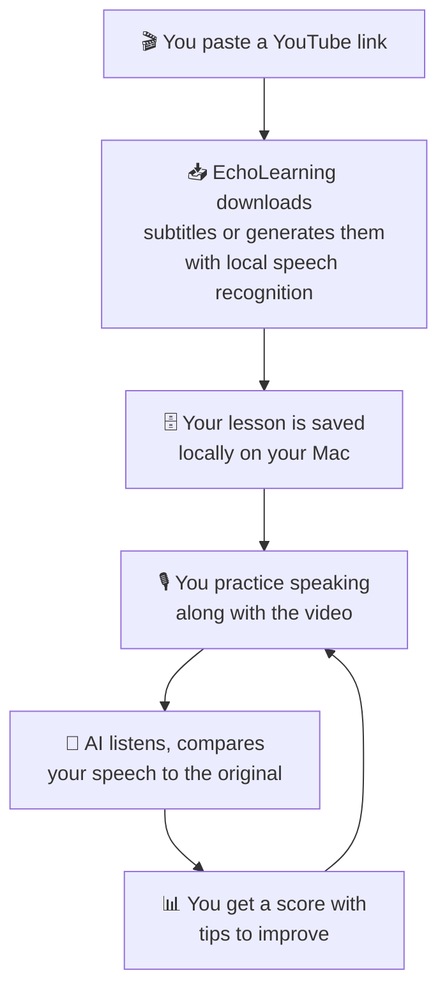

**In plain English:**
1. **Paste a link** — Give EchoLearning any YouTube video URL in English or Japanese.
2. **Lesson is created** — The app extracts subtitles (or creates them using speech recognition if none exist). For Japanese videos, it automatically adds reading guides (Furigana) above difficult characters.
3. **Practice speaking** — Choose between two modes: repeat sentence by sentence, or shadow along continuously with the video.
4. **Get feedback** — AI analyzes your pronunciation, rhythm, speed, and intonation, then gives you a score out of 100 with personalized tips.
5. **Improve and repeat** — Retry difficult phrases and watch your score climb!

---

# Part 2: Quick Start Guide

## What You Need (Hardware & Software)

### Computer Requirements

| Requirement | Details |
|:---|:---|
| **Computer** | Mac (Intel or Apple Silicon M1/M2/M3/M4) |
| **Operating System** | macOS 12 (Monterey) or newer |
| **RAM (Memory)** | 8 GB minimum · 16 GB recommended · 32 GB+ for advanced AI models |
| **Free Disk Space** | At least 15 GB (AI models need 5–22 GB depending on which ones you choose) |
| **Microphone** | Built-in Mac microphone or any USB/Bluetooth headset |
| **Internet** | Needed only for installation and downloading videos. Practice works 100% offline! |

### Which Mac Can Run EchoLearning?

```text
┌───────────────────────────────────────────────────────────────────────┐
│  🖥️  YOUR MAC                        →  RECOMMENDED AI MODEL         │
├───────────────────────────────────────────────────────────────────────┤
│  8 GB MacBook Air (M1/M2/M3)         →  Qwen3.5-4B (lightweight)     │
│  16 GB Mac (Intel or Apple Silicon)   →  Qwen3.5-9B (recommended ⭐)  │
│  32 GB+ Mac (M-series Pro/Max)       →  Qwen3.5-27B or 35B (premium) │
└───────────────────────────────────────────────────────────────────────┘
```

> [!TIP]
> **Not sure how much RAM your Mac has?**
> Click the Apple menu (🍎) in the top-left corner → "About This Mac" → look for "Memory."

### Software You Need First

You need two free tools installed before setting up EchoLearning:

1. **Homebrew** — A package manager (a tool that installs other tools) for Mac.
   - If you don't have it, open Terminal and paste:
     ```
     /bin/bash -c "$(curl -fsSL https://raw.githubusercontent.com/Homebrew/install/HEAD/install.sh)"
     ```

2. **Git** — A tool for downloading code from the internet.
   - Install it by running in Terminal:
     ```
     xcode-select --install
     ```

> [!NOTE]
> **What is "Terminal"?**
> Terminal is a built-in Mac app where you type commands. Find it by pressing `Cmd + Space`, typing "Terminal," and pressing Enter.

---

## Installation — The Easy Way (Recommended)

The fastest way to get started. One command does everything: downloads EchoLearning, installs all required tools, and sets up the AI models.

### Step 1: Open Terminal

Press `Cmd + Space`, type "Terminal," and press Enter.

### Step 2: Paste and Run This Command

```bash
curl -fsSL https://raw.githubusercontent.com/NinjaRoboticsEducation/EchoLearning/HEAD/scripts/install.sh | bash
```

### Step 3: Choose Your AI Model

The installer will ask you which AI model to download. If you're unsure, just press **Enter** to accept the recommended default.

### Step 4: Wait for the Download

The AI models are large files (5–20 GB). The download time depends on your internet speed. If the download is interrupted, don't worry — re-running the command will resume where it left off.

### Step 5: Start EchoLearning

```bash
cd EchoLearning
./scripts/start_all.sh
```

Your browser will open automatically. You're ready to practice! 🎉

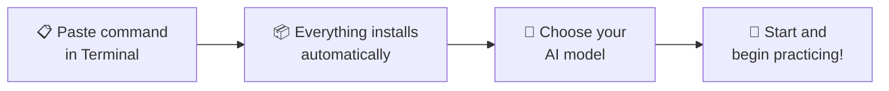

---

## Installation — Manual Setup (For Those Who Prefer Control)

If you prefer to see each step:

### Step 1: Download EchoLearning

```bash
git clone https://github.com/NinjaRoboticsEducation/EchoLearning.git
cd EchoLearning
```

### Step 2: Run the Setup

```bash
./setup.sh
```

This will:
- Install required tools (ffmpeg, Python, Node.js, AI engines)
- Create the app environment
- Build the web interface
- Ask you to choose an AI model

### Step 3: Start EchoLearning

```bash
./scripts/start_all.sh
```

Your browser opens automatically at `http://localhost:5173`.

---

## Starting EchoLearning

Every time you want to practice, just run:

```bash
cd EchoLearning
./scripts/start_all.sh
```

> [!TIP]
> **Want a desktop shortcut?**
> Create a file called `EchoLearning.command` on your Desktop with these contents:
> ```bash
> #!/bin/bash
> cd "/path/to/EchoLearning"
> ./scripts/start_all.sh
> ```
> Then run `chmod +x ~/Desktop/EchoLearning.command` in Terminal. Now you can double-click to start!

---

## Your First Practice Session

### 1. Generate a Lesson

1. On the Home page, paste a YouTube URL (e.g., `https://www.youtube.com/watch?v=...`).
2. Choose the language: **English** or **Japanese**.
3. Click **Generate Learning Transcript**.
4. Your lesson is saved — you can practice it anytime, even without internet!

### 2. Open the Practice Studio

Click on any saved lesson to enter the Practice Studio. Choose your mode:

| Mode | How It Works | Best For |
|:---|:---|:---|
| **🎯 Listen-Then-Repeat** | Video plays one sentence, pauses, you repeat it | Beginners, precise pronunciation practice |
| **🌊 Simultaneous Shadowing** | Video plays continuously, you speak along in real time (up to 60 minutes) | Intermediate/advanced learners, building fluency |

### 3. Practice and Get Feedback

1. **Speak** — The AI shows your recognized speech in real time.
2. **Click "Finish Recording"** — Your complete speech is transcribed.
3. **Click "Analyze Shadowing Result"** — Get your performance score.

### 4. Read Your Score

Your score has 4 parts:

```text
┌─────────────────────────────────────────────┐
│          YOUR SHADOWING SCORE               │
├─────────────────────────────────────────────┤
│  📝 Content Accuracy (35%)                   │
│     Did you say the right words?             │
│                                              │
│  🗣️ Pronunciation (25%)                      │
│     How clear and correct was each sound?    │
│                                              │
│  🏃 Fluency (25%)                            │
│     Was your speaking speed natural?         │
│                                              │
│  🎵 Prosody (15%)                            │
│     Did your voice rise and fall naturally?  │
│                                              │
│  🏆 Overall Score: 78/100                    │
│  💡 Tip: "Try slowing down on long          │
│      vowels in 東京 (Tōkyō)!"               │
└─────────────────────────────────────────────┘
```

Each word is color-coded: ✅ green (correct), 🔴 red (missed), 🟡 yellow (wrong word), 🔵 blue (unclear).

---

## Key Features at a Glance

### 📖 Contextual Dictionary
Click any word in the transcript to see:
- What it means **in this specific sentence**
- Pronunciation guide (IPA for English, Furigana for Japanese)
- Pitch accent patterns (for Japanese)
- Audio pronunciation (plays instantly offline)
- Option to save to your Vocabulary list

### ✏️ Editable Transcripts
YouTube subtitles aren't always perfect. Click the edit button on any sentence to fix typos or errors. For Japanese text, Furigana readings update automatically.

### 💾 Save & Practice Later
Every lesson is saved to your Mac. You can generate lessons when you find interesting videos and come back to practice days or weeks later — no internet needed.

### 🔄 Switch AI Models Anytime
On the Home page, use the **Model Selection** dropdown to switch between installed AI models instantly — no restart needed.

---

## Shutting Down

Two easy ways:

1. **From the app:** Click the **SHUT DOWN** button in the top navigation bar.
2. **From Terminal:** Run `./scripts/stop.sh` in the EchoLearning folder.

Both methods safely stop all background services and free up your Mac's memory.

---

## Uninstalling EchoLearning

### Quick Decision Guide

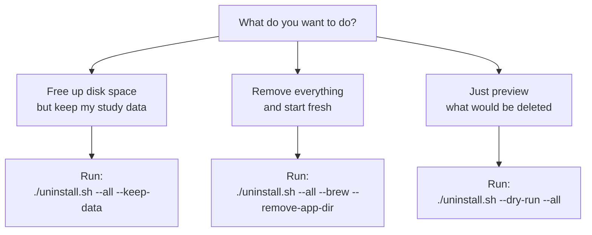

### Common Uninstall Commands

| What You Want | Command | Space Freed |
|:---|:---|:---|
| Free up space, **keep** study data | `./uninstall.sh --all --keep-data` | 7–25 GB |
| Full reset, **backup** data first | `./uninstall.sh --all --backup-dir ~/Desktop` | 7–25 GB |
| Remove **everything** completely | `./uninstall.sh --all --brew --remove-app-dir` | Up to 26+ GB |
| **Preview only** (nothing deleted) | `./uninstall.sh --dry-run --all` | 0 GB |
| **Guided menu** (step-by-step prompts) | `./uninstall.sh` | You choose |

> [!IMPORTANT]
> Your study data (vocabulary, scores, recordings) is **never deleted** unless you specifically ask for it. The `--keep-data` flag ensures your data stays safe even when removing AI models.

### Reinstalling After Cleanup

- **If you kept the folder:** Run `./setup.sh` then `./scripts/start_all.sh`.
- **If you removed everything:** Run the one-line installer again (see [Installation — The Easy Way](#installation--the-easy-way-recommended)).

---

## Remote Access from iPhone & iPad (via Tailscale)

Want to practice from your phone or tablet while your Mac does the heavy lifting at home?

**Tailscale** creates a private, encrypted tunnel between your devices — no complicated setup, no security risks.

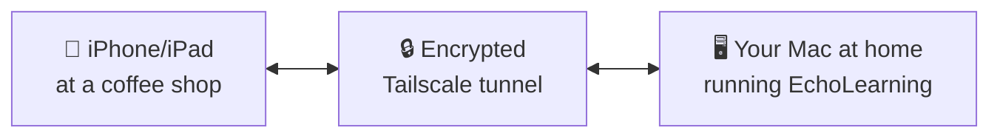

### Setup in 3 Minutes

1. **Install Tailscale on your Mac:**
   ```
   brew install --cask tailscale
   ```
   Or download from the Mac App Store. Sign in.

2. **Find your Mac's Tailscale address:**
   ```
   tailscale ip -4
   ```
   You'll see something like `100.64.0.10`.

3. **Install Tailscale on your iPhone/iPad** from the App Store. Sign into the same account.

4. **Open Safari on your phone** and go to:
   ```
   http://100.64.0.10:3000
   ```
   (Replace with your Mac's address from step 2.)

That's it! Practice from anywhere. 🎉

> [!TIP]
> **Control remote access from Settings:**
> In the app's Settings page, you can turn Tailscale access ON or OFF with a single click. When OFF, only your Mac can access EchoLearning — remote devices are blocked instantly.

---

## Connecting AI Coding Tools (MCP)

If you use AI coding assistants like **Claude Code**, **OpenAI Codex**, or **Google Antigravity**, you can connect them to EchoLearning using **MCP (Model Context Protocol)** — an open standard that lets AI assistants use external tools.

This means your AI assistant can:
- Generate new lessons from YouTube links while you chat
- Quiz you on saved vocabulary
- Export your study history

### Setup for Common AI Assistants

**Claude Code:**
```bash
claude mcp add echolearning /path/to/EchoLearning/scripts/start_mcp.sh
```

**OpenAI Codex** (`~/.codex/config.toml`):
```toml
[mcp_servers.echolearning]
command = "/path/to/EchoLearning/scripts/start_mcp.sh"
```

**Google Antigravity** (`mcp_config.json`):
```json
{
  "mcpServers": {
    "echolearning": {
      "command": "/path/to/EchoLearning/scripts/start_mcp.sh"
    }
  }
}
```

For the full list of 13 available MCP tools, see [MCP Tools Reference Table](#mcp-tools-reference-table) in the Appendix.

---

# Part 3: Appendix

## Troubleshooting & FAQ

### My microphone isn't working in the browser

1. **Check macOS permissions:** Go to **System Settings → Privacy & Security → Microphone** and make sure your browser has permission.
2. **Check browser permissions:** Click the lock/settings icon next to the address bar and set Microphone to "Allow."
3. **Note on remote access:** Microphone works on `http://localhost` and `http://127.0.0.1`. If accessing via Tailscale, make sure your browser allows microphone on non-HTTPS pages, or set up Tailscale Serve for private HTTPS.

### "Port 3000 / 8080 / 8081 / 5173 already in use"

Run this in Terminal:
```bash
./scripts/stop.sh
```
This cleans up any leftover processes. The next time you start EchoLearning, it also automatically cleans up stale processes.

If the problem persists, another app may be using that port. Check with:
```bash
lsof -i :3000 -i :8080 -i :8081 -i :5173
```

### My model download was interrupted

No problem! Downloads are resumable. Just run:
```bash
./scripts/download_models.sh
```
It picks up where it left off.

### Can I run EchoLearning on an 8 GB Mac?

Yes! Choose the lightweight **Qwen3.5-4B** model during setup. It uses about 4 GB of RAM and works well on 8 GB Macs.

### Japanese videos without subtitles show an error

EchoLearning needs `ffmpeg` and `yt-dlp` to download and transcribe videos without subtitles. Install them:
```bash
brew install ffmpeg yt-dlp
```
Note: Some music videos or DRM-protected streams can't be downloaded. Standard conversations, podcasts, and news clips work best.

### Where is my study data?

Your data is stored in the `data/` folder inside EchoLearning:
- **Database:** `data/echolearning.sqlite3`
- **Audio recordings:** `data/audio/`

To back up, either:
- Use **Settings → Study backup → Generate Backup** in the app
- Copy the `data/` folder manually

---

## Choosing Your AI Model (Detailed Hardware Guide)

EchoLearning uses two types of local AI: a **language model** (for coaching and dictionary) and a **speech recognition model** (for understanding your speech). The speech model is always the same; you choose which language model fits your Mac.

| Model | Download Size | RAM Needed | Best For | Quality |
|:---|:---:|:---:|:---|:---|
| **Qwen3.5-4B** (Q6_K) | 3.3 GB | ~4 GB | 8–16 GB Macs, fastest response | Good — great for quick definitions |
| **Qwen3.5-9B** (Q4_K_M) | 5.3 GB | ~6 GB | 16 GB Macs wanting lower RAM use | Very good — balanced choice |
| **Qwen3.5-9B** (Q6_K) ⭐ | 7.0 GB | ~8 GB | 16–24 GB Macs (recommended default) | Excellent — best quality for most users |
| **Qwen3.5-27B** (Q4_K_M) | 15.6 GB | ~17 GB | 32 GB+ Macs | Premium — nuanced Japanese and grammar |
| **Qwen3.5-35B-A3B** (Q4_K_M) | 20.5 GB | ~22 GB | 32–64 GB+ Macs | Ultra — biggest model, blazingly fast |
| **Whisper Large-v3-Turbo** (speech recognition) | 1.5 GB | ~1.6 GB | All systems (auto-installed) | — |

> [!TIP]
> You can install multiple models and switch between them on the Home page without restarting. To download additional models later, run `./scripts/download_models.sh`.

---

## MCP Tools Reference Table

EchoLearning provides 13 tools accessible through MCP (both local and HTTP at `http://127.0.0.1:3000/mcp`):

| Tool | What It Does |
|:---|:---|
| `get_capabilities` | Check system status and which AI model is active |
| `fetch_transcript` | Create a lesson from a YouTube link |
| `start_transcript_job` | Start a long video transcription in the background |
| `get_job_status` | Check progress of a background transcription |
| `cancel_job` | Cancel a running background transcription |
| `retokenize_text` | Split text into grammar tokens with Furigana |
| `lookup_word` | Look up a word's meaning in context |
| `save_vocabulary` | Save a word to your vocabulary list |
| `list_vocabulary` | View your saved vocabulary cards |
| `list_materials` | View all your saved lessons |
| `list_history` | View your past practice sessions and scores |
| `pronounce_text` | Generate audio pronunciation for any word or sentence |
| `export_study_data` | Export your study data as JSON or CSV |

---

## Uninstaller Detailed Reference

### All Command-Line Flags

| Flag | What It Does |
|:---|:---|
| `--dry-run` | Preview what would be deleted (nothing is actually removed) |
| `--deps-only` | Remove only development files (keep AI models and study data) |
| `--all` | Remove development files + AI models + study data |
| `--keep-data` | Protect your study data when used with `--all` |
| `--keep-models` | Protect downloaded AI models when used with `--all` |
| `--backup-dir <folder>` | Create a backup of your study data before removing |
| `--brew` | Also uninstall the Homebrew AI engine packages (llama.cpp, whisper-cpp) |
| `--remove-app-dir` | Delete the entire EchoLearning folder after cleanup |
| `-y` / `--yes` | Skip confirmation prompts |
| `--non-interactive` | Run without any prompts (for automation) |
| `--project-root <dir>` | Specify which EchoLearning folder to uninstall |

### Safety Features

- **Protected paths:** Won't run on system folders (`/`, `/System`, `/Applications`, etc.)
- **Signature check:** Verifies it's actually an EchoLearning folder before deleting
- **Safe Homebrew removal:** Only removes `llama.cpp` and `whisper-cpp` — never touches `ffmpeg`, `node`, `git`, or `python`
- **Study data isolation:** Your data is only deleted if you specifically ask for it

---

## Glossary

| Term | What It Means |
|:---|:---|
| **Shadowing** | A language practice technique: listen to a speaker and repeat immediately, matching their speed and rhythm |
| **Furigana** | Small reading guides (in Hiragana) placed above Japanese Kanji characters to show pronunciation |
| **Pitch Accent** | The pattern of high and low tones in Japanese words that changes meaning |
| **IPA** | International Phonetic Alphabet — a universal system for writing speech sounds |
| **Mora** | The rhythmic beat unit in Japanese. "Tokyo" (とうきょう) has 4 moras: と・う・きょ・う |
| **LLM** | Large Language Model — the AI that understands and generates language (like Qwen3.5) |
| **GGUF** | A file format for AI models designed to run on your own computer |
| **Quantization** | A technique to compress AI models so they use less memory while keeping quality |
| **ASR** | Automatic Speech Recognition — turning spoken words into text (what Whisper does) |
| **MCP** | Model Context Protocol — a standard that lets AI assistants connect to external tools |
| **SQLite** | A lightweight database that stores data in a single file on your computer |
| **Tailscale** | A free tool that creates a private, encrypted network between your devices |
| **ADK** | Agent Development Kit — Google's framework for building AI applications |
| **Homebrew** | A popular package manager for Mac that installs software via Terminal commands |

---

## Architecture Diagram

For those interested in the technical details, here's how all the pieces fit together:

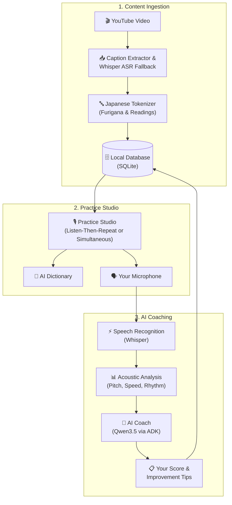

### Background Services (What Runs When EchoLearning Is Active)

| Service | Port | Purpose |
|:---|:---:|:---|
| llama-server | 8080 | Runs the AI language model |
| whisper-server | 8081 | Runs speech recognition |
| FastAPI Backend | 3000 | Handles the app logic and data |
| Vite Frontend | 5173 | Serves the web interface |

---

## Running Tests (For Developers)

```bash
# Python backend tests
./adk_backend/.venv/bin/pytest tests/ -v

# TypeScript linting
npm run lint

# Build production frontend
npm run build

# Check system health
curl -s http://127.0.0.1:3000/api/health | jq .
```

---

## License & Acknowledgments

EchoLearning is free and open-source software under the **Apache License 2.0**.

Built with these excellent open-source projects:
- [Google ADK](https://github.com/google/adk-python) — Agent coordination
- [llama.cpp](https://github.com/ggml-org/llama.cpp) — Local AI inference
- [whisper.cpp](https://github.com/ggml-org/whisper.cpp) — Local speech recognition
- [Qwen3.5](https://github.com/QwenLM/Qwen2.5) — Multilingual language models
- [Fugashi](https://github.com/polm/fugashi) & [UniDic](https://ccd.ninjal.ac.jp/unidic/) — Japanese analysis
- [FastAPI](https://fastapi.tiangolo.com/) — Python web framework
- [React 19](https://react.dev/) & [Tailwind CSS](https://tailwindcss.com/) — User interface
- [FastMCP](https://modelcontextprotocol.io/) — AI tool integration
- [Tailscale](https://tailscale.com/) — Private networking

---

<p align="center">Made with ❤️ for language learners around the world. Happy Shadowing! 🎧</p>


---

<br/>
<br/>
<br/>

---

<a id="japanese"></a><a id="ja"></a>
# 🇯🇵 日本語版 (Japanese)

---
<center><a href="#english">English</a> ｜ <a href="#japanese">日本語版</a> ｜ <a href="#traditional-chinese">繁體中文版</a> ｜ <a href="#simplified-chinese">简体中文版</a></center>

---

# 🎧 EchoLearning — あなただけのAI語学パーソナルコーチ

> **本物のYouTube動画で英語と日本語のスピーキングをマスター — 100%オフライン、100%無料、100%プライベート。**

---

## 📑 目次

- [Part 1: What is EchoLearning?](#part-1-what-is-echolearning)
  - [EchoLearning誕生の背景](#the-idea-behind-echolearning)
  - [EchoLearningの特長](#what-makes-echolearning-special)
  - [全体の仕組み](#how-it-works--the-big-picture)
- [Part 2: Quick Start Guide](#part-2-quick-start-guide)
  - [必要な環境（ハードウェアとソフトウェア）](#what-you-need-hardware--software)
  - [インストール — かんたん手順（推奨）](#installation--the-easy-way-recommended)
  - [インストール — 手動セットアップ（細かく管理したい方向け）](#installation--manual-setup-for-those-who-prefer-control)
  - [EchoLearningの起動方法](#starting-echolearning)
  - [最初の練習セッション](#your-first-practice-session)
  - [主な機能一覧](#key-features-at-a-glance)
  - [終了方法](#shutting-down)
  - [EchoLearningのアンインストール](#uninstalling-echolearning)
  - [iPhoneやiPadからのリモートアクセス（Tailscale経由）](#remote-access-from-iphone--ipad-via-tailscale)
  - [AIコーディングツールとの接続（MCP）](#connecting-ai-coding-tools-mcp)
- [Part 3: Appendix](#part-3-appendix)
  - [トラブルシューティングとよくある質問（FAQ）](#troubleshooting--faq)
  - [AIモデルの選び方（ハードウェア詳細ガイド）](#choosing-your-ai-model-detailed-hardware-guide)
  - [MCPツール一覧表](#mcp-tools-reference-table)
  - [アンインストーラー詳細リファレンス](#uninstaller-detailed-reference)
  - [用語集](#glossary)
  - [アーキテクチャ設計図](#architecture-diagram)
  - [テストの実行方法（開発者向け）](#running-tests-for-developers)
  - [ライセンスと謝辞](#license--acknowledgments)

---

# Part 1: What is EchoLearning?

## EchoLearning誕生の背景

**シャドーイング（Shadowing）**は、多くの言語を操るポリグロット（多言語話者）にも愛され、音声言語学者からも推奨されている言語習得法です。やり方はとてもシンプル。ネイティブスピーカーの音声を耳で聴きながら、そのスピードやリズム、イントネーションに合わせて、影（シャドー）のようにすぐ後ろをついて声に出して復唱します。

これは外国語を自然に話せるようになるための最も効果的な方法の一つですが、ひとりで練習していると悩みが尽きません。「今の発音、本当に合っていたのかな？」「聞き落とした単語はどれだろう？」「不自然なリズムになっていなかったかな？」

**EchoLearning**は、そんな悩みを解決します。お好きなYouTube動画を自分専用の語学レッスンに変え、あなたが練習している声を聴いて詳しいフィードバックを届けてくれる、完全無料・オープンソースの学習アプリです。すべての処理はあなた自身のMac上で動作するAIが担当します。

## EchoLearningの特長

```text
┌──────────────────────────────────────────────────────────────────────┐
│                    なぜ ECHOLEARNING を選ぶのか？                    │
├──────────────────────────────────────────────────────────────────────┤
│  🔒 100% プライベート    音声がパソコンの外へ送信されることはありません│
│  💸 完全無料             月額料金なし、API利用料なし、利用制限なし    │
│  ⚡ 即時フィードバック   あなたが話した瞬間にリアルタイムで音声認識   │
│  🇯🇵 英語＆日本語に対応   両言語の学習を徹底的にサポート               │
│  📚 保存していつでも練習 今レッスンを作って、あとからいつでも練習     │
│  📱 スマホにも対応       Tailscale経由でスマホからも練習可能          │
└──────────────────────────────────────────────────────────────────────┘
```

> [!NOTE]
> **なぜすべてが自分のパソコン内で完結するの？**
> 声に出して練習し、失敗を重ねることは語学学習において大切なステップです。EchoLearningなら、あなたの声の録音データも学習記録も、すべてあなたのMacの中だけに安全に保存されます。インターネット上にアップロードされることは一切ありません。

## 全体の仕組み

EchoLearningがバックグラウンドでどのような処理を行っているかを、分かりやすく図にまとめました：

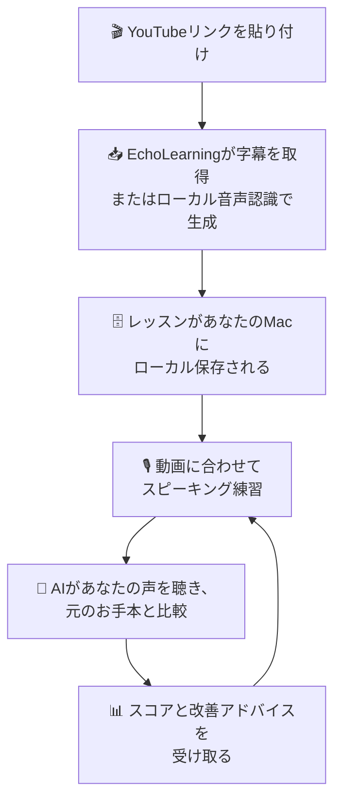

**かんたんに説明すると：**
1. **リンクを貼り付け** — 英語または日本語のお好きなYouTube動画のURLをEchoLearningに入力します。
2. **レッスンが完成** — アプリが字幕を自動抽出します（字幕がない動画でも、音声認識を使って自動生成します）。日本語の動画なら、難しい漢字の上に読み仮名（ふりがな）を自動で振ってくれます。
3. **スピーキングを練習** — 1文ずつ一時停止して繰り返すモードと、動画に合わせて途切れずシャドーイングするモードの2種類から選べます。
4. **フィードバックを確認** — 発音、リズム、スピード、イントネーションをAIが細かく分析し、100点満点のスコアとあなたに合わせた改善アドバイスを提示します。
5. **復習して上達** — 難しかったフレーズをもう一度練習して、スコアが上がっていくのを実感しましょう！

---

# Part 2: Quick Start Guide

## 必要な環境（ハードウェアとソフトウェア）

### 必要なパソコンスペック

| 必要な項目 | 詳細 |
|:---|:---|
| **コンピューター** | Mac（IntelプロセッサまたはApple Silicon M1/M2/M3/M4） |
| **オペレーティングシステム（OS）** | macOS 12 (Monterey) 以降 |
| **RAM（メモリ）** | 最小8 GB · 推奨16 GB · 高性能AIモデルを使う場合は32 GB以上 |
| **ディスク空き容量** | 最低15 GB以上（選択するAIモデルに応じて5〜22 GBの空き容量が必要です） |
| **マイク** | Mac内蔵マイク、または各種USB/Bluetoothヘッドセット |
| **インターネット接続** | インストール時および動画のダウンロード時のみ必要です。普段の練習は100%オフラインで行えます！ |

### あなたのMacで動くモデルの目安

```text
┌───────────────────────────────────────────────────────────────────────┐
│  🖥️  お使いのMac                      →  おすすめのAIモデル           │
├───────────────────────────────────────────────────────────────────────┤
│  8 GB MacBook Air (M1/M2/M3)         →  Qwen3.5-4B（軽量モデル）     │
│  16 GB Mac（IntelまたはApple Silicon）→  Qwen3.5-9B（イチオシ ⭐）     │
│  32 GB以上のMac（Pro / Maxシリーズ） →  Qwen3.5-27Bまたは35B（最高峰）│
└───────────────────────────────────────────────────────────────────────┘
```

> [!TIP]
> **自分のMacのメモリ（RAM）が何GBかわからないときは？**
> 画面左上のアップルメニュー（🍎）をクリック →「このMacについて」を開き、「メモリ」の項目を確認してください。

### 事前に必要なソフトウェア

EchoLearningをセットアップする前に、以下の2つの無料ツールがインストールされている必要があります：

1. **Homebrew** — Mac用のパッケージマネージャー（Package Manager：他のツールをインストールするための管理ツール）。
   - まだお持ちでない場合は、ターミナルを開いて以下のコマンドを貼り付けて実行してください：
     ```
     /bin/bash -c "$(curl -fsSL https://raw.githubusercontent.com/Homebrew/install/HEAD/install.sh)"
     ```

2. **Git** — インターネット上からコードをダウンロードするためのツール。
   - ターミナルで以下のコマンドを実行してインストールします：
     ```
     xcode-select --install
     ```

> [!NOTE]
> **「ターミナル（Terminal）」とは？**
> ターミナルは、Macに標準搭載されているコマンド（文字による命令）を入力してパソコンを操作するためのアプリです。キーボードの `Cmd + Space` を押し、検索窓に「Terminal」または「ターミナル」と入力してEnterキーを押すと開きます。

---

## インストール — かんたん手順（推奨）

最も手軽でおすすめの始め方です。たった1行のコマンドを実行するだけで、EchoLearning本体のダウンロード、必要なツールの準備、AIモデルのセットアップまでをすべて自動で行います。

### ステップ 1: ターミナルを開く

`Cmd + Space` を押し、「ターミナル」または「Terminal」と入力してEnterキーを押します。

### ステップ 2: コマンドを貼り付けて実行する

```bash
curl -fsSL https://raw.githubusercontent.com/NinjaRoboticsEducation/EchoLearning/HEAD/scripts/install.sh | bash
```

### ステップ 3: AIモデルを選ぶ

インストーラーから、どのAIモデルをダウンロードするか尋ねられます。迷ったら、そのまま **Enter** キーを押して推奨デフォルト設定を選べば大丈夫です。

### ステップ 4: ダウンロード完了を待つ

AIモデルはファイルサイズが大きいため（5〜20 GB程度）、お使いのインターネット回線の速度によって少し時間がかかります。もし途中で通信が切れてしまっても心配いりません。もう一度同じコマンドを実行すれば、中断したところから自動的に再開されます。

### ステップ 5: EchoLearningを起動する

```bash
cd EchoLearning
./scripts/start_all.sh
```

ブラウザが自動的に立ち上がります。さっそく練習を始めましょう！ 🎉

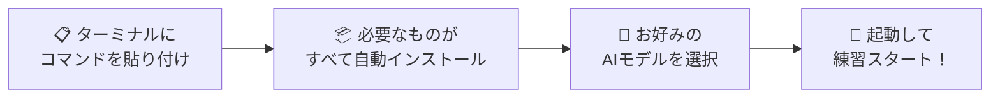

---

## インストール — 手動セットアップ（細かく管理したい方向け）

各工程を自分で確認しながら進めたい場合は、こちらの手順を行ってください：

### ステップ 1: EchoLearningをダウンロード

```bash
git clone https://github.com/NinjaRoboticsEducation/EchoLearning.git
cd EchoLearning
```

### ステップ 2: セットアップを実行

```bash
./setup.sh
```

このコマンドにより以下の処理が実行されます：
- 必要なツール群のインストール（ffmpeg, Python, Node.js, AIエンジンなど）
- アプリ実行環境の構築
- ウェブ管理画面のビルド
- AIモデルの選択プロンプト

### ステップ 3: EchoLearningを起動

```bash
./scripts/start_all.sh
```

ブラウザが自動で開き、`http://localhost:5173` が表示されます。

---

## EchoLearningの起動方法

練習したいときは、毎回ターミナルで以下のコマンドを実行するだけです：

```bash
cd EchoLearning
./scripts/start_all.sh
```

> [!TIP]
> **デスクトップに起動用ショートカットを作りたいですか？**
> デスクトップ上に `EchoLearning.command` という名前のファイルを作成し、以下の内容を書き込みます：
> ```bash
> #!/bin/bash
> cd "/path/to/EchoLearning"
> ./scripts/start_all.sh
> ```
> 次にターミナルで `chmod +x ~/Desktop/EchoLearning.command` を実行してください。これで、次回からはデスクトップのアイコンをダブルクリックするだけで起動できるようになります！

---

## 最初の練習セッション

### 1. レッスンを作成する

1. ホーム画面で、練習したいYouTube動画のURL（例：`https://www.youtube.com/watch?v=...`）を貼り付けます。
2. 言語を選択します：**English（英語）** または **Japanese（日本語）**。
3. **Generate Learning Transcript**（学習用テキスト生成）ボタンをクリックします。
4. これでレッスンが保存されました。インターネットがないオフライン環境でも、いつでも練習できます！

### 2. Practice Studio（練習スタジオ）を開く

保存したレッスンをクリックして「Practice Studio」に入ります。お好みの練習モードを選択してください：

| モード | 仕組み | こんな練習におすすめ |
|:---|:---|:---|
| **🎯 Listen-Then-Repeat（聴いてから復唱）** | 動画が1文再生されたら一時停止し、それを繰り返して発声します | 初心者の方、1語1語の発音を丁寧に確認したいとき |
| **🌊 Simultaneous Shadowing（同時シャドーイング）** | 動画を止めずに再生し続け、リアルタイムで動画に合わせて発声します（最長60分まで） | 中級・上級者の方、スラスラ話す流暢さを身につけたいとき |

### 3. 声を出して練習し、フィードバックをもらう

1. **話す** — AIがあなたの声をリアルタイムで文字認識して画面に表示します。
2. **「Finish Recording」（録音終了）をクリック** — あなたが話した全体の内容が文字起こしされます。
3. **「Analyze Shadowing Result」（シャドーイング結果を分析）をクリック** — あなたのスピーキング評価スコアが算出されます。

### 4. スコアを確認する

スコアは以下の4つの項目で採点されます：

```text
┌─────────────────────────────────────────────┐
│          シャドーイング評価スコア           │
├─────────────────────────────────────────────┤
│  📝 内容の正確さ (35%)                      │
│     正しい単語を言えていましたか？          │
│                                             │
│  🗣️ 発音 (25%)                               │
│     それぞれの音が明瞭かつ正確でしたか？    │
│                                             │
│  🏃 流暢さ (25%)                             │
│     話すスピードは自然でしたか？            │
│                                             │
│  🎵 抑揚・プロソディ (15%)                  │
│     声の高低やリズムが自然でしたか？        │
│                                             │
│  🏆 総合スコア: 78/100                      │
│  💡 アドバイス: 「『東京（Tōkyō）』の長音を │
│      もう少し意識して伸ばしてみましょう！」 │
└─────────────────────────────────────────────┘
```

単語ごとに色分けされて表示されます：✅ 緑色（正解）、🔴 赤色（聞き落とし・未発話）、🟡 黄色（誤った単語）、🔵 青色（発音が不明瞭）。

---

## 主な機能一覧

### 📖 文脈を理解する辞書機能（Contextual Dictionary）
テキスト内の単語をクリックすると、以下がすぐに確認できます：
- **その文脈・文章の中での** 正確な意味
- 発音ガイド（英語はIPA発音記号、日本語はふりがな）
- 音調・ピッチアクセントのパターン（日本語）
- 音声での発音再生（オフラインで瞬時に再生）
- 単語帳（Vocabularyリスト）への保存オプション

### ✏️ 字幕テキストの編集（Editable Transcripts）
YouTubeの字幕は必ずしも完璧ではありません。文章ごとの編集ボタンをクリックすれば、誤字や間違いを手動でサッと修正できます。日本語テキストの場合、修正に合わせてふりがなも自動更新されます。

### 💾 保存してあとから練習（Save & Practice Later）
作成したレッスンはすべてお使いのMac内に保存されます。気になる動画を見つけたときにレッスンだけ作っておき、数日後や数週間後にネットのない場所でじっくり練習することも可能です。

### 🔄 AIモデルをいつでも切り替え（Switch AI Models Anytime）
ホーム画面の **Model Selection（モデル選択）** プルダウンメニューから、インストール済みのAIモデルをいつでも切り替えられます。アプリの再起動は不要です。

---

## 終了方法

アプリを終了する方法は2つあります：

1. **画面上から終了:** ナビゲーションバー右上にある **SHUT DOWN** ボタンをクリックします。
2. **ターミナルから終了:** EchoLearningフォルダ内で `./scripts/stop.sh` を実行します。

どちらの方法でも、バックグラウンドで動いているすべての関連サービスが安全に停止し、Macのメモリがすっきりと解放されます。

---

## EchoLearningのアンインストール

### 選び方チャート

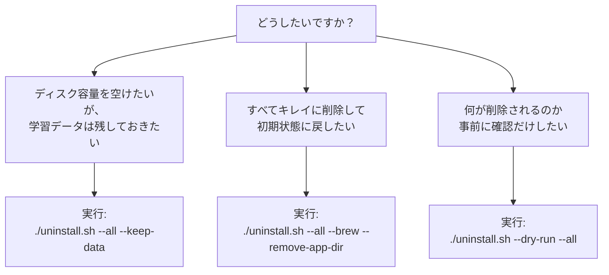

### よく使われるアンインストールコマンド

| やりたいこと | 実行するコマンド | 解放される容量 |
|:---|:---|:---|
| 容量を空けつつ、学習データは**残す** | `./uninstall.sh --all --keep-data` | 7〜25 GB |
| 完全初期化するが、先にデータを**バックアップ**する | `./uninstall.sh --all --backup-dir ~/Desktop` | 7〜25 GB |
| すべてを完全に**まるごと削除**する | `./uninstall.sh --all --brew --remove-app-dir` | 最大26 GB以上 |
| **事前プレビューのみ**（何も削除しません） | `./uninstall.sh --dry-run --all` | 0 GB |
| **対話式メニュー**（質問に答えながら進める） | `./uninstall.sh` | 選択による |

> [!IMPORTANT]
> あなたの学習データ（単語帳、スコア履歴、録音音声）は、あなたが明示的に削除を指示しない限り**絶対に削除されません**。`--keep-data` フラグを付けることで、巨大なAIモデルだけを削除して空き容量を確保しつつ、大切な学習記録は安全に保護できます。

### アンインストール後の再インストール方法

- **フォルダを残した場合:** `./setup.sh` を実行したのち、`./scripts/start_all.sh` で起動します。
- **すべて削除した場合:** 1行コマンドでの自動インストールを再度実行してください（[インストール — かんたん手順（推奨）](#installation--the-easy-way-recommended)を参照）。

---

## iPhoneやiPadからのリモートアクセス（Tailscale経由）

Macを自宅に置いたまま、カフェや外出先からiPhoneやiPadで練習したいと思ったことはありませんか？

**Tailscale**（テイルスケール）を使えば、お使いの端末同士の間にプライベートで暗号化された安全なトンネルが作られます。面倒な初期設定やセキュリティ上のリスクもありません。

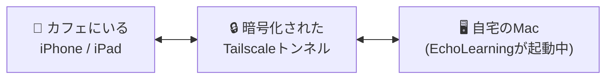

### わずか3分でできる設定手順

1. **MacにTailscaleをインストール:**
   ```
   brew install --cask tailscale
   ```
   またはMac App Storeからダウンロードしてサインインします。

2. **MacのTailscale IPアドレスを確認:**
   ```
   tailscale ip -4
   ```
   `100.64.0.10` のような数字が表示されます。

3. **iPhoneやiPadにもTailscaleをインストール:**
   App Storeからインストールし、Macと同じアカウントでサインインします。

4. **スマホのSafariを開いてアクセス:**
   ```
   http://100.64.0.10:3000
   ```
   （※「100.64.0.10」の部分は、ステップ2で確認したあなたのMacのアドレスに置き換えてください。）

たったこれだけです！どこからでも快適に練習できます。 🎉

> [!TIP]
> **アプリの設定画面からリモートアクセスを管理:**
> アプリ内の「Settings（設定）」ページから、Tailscale経由のアクセス許可をワンクリックでON/OFFできます。OFFに設定すれば、Mac本体からのみアクセスできるようになり、外部端末からの通信は瞬時に遮断されます。

---

## AIコーディングツールとの接続（MCP）

普段 **Claude Code**、**OpenAI Codex**、**Google Antigravity** などのAIコーディングアシスタントを活用しているなら、**MCP（Model Context Protocol）**を通じてEchoLearningと接続できます。MCPは、外部ツールをAIアシスタントに連携させるためのオープン標準規格です。

連携すると、普段のチャット画面から直接以下のような操作が可能になります：
- チャットしながらYouTubeリンクを渡して新しいレッスンを生成させる
- 保存した単語帳からクイズを出題してもらう
- これまでの学習履歴データを書き出す

### 各種AIアシスタントでの設定例

**Claude Code:**
```bash
claude mcp add echolearning /path/to/EchoLearning/scripts/start_mcp.sh
```

**OpenAI Codex** (`~/.codex/config.toml`):
```toml
[mcp_servers.echolearning]
command = "/path/to/EchoLearning/scripts/start_mcp.sh"
```

**Google Antigravity** (`mcp_config.json`):
```json
{
  "mcpServers": {
    "echolearning": {
      "command": "/path/to/EchoLearning/scripts/start_mcp.sh"
    }
  }
}
```

利用可能な全13種類のMCPツールについては、付録の [MCPツール一覧表](#mcp-tools-reference-table) をご覧ください。

---

# Part 3: Appendix

## トラブルシューティングとよくある質問（FAQ）

### ブラウザでマイクが動きません

1. **macOSの権限設定を確認:** **システム設定 → プライバシーとセキュリティ → マイク** を開き、お使いのブラウザにマイクの使用が許可されているか確認してください。
2. **ブラウザ側の権限設定を確認:** アドレスバーの左側にある鍵アイコンや設定アイコンをクリックし、マイクが「許可」になっていることを確認します。
3. **リモートアクセス時の注意:** マイク入力は `http://localhost` および `http://127.0.0.1` で動作します。Tailscale経由でアクセスする場合、ブラウザが非HTTPSページでのマイク使用を許可しているか確認するか、プライベートなHTTPS環境を構築できるTailscale Serveをご利用ください。

### 「Port 3000 / 8080 / 8081 / 5173 already in use」というエラーが出る

ターミナルで次のコマンドを実行してください：
```bash
./scripts/stop.sh
```
これにより、残っていたプロセスがクリーンアップされます。なお、EchoLearningの起動スクリプトは次回起動時にも自動で古いプロセスを整理します。

それでも解決しない場合は、他のアプリがそのポート番号を使用している可能性があります。以下で確認できます：
```bash
lsof -i :3000 -i :8080 -i :8081 -i :5173
```

### AIモデルのダウンロードが途中で止まってしまいました

問題ありません！モデルのダウンロードは中断再開（レジューム）に対応しています。そのままもう一度以下を実行してください：
```bash
./scripts/download_models.sh
```
ダウンロードが止まった続きから自動で再開されます。

### 8 GBのMacでもEchoLearningは動きますか？

はい、快適に動作します！セットアップ時に軽量モデルの **Qwen3.5-4B** を選択してください。メモリ消費量は約4 GB程度に抑えられており、8 GBのMacでも快適に動作します。

### 字幕のない日本語動画を読み込むとエラーになります

字幕のない動画をダウンロードして音声認識で文字起こしするには、`ffmpeg` と `yt-dlp` が必要です。以下のコマンドでインストールしてください：
```bash
brew install ffmpeg yt-dlp
```
※注意：一部の音楽ビデオ（ミュージックビデオ）やDRM（デジタル著作権管理）で保護された配信動画などはダウンロードできない場合があります。日常会話の動画、ポッドキャスト、ニュース動画などが最も適しています。

### 学習データはどこに保存されていますか？

すべてのデータはEchoLearningフォルダ内の `data/` フォルダに保存されています：
- **データベース:** `data/echolearning.sqlite3`
- **音声録音データ:** `data/audio/`

バックアップを取りたい場合は、以下のいずれかの方法で行えます：
- アプリ内の **Settings → Study backup → Generate Backup** を利用する
- `data/` フォルダを手動で丸ごとコピーする

---

## AIモデルの選び方（ハードウェア詳細ガイド）

EchoLearningは2種類のローカルAIを活用しています。アドバイスや辞書機能を提供する**言語モデル（LLM）**と、あなたの発声を理解する**音声認識モデル（ASR）**です。音声認識モデルはどのMacでも共通ですが、言語モデルはお手持ちのMacのスペックに合わせて最適なものを選択できます。

| モデル名 | ダウンロード容量 | 必要RAM | こんな環境・用途に | 品質 |
|:---|:---:|:---:|:---|:---|
| **Qwen3.5-4B** (Q6_K) | 3.3 GB | 約4 GB | 8〜16 GBのMac、最も高速な応答を重視したい方 | 良好 — 語句の意味を素早く調べるのに最適 |
| **Qwen3.5-9B** (Q4_K_M) | 5.3 GB | 約6 GB | 16 GBのMacでメモリ消費を抑えたい方 | とても良好 — バランスの取れた選択肢 |
| **Qwen3.5-9B** (Q6_K) ⭐ | 7.0 GB | 約8 GB | 16〜24 GBのMac（おすすめの標準設定） | 優秀 — ほとんどのユーザーにとって最高の品質 |
| **Qwen3.5-27B** (Q4_K_M) | 15.6 GB | 約17 GB | 32 GB以上のMac | プレミアム — 繊細な日本語のニュアンスや文法解説 |
| **Qwen3.5-35B-A3B** (Q4_K_M) | 20.5 GB | 約22 GB | 32〜64 GB以上のMac | ウルトラ — 最大級モデル、驚異的な処理スピード |
| **Whisper Large-v3-Turbo** (音声認識) | 1.5 GB | 約1.6 GB | すべてのMac（自動インストールされます） | — |

> [!TIP]
> 複数のモデルを同時にインストールしておき、ホーム画面から再起動なしで自由に切り替えることができます。あとから追加でモデルをダウンロードしたい場合は、`./scripts/download_models.sh` を実行してください。

---

## MCPツール一覧表

EchoLearningでは、MCP経由で利用できる13種類のツールを提供しています（ローカル実行および `http://127.0.0.1:3000/mcp` 経由のHTTP通信に対応）：

| ツール名 | 機能説明 |
|:---|:---|
| `get_capabilities` | システムの状態と、現在アクティブなAIモデルを確認します |
| `fetch_transcript` | YouTubeリンクから学習用レッスンを作成します |
| `start_transcript_job` | 長時間の動画を対象に、バックグラウンドでの文字起こしジョブを開始します |
| `get_job_status` | バックグラウンド文字起こしジョブの進捗状況を確認します |
| `cancel_job` | 実行中のバックグラウンド文字起こしジョブを中止します |
| `retokenize_text` | 文章を形態素解析して文法トークンに分割し、ふりがなを付与します |
| `lookup_word` | 文脈に応じた単語の意味を検索します |
| `save_vocabulary` | 単語をご自身の単語帳（Vocabularyリスト）に保存します |
| `list_vocabulary` | 保存されている単語カードの一覧を取得します |
| `list_materials` | 保存済みの全レッスン一覧を表示します |
| `list_history` | これまでの練習セッション履歴と採点スコアを確認します |
| `pronounce_text` | 任意の単語や文章の音声発音を生成します |
| `export_study_data` | 学習データをJSON形式またはCSV形式でエクスポートします |

---

## アンインストーラー詳細リファレンス

### すべてのコマンドラインオプション一覧

| オプション | 機能説明 |
|:---|:---|
| `--dry-run` | 何が削除されるかを事前確認します（実際には何も削除されません） |
| `--deps-only` | 開発環境・動作環境のファイルのみを削除します（AIモデルと学習データは保持） |
| `--all` | 動作環境ファイル ＋ AIモデル ＋ 学習データのすべてを削除対象にします |
| `--keep-data` | `--all` と併用し、学習データだけは保護して削除対象から除外します |
| `--keep-models` | `--all` と併用し、ダウンロード済みのAIモデルを保護して残します |
| `--backup-dir <folder>` | 削除を実行する前に、指定フォルダへ学習データのバックアップを作成します |
| `--brew` | Homebrewで導入したAIエンジンパッケージ（llama.cpp, whisper-cpp）もアンインストールします |
| `--remove-app-dir` | クリーンアップ完了後、EchoLearningフォルダ自体も完全に削除します |
| `-y` / `--yes` | 実行確認のプロンプトをスキップして即座に処理します |
| `--non-interactive` | 一切の質問を表示せずに実行します（自動化スクリプト向け） |
| `--project-root <dir>` | アンインストール対象とするEchoLearningフォルダのパスを明示的に指定します |

### 安全設計について

- **保護ディレクトリのガード:** システムにとって重要なフォルダ（`/`, `/System`, `/Applications` など）上では絶対に動作しません。
- **署名チェック:** 削除処理の前に、対象フォルダが本当にEchoLearningのものであるかを確実に検証します。
- **Homebrewの安全な削除:** 削除対象は `llama.cpp` と `whisper-cpp` のみです。他の開発でも使われる `ffmpeg`, `node`, `git`, `python` などには一切手を触れません。
- **学習データの隔離保護:** あなたが明示的に指定しない限り、学習データが誤って消去されることはありません。

---

## 用語集

| 用語 | 意味・解説 |
|:---|:---|
| **シャドーイング（Shadowing）** | お手本の音声を耳で聴きながら、影のようについて即座に同じ速度・リズムで復唱する語学トレーニング法 |
| **ふりがな（Furigana）** | 漢字の読み方を示すために、文字の上などに小さく添えられるひらがな |
| **ピッチアクセント（Pitch Accent）** | 日本語の単語において、音の高低（高・低）によって意味を区別するアクセント体系 |
| **IPA** | 国際音声記号（International Phonetic Alphabet） — あらゆる言語の発音を正確に表記するための世界共通記号 |
| **モーラ（Mora / 拍）** | 日本語のリズムの基本単位。「とうきょう」は「と・う・きょ・う」の4拍（4モーラ）と数えます |
| **LLM** | 大規模言語モデル（Large Language Model） — 人間の言葉を理解し、自然な文章を生成するAI（Qwen3.5など） |
| **GGUF** | 個人用パソコンなどのローカル環境で効率よくAIモデルを動かすために設計されたファイル形式 |
| **量子化（Quantization）** | AIモデルの品質をできる限り保ったままデータサイズを圧縮し、メモリ消費を大幅に減らす技術 |
| **ASR** | 自動音声認識（Automatic Speech Recognition） — 話された音声を文字に変換する技術（Whisperが担当） |
| **MCP** | Model Context Protocol — AIアシスタントが外部のツールや機能とシームレスに連携するための通信規格 |
| **SQLite** | お使いのパソコン内の1つのファイルにすべてのデータを軽量・高速に保存できるデータベース |
| **Tailscale** | 自宅のパソコンとスマホなどの端末同士を、プライベートかつ暗号化されたネットワークで安全につなぐ無料ツール |
| **ADK** | Agent Development Kit — Googleが提供する、自律型AIエージェントアプリケーション構築のためのフレームワーク |
| **Homebrew** | ターミナルからコマンドを入力するだけで様々なソフトウェアを導入できる、Mac定番のパッケージ管理ツール |

---

## アーキテクチャ設計図

技術的な構造に興味がある方向けに、各システムコンポーネントがどのように連携しているかを図解します：

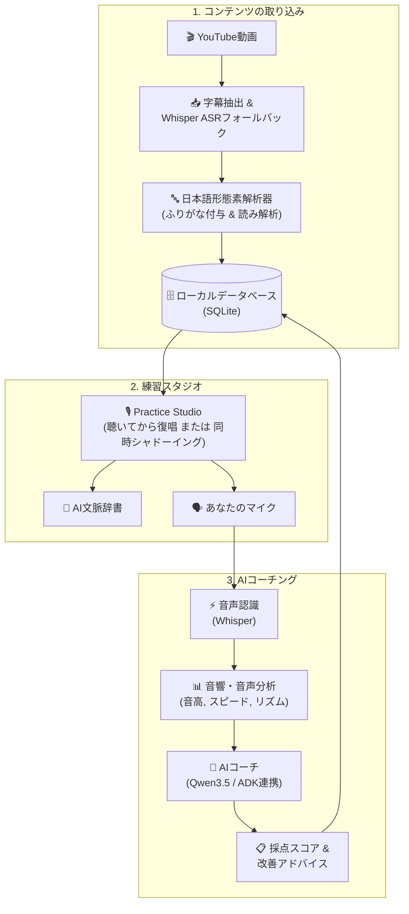

### バックグラウンドサービス一覧（EchoLearning起動中に常駐するプロセス）

| サービス名 | ポート番号 | 役割 |
|:---|:---:|:---|
| llama-server | 8080 | AI言語モデルの実行を担当 |
| whisper-server | 8081 | 音声認識の実行を担当 |
| FastAPI Backend | 3000 | アプリの処理ロジックおよびデータ管理を担当 |
| Vite Frontend | 5173 | ウェブ操作画面の配信を担当 |

---

## テストの実行方法（開発者向け）

```bash
# Pythonバックエンドのテスト実行
./adk_backend/.venv/bin/pytest tests/ -v

# TypeScriptの構文チェック（リント）
npm run lint

# プロダクション用フロントエンドのビルド
npm run build

# システムの正常稼働確認（ヘルスチェック）
curl -s http://127.0.0.1:3000/api/health | jq .
```

---

## ライセンスと謝辞

EchoLearningは、**Apache License 2.0** のもとで提供されている無料のオープンソースソフトウェアです。

本プロジェクトは、以下の素晴らしいオープンソースソフトウェアの数々を活用して構築されています：
- [Google ADK](https://github.com/google/adk-python) — AIエージェントの統括・協調制御
- [llama.cpp](https://github.com/ggml-org/llama.cpp) — ローカル環境での高速AI推論
- [whisper.cpp](https://github.com/ggml-org/whisper.cpp) — ローカル環境での音声認識
- [Qwen3.5](https://github.com/QwenLM/Qwen2.5) — 高性能な多言語対応言語モデル
- [Fugashi](https://github.com/polm/fugashi) & [UniDic](https://ccd.ninjal.ac.jp/unidic/) — 日本語の形態素・読み・アクセント解析
- [FastAPI](https://fastapi.tiangolo.com/) — 高速Pythonウェブフレームワーク
- [React 19](https://react.dev/) & [Tailwind CSS](https://tailwindcss.com/) — モダンで洗練されたユーザーインターフェース
- [FastMCP](https://modelcontextprotocol.io/) — AIツール連携フレームワーク
- [Tailscale](https://tailscale.com/) — 安全なプライベートネットワーク構築

---

<p align="center">世界中の語学学習者へ、心を込めて ❤️ 楽しくシャドーイングを続けましょう！ 🎧</p>


---

<br/>
<br/>
<br/>

---

<a id="traditional-chinese"></a><a id="zh-tw"></a><a id="zh-hant"></a>
# 🇹🇼 繁體中文版 (Traditional Chinese)

---
<center><a href="#english">English</a> ｜ <a href="#japanese">日本語版</a> ｜ <a href="#traditional-chinese">繁體中文版</a> ｜ <a href="#simplified-chinese">简体中文版</a></center>

---

# 🎧 EchoLearning — 你的專屬本機 AI 語言教練

> **透過真實 YouTube 影片精通英語與日語口說 — 100% 離線運行、100% 免費、100% 隱私保護。**

---

## 📑 目錄

- [Part 1: What is EchoLearning?](#part-1-what-is-echolearning)
  - [The Idea Behind EchoLearning](#the-idea-behind-echolearning)
  - [What Makes EchoLearning Special](#what-makes-echolearning-special)
  - [How It Works — The Big Picture](#how-it-works--the-big-picture)
- [Part 2: Quick Start Guide](#part-2-quick-start-guide)
  - [What You Need (Hardware & Software)](#what-you-need-hardware--software)
  - [Installation — The Easy Way (Recommended)](#installation--the-easy-way-recommended)
  - [Installation — Manual Setup (For Those Who Prefer Control)](#installation--manual-setup-for-those-who-prefer-control)
  - [Starting EchoLearning](#starting-echolearning)
  - [Your First Practice Session](#your-first-practice-session)
  - [Key Features at a Glance](#key-features-at-a-glance)
  - [Shutting Down](#shutting-down)
  - [Uninstalling EchoLearning](#uninstalling-echolearning)
  - [Remote Access from iPhone & iPad (via Tailscale)](#remote-access-from-iphone--ipad-via-tailscale)
  - [Connecting AI Coding Tools (MCP)](#connecting-ai-coding-tools-mcp)
- [Part 3: Appendix](#part-3-appendix)
  - [Troubleshooting & FAQ](#troubleshooting--faq)
  - [Choosing Your AI Model (Detailed Hardware Guide)](#choosing-your-ai-model-detailed-hardware-guide)
  - [MCP Tools Reference Table](#mcp-tools-reference-table)
  - [Uninstaller Detailed Reference](#uninstaller-detailed-reference)
  - [Glossary](#glossary)
  - [Architecture Diagram](#architecture-diagram)
  - [Running Tests (For Developers)](#running-tests-for-developers)
  - [License & Acknowledgments](#license--acknowledgments)

---

# Part 1: What is EchoLearning?

## EchoLearning 的核心理念

**跟讀法**（Shadowing）是一種廣受多語達人（Polyglot，能說多種語言的人）喜愛、且備受語音學家推崇的語言學習技巧。它的概念非常簡單：聆聽母語人士的發音，並立刻開口複誦，同時模仿對方的語速、節奏和語調。

這是讓你在說外語時聽起來更加自然最有效的方法之一 — 但自己一個人練習往往令人受挫。你怎麼知道自己的發音到底準不準？漏掉了哪些單字？節奏聽起來自然嗎？

**EchoLearning** 正是為了徹底解決這些難題而生。這是一款免費且開源的應用程式，能將任何 YouTube 影片轉化為你的專屬語言課程，並在你開口練習時專注聆聽、給予詳盡的回饋分析 — 背後全由直接在你的 Mac 上本機運行的 AI 技術驅動。

## EchoLearning 的獨特優勢

```text
┌──────────────────────────────────────────────────────────────────────┐
│                    為什麼選擇 ECHOLEARNING？                         │
├──────────────────────────────────────────────────────────────────────┤
│  🔒 100% 隱私保護       你的聲音永遠不會離開你的電腦。               │
│  💸 完全免費            零訂閱費、無 API 費用、無使用限制。          │
│  ⚡ 即時回饋            開口說話的同時進行即時語音辨識。             │
│  🇯🇵 支援英日雙語        對英語與日語提供深度且完整的支援。           │
│  📚 儲存並隨時練習      現在生成課程，隨時隨地離線練習。             │
│  📱 支援行動裝置        透過 Tailscale 直接用手機隨時練習。          │
└──────────────────────────────────────────────────────────────────────┘
```

> [!NOTE]
> **為什麼所有資料都保留在你的電腦本機？**
> 開口大聲說話並從錯誤中學習是語言進步的必經之路。EchoLearning 將你的語音錄音與所有學習數據完全保存在你的 Mac 本機 — 絕不會有任何資料被上傳至網際網路。

## 運作原理 — 系統全貌

以下是 EchoLearning 後台運作方式的簡化圖解：

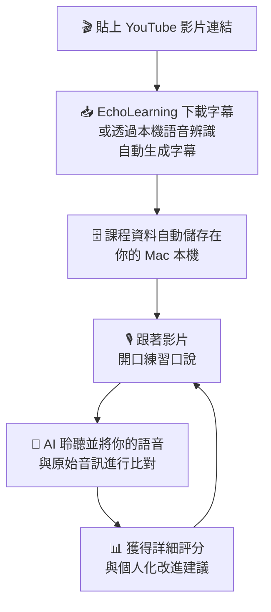

**用最通俗易懂的話來說：**
1. **貼上連結** — 提供任何英語或日語的 YouTube 影片網址給 EchoLearning。
2. **自動建立課程** — 應用程式會擷取字幕（若沒有字幕，則會使用語音辨識技術自動生成）。針對日語影片，它還會在難字上方自動標註振假名讀音（Furigana）。
3. **開口練習** — 兩種練習模式隨你挑選：逐句跟讀，或是跟著影片不間斷地同步影子跟讀。
4. **取得回饋** — AI 會全面分析你的發音、節奏、語速與語調，並給出 100 分制的評分以及量身打造的改進技巧。
5. **精進複習** — 針對卡關的句子重新挑戰，看著自己的分數一步步往上衝！

---

# Part 2: Quick Start Guide

## 必備條件（硬體與軟體需求）

### 電腦硬體需求

| 需求項目 | 詳細說明 |
|:---|:---|
| **電腦** | Mac（Intel 或 Apple Silicon M1/M2/M3/M4 系列晶片） |
| **作業系統** | macOS 12 (Monterey) 或更新版本 |
| **記憶體 (RAM)** | 最少 8 GB · 建議 16 GB · 若要運行高階 AI 模型建議 32 GB 以上 |
| **可用磁碟空間** | 至少 15 GB（AI 模型檔案約 5–22 GB，取決於你選擇的模型規格） |
| **麥克風** | Mac 內建麥克風，或任何 USB / 藍牙耳機麥克風皆可 |
| **網際網路連線** | 僅於初始安裝及下載影片時需要。日常練習 100% 完全離線運行！ |

### 你的 Mac 能運行 EchoLearning 嗎？

```text
┌───────────────────────────────────────────────────────────────────────┐
│  🖥️  你的 MAC                         →  建議選擇的 AI 模型           │
├───────────────────────────────────────────────────────────────────────┤
│  8 GB MacBook Air (M1/M2/M3)         →  Qwen3.5-4B (輕量版)           │
│  16 GB Mac (Intel 或 Apple Silicon)   →  Qwen3.5-9B (推薦規格 ⭐)      │
│  32 GB+ Mac (M 系列 Pro/Max)          →  Qwen3.5-27B 或 35B (旗艦版)   │
└───────────────────────────────────────────────────────────────────────┘
```

> [!TIP]
> **不知道自己的 Mac 有多少記憶體 (RAM)？**
> 點擊螢幕左上角的 Apple 選單 (🍎) →「關於這台 Mac」→ 查看「記憶體」欄位。

### 事前必備軟體

在安裝 EchoLearning 之前，你需要先準備好兩款免費工具：

1. **Homebrew** — Mac 上最受歡迎的套件管理工具（專門幫你安裝其他軟體的工具）。
   - 如果你尚未安裝，請打開「終端機」（Terminal）並貼上以下指令：
     ```
     /bin/bash -c "$(curl -fsSL https://raw.githubusercontent.com/Homebrew/install/HEAD/install.sh)"
     ```

2. **Git** — 一款用來從網路上下載程式碼的工具。
   - 在「終端機」中執行以下指令即可安裝：
     ```
     xcode-select --install
     ```

> [!NOTE]
> **什麼是「終端機」（Terminal）？**
> 「終端機」是 Mac 內建的應用程式，讓你能輸入文字指令來操作電腦。你可以按下 `Cmd + Space`（空白鍵）開啟 Spotlight 搜尋，輸入「Terminal」或「終端機」，然後按下 Enter 鍵即可打開。

---

## 安裝步驟 — 簡易模式（推薦）

這是最快上手的安裝方式。只需一行指令，就能自動完成所有事情：下載 EchoLearning、安裝所有必要工具，並配置好 AI 模型。

### 步驟一：打開「終端機」

按下 `Cmd + Space`，輸入「Terminal」，然後按下 Enter。

### 步驟二：貼上並執行此指令

```bash
curl -fsSL https://raw.githubusercontent.com/NinjaRoboticsEducation/EchoLearning/HEAD/scripts/install.sh | bash
```

### 步驟三：選擇你的 AI 模型

安裝程式會詢問你想下載哪一款 AI 模型。如果不確定，直接按下 **Enter** 鍵接受系統推薦的預設值即可。

### 步驟四：等待下載完成

AI 模型檔案較大（約 5–20 GB）。下載時間取決於你的網路速度。萬一下載過程中斷也不必擔心 — 重新執行同一行指令就會自動從中斷處繼續下載（斷點續傳）。

### 步驟五：啟動 EchoLearning

```bash
cd EchoLearning
./scripts/start_all.sh
```

你的瀏覽器會自動開啟。你已經準備好開始練習了！🎉


---

## 安裝步驟 — 手動設定（適合偏好自主掌控的進階使用者）

如果你偏好逐步檢視並掌控每個安裝步驟：

### 步驟一：下載 EchoLearning

```bash
git clone https://github.com/NinjaRoboticsEducation/EchoLearning.git
cd EchoLearning
```

### 步驟二：執行設定指令

```bash
./setup.sh
```

這項指令將會：
- 安裝所需的系統工具（ffmpeg、Python、Node.js、AI 推論引擎）
- 建立應用程式的獨立運行環境
- 建置前端網頁介面
- 提示你選擇合適的 AI 模型

### 步驟三：啟動 EchoLearning

```bash
./scripts/start_all.sh
```

你的瀏覽器將會自動開啟並載入 `http://localhost:5173`。

---

## 啟動 EchoLearning

往後每次想練習時，只需執行：

```bash
cd EchoLearning
./scripts/start_all.sh
```

> [!TIP]
> **想要一個桌面捷徑嗎？**
> 在你的桌面上建立一個名為 `EchoLearning.command` 的檔案，內容如下：
> ```bash
> #!/bin/bash
> cd "/path/to/EchoLearning"
> ./scripts/start_all.sh
> ```
> 接著在終端機中執行 `chmod +x ~/Desktop/EchoLearning.command`。現在只要在桌面上連按兩下該圖示就能立刻啟動！

---

## 你的第一次練習體驗

### 1. 建立一堂課程

1. 在首頁上貼上 YouTube 影片網址（例如：`https://www.youtube.com/watch?v=...`）。
2. 選擇語言：**English（英語）** 或 **Japanese（日語）**。
3. 點擊 **Generate Learning Transcript（生成學習逐字稿）**。
4. 課程會自動儲存 — 隨時都能打開練習，就算沒有網路也完全沒問題！

### 2. 進入練習工作室

點擊任何已儲存的課程即可進入練習工作室。選擇適合你的練習模式：

| 模式 | 運作方式 | 最適合對象 |
|:---|:---|:---|
| **🎯 逐句聆聽跟讀 (Listen-Then-Repeat)** | 影片播放一句後自動暫停，等待你開口複誦 | 初學者、雕琢精準發音 |
| **🌊 同步影子跟讀 (Simultaneous Shadowing)** | 影片不間斷連續播放，你即時同步跟讀（最長支援 60 分鐘） | 中高階學習者、訓練流利度與語感 |

### 3. 開口練習並取得回饋

1. **開口說話** — AI 會即時顯示辨識到的語音文字。
2. **點擊「Finish Recording（結束錄音）」** — 系統會將你的完整語音轉為文字。
3. **點擊「Analyze Shadowing Result（分析跟讀成效）」** — 取得全方位的表現評分。

### 4. 解讀你的成績單

你的評分由 4 個核心維度組成：

```text
┌─────────────────────────────────────────────┐
│              你的影子跟讀評分               │
├─────────────────────────────────────────────┤
│  📝 內容準確度 Content Accuracy (35%)       │
│     你有沒有說出正確的字詞？                │
│                                             │
│  🗣️ 發音表現 Pronunciation (25%)            │
│     每個音節的發音是否清晰準確？            │
│                                             │
│  🏃 流利度 Fluency (25%)                    │
│     你的說話速度是否自然流暢？              │
│                                             │
│  🎵 語調韻律 Prosody (15%)                  │
│     聲音的抑揚頓挫與起伏是否自然？          │
│                                             │
│  🏆 綜合總分 Overall Score: 78/100          │
│  💡 改進建議 Tip: "試著放慢『東京 (Tōkyō)』 │
│      長母音的拖音長度！"                    │
└─────────────────────────────────────────────┘
```

每個單字都會以顏色標示狀態：✅ 綠色（正確）、🔴 紅色（漏唸）、🟡 黃色（用詞錯誤）、🔵 藍色（發音含糊不清）。

---

## 核心功能一覽

### 📖 語境即時字典
點擊逐字稿中的任何單字，即可查看：
- 該單字**在此特定句子中**的精確語意
- 發音指引（英語提供 IPA 國際音標，日語提供振假名）
- 聲調高低音型（針對日語音調核 Pitch Accent）
- 原生語音示範（離線秒速播放）
- 一鍵收藏至你的單字庫（Vocabulary）

### ✏️ 可自由編輯的逐字稿
YouTube 自動生成的字幕難免會有錯漏。點擊任何句子旁的編輯按鈕即可輕鬆修正錯字。若是日語句子，振假名讀音會自動即時更新。

### 💾 本機永久儲存，隨時複習
所有生成的課程都會妥善保存在你的 Mac 本機。當你逛到感興趣的影片時可先批量生成課程，日後隔幾天或數週後再回來複習 — 完全不需要連上網路。

### 🔄 隨時切換 AI 模型
在首頁的 **Model Selection（模型選擇）** 下拉選單中，你可以即時在已安裝的多個 AI 模型之間秒速切換 — 無需重啟任何伺服器。

---

## 關閉系統

提供兩種便捷方式：

1. **直接在網頁介面操作：** 點擊頂部導航列的 **SHUT DOWN（關閉系統）** 按鈕。
2. **透過終端機操作：** 在 EchoLearning 資料夾中執行 `./scripts/stop.sh`。

兩種方式都會安全終止所有背景服務程序，並完整釋放你的 Mac 記憶體。

---

## 解除安裝 EchoLearning

### 快速決策指南

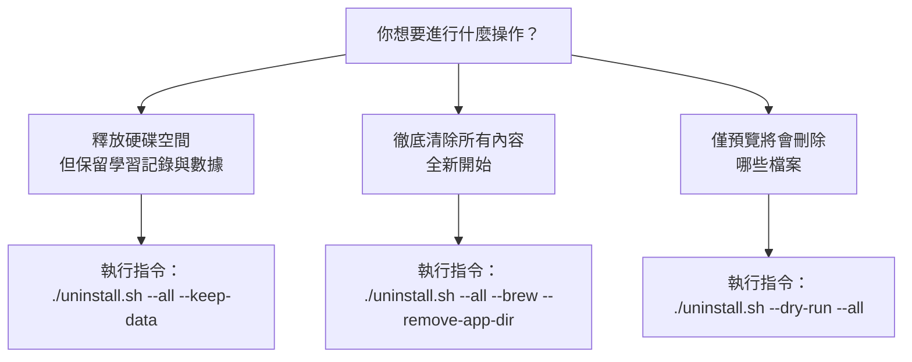

### 常見解除安裝指令

| 需求目標 | 執行指令 | 釋放空間 |
|:---|:---|:---|
| 釋放磁碟空間，**保留**學習數據 | `./uninstall.sh --all --keep-data` | 7–25 GB |
| 完整重置，但在刪除前先**備份**數據 | `./uninstall.sh --all --backup-dir ~/Desktop` | 7–25 GB |
| **徹底移除**所有檔案與相依套件 | `./uninstall.sh --all --brew --remove-app-dir` | 高達 26+ GB |
| **純預覽模擬**（不刪除任何檔案） | `./uninstall.sh --dry-run --all` | 0 GB |
| **互動導引選單**（一步步詢問確認） | `./uninstall.sh` | 自行勾選決定 |

> [!IMPORTANT]
> 除非你明確要求刪除，否則你的個人學習記錄（單字庫、評分歷史、語音錄音）**絕對不會被刪除**。`--keep-data` 參數可確保在清理龐大的 AI 模型檔案時，你的心血記錄依然完好無損。

### 清理後重新安裝

- **若你保留了資料夾：** 依序執行 `./setup.sh` 與 `./scripts/start_all.sh` 即可。
- **若你刪除了所有檔案：** 重新執行一行安裝指令（請參閱 [安裝步驟 — 簡易模式](#installation--the-easy-way-recommended)）。

---

## 透過 iPhone 與 iPad 遠端連線（使用 Tailscale）

想在通勤路上用手機或平板練習，同時讓家裡的 Mac 在背景負責所有的繁重運算嗎？

**Tailscale** 能在你的不同裝置間建立安全加密的專屬通道 — 無需繁瑣設定，更沒有資安外洩風險。

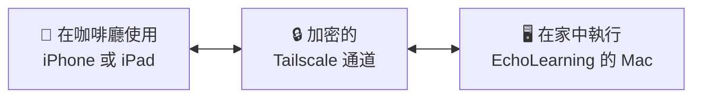

### 3 分鐘快速設定

1. **在你的 Mac 上安裝 Tailscale：**
   ```
   brew install --cask tailscale
   ```
   或是直接從 Mac App Store 下載安裝，並登入帳號。

2. **查詢你的 Mac 的 Tailscale 專屬 IP 位址：**
   ```
   tailscale ip -4
   ```
   終端機會顯示類似 `100.64.0.10` 的 IP 位址。

3. **在你的 iPhone / iPad 上安裝 Tailscale：**
   從 App Store 下載 Tailscale，並登入相同的帳號。

4. **在手機上打開 Safari 瀏覽器**，前往：
   ```
   http://100.64.0.10:3000
   ```
   （請將網址替換為你在步驟 2 中查到的 Mac IP 位址。）

就這麼簡單！無論身在何處都能隨時練習。🎉

> [!TIP]
> **在設定頁面中掌控遠端連線權限：**
> 在應用程式的「Settings（設定）」頁面中，只需輕輕一點即可隨時開啟（ON）或關閉（OFF）Tailscale 遠端存取。切換為 OFF 時，僅允許本機 Mac 連線，遠端裝置將被立即阻擋。

---

## 連接 AI 程式碼編輯工具（MCP）

如果你有使用 **Claude Code**、**OpenAI Codex** 或 **Google Antigravity** 等 AI 輔助開發工具，你可以透過 **MCP (Model Context Protocol)** 將它們與 EchoLearning 串接 — 這是專為 AI 助理設計的開放標準協定，讓 AI 能直接呼叫外部工具。

串接之後，你的 AI 助理就能直接：
- 在聊天時根據你給的 YouTube 連結自動建立新課程
- 隨機抽選你儲存的單字庫對你進行即興測驗
- 匯出你的完整學習歷史與數據

### 常見 AI 助理設定方式

**Claude Code:**
```bash
claude mcp add echolearning /path/to/EchoLearning/scripts/start_mcp.sh
```

**OpenAI Codex** (`~/.codex/config.toml`):
```toml
[mcp_servers.echolearning]
command = "/path/to/EchoLearning/scripts/start_mcp.sh"
```

**Google Antigravity** (`mcp_config.json`):
```json
{
  "mcpServers": {
    "echolearning": {
      "command": "/path/to/EchoLearning/scripts/start_mcp.sh"
    }
  }
}
```

如需查看全部 13 個可用的 MCP 工具清單，請參閱附錄中的 [MCP 工具參考表](#mcp-tools-reference-table)。

---

# Part 3: Appendix

## 常見問題與疑難排解

### 瀏覽器無法偵測到麥克風

1. **檢查 macOS 系統權限：** 前往 **系統設定 → 隱私權與安全性 → 麥克風**，確認你的瀏覽器已被授權取用麥克風。
2. **檢查瀏覽器網站權限：** 點擊網址列旁的鎖頭或設定圖示，將「麥克風」權限調整為「允許」。
3. **遠端連線注意事項：** 麥克風在 `http://localhost` 和 `http://127.0.0.1` 下能正常運作。若是透過 Tailscale 遠端存取，請確保瀏覽器允許在非 HTTPS（HTTP）網頁上使用麥克風，或者可設定 Tailscale Serve 啟用私有 HTTPS 加密連線。

### 出現「連接埠（Port）3000 / 8080 / 8081 / 5173 已被佔用」提示

在終端機中執行此指令：
```bash
./scripts/stop.sh
```
這會徹底清除殘留的背景程序。下次啟動 EchoLearning 時，系統也會自動清理未正常退出的舊程序。

若問題依然存在，可能是其他軟體佔用了該連接埠。可透過以下指令進行排查：
```bash
lsof -i :3000 -i :8080 -i :8081 -i :5173
```

### 模型下載過程中斷了怎麼辦？

完全不用擔心！所有模型下載皆支援斷點續傳。只要再次執行：
```bash
./scripts/download_models.sh
```
系統會自動從上次中斷的地方繼續下載。

### 8 GB 記憶體的 Mac 可以順暢執行 EchoLearning 嗎？

可以！在初始設定時選擇輕量版的 **Qwen3.5-4B** 模型即可。它僅需約 4 GB 的記憶體，在 8 GB 的 Mac 上表現十分優異。

### 沒有字幕的日語影片顯示錯誤

EchoLearning 需要藉由 `ffmpeg` 與 `yt-dlp` 來下載音訊並自動轉錄沒有字幕的影片。請透過指令安裝：
```bash
brew install ffmpeg yt-dlp
```
注意事項：部分受版權保護（DRM）或特定音樂錄影帶可能無法直接下載。一般的日常對話影片、Podcast 訪談或新聞片段都能完美支援。

### 我的個人學習資料存放在哪裡？

所有資料皆儲存在 EchoLearning 專案內的 `data/` 資料夾中：
- **資料庫檔案：** `data/echolearning.sqlite3`
- **練習錄音音訊：** `data/audio/`

若想進行備份，你可以：
- 在應用程式中的 **Settings → Study backup → Generate Backup** 點擊生成備份檔案
- 或是直接手動複製備份整個 `data/` 資料夾

---

## 挑選適合你的 AI 模型（詳細硬體指南）

EchoLearning 在本機運行兩種類型的 AI：**大型語言模型 (LLM)**（負責教學指導、語意分析與字典查詢）與**語音辨識模型 (ASR)**（負責辨別你的發音與口說內容）。語音辨識模型全機種皆統一採用高效能版本；你只需根據你 Mac 的記憶體大小挑選合適的語言模型規格即可。

| 模型名稱 | 下載大小 | 記憶體需求 (RAM) | 最佳適用場景 | 模型品質與表現 |
|:---|:---:|:---:|:---|:---|
| **Qwen3.5-4B** (Q6_K) | 3.3 GB | ~4 GB | 8–16 GB Mac，回應速度最飛快 | 良好 — 非常適合快速查詞與基礎評分 |
| **Qwen3.5-9B** (Q4_K_M) | 5.3 GB | ~6 GB | 想節省記憶體開銷的 16 GB Mac | 優秀 — 性能與資源消耗平衡的首選 |
| **Qwen3.5-9B** (Q6_K) ⭐ | 7.0 GB | ~8 GB | 16–24 GB Mac（官方推薦預設值） | 卓越 — 最適合絕大多數使用者的頂尖品質 |
| **Qwen3.5-27B** (Q4_K_M) | 15.6 GB | ~17 GB | 32 GB 以上高階 Mac | 旗艦頂級 — 對細膩日語語意與文法有極佳掌握 |
| **Qwen3.5-35B-A3B** (Q4_K_M) | 20.5 GB | ~22 GB | 32–64 GB 以上專業 Mac | 極致極限 — 參數量最大且推論極速 |
| **Whisper Large-v3-Turbo** (語音辨識) | 1.5 GB | ~1.6 GB | 所有系統適用（系統自動安裝） | — |

> [!TIP]
> 你可以同時安裝多個模型，並隨時在首頁無縫切換，無需重新啟動。若日後想下載其他模型規格，只需執行 `./scripts/download_models.sh` 即可。

---

## MCP 工具參考表

EchoLearning 提供 13 項可透過 MCP 呼叫的強大工具（同時支援本機 Stdio 管道與 HTTP 協定，網址為 `http://127.0.0.1:3000/mcp`）：

| 工具名稱 | 功能簡介 |
|:---|:---|
| `get_capabilities` | 檢查系統運行狀態及當前啟用的 AI 模型 |
| `fetch_transcript` | 根據 YouTube 連結解析並建立全新課程 |
| `start_transcript_job` | 在背景啟動長影片的逐字稿語音轉錄任務 |
| `get_job_status` | 查詢背景逐字稿轉錄任務的當前進度 |
| `cancel_job` | 取消正在執行中的背景轉錄任務 |
| `retokenize_text` | 將文字進行日英文法分詞並標註振假名 |
| `lookup_word` | 結合當前上下文語境查詢單字的精確意涵 |
| `save_vocabulary` | 將生詞加入並儲存至你的個人單字庫 |
| `list_vocabulary` | 瀏覽已儲存的所有單字卡清單 |
| `list_materials` | 瀏覽已建立並儲存的所有學習教材課程 |
| `list_history` | 查閱過往所有的練習記錄與成績評分 |
| `pronounce_text` | 為指定單字或句子生成原生離線語音示範 |
| `export_study_data` | 將個人學習數據匯出為 JSON 或 CSV 格式 |

---

## 解除安裝程式詳細參考

### 所有命令列參數

| 參數 | 功能說明 |
|:---|:---|
| `--dry-run` | 純模擬預覽將被刪除的檔案（不會實際刪除任何東西） |
| `--deps-only` | 僅清除開發相依套件（保留 AI 模型與個人學習數據） |
| `--all` | 同時移除相依套件 + AI 模型 + 個人學習數據 |
| `--keep-data` | 搭配 `--all` 使用，強制保護並保留個人學習數據 |
| `--keep-models` | 搭配 `--all` 使用，保護並保留已下載的 AI 模型檔案 |
| `--backup-dir <folder>` | 在執行移除之前，將學習數據完整備份至指定資料夾 |
| `--brew` | 一併解除安裝 Homebrew 上的 AI 引擎套件 (llama.cpp, whisper-cpp) |
| `--remove-app-dir` | 在清理完畢後，徹底刪除整個 EchoLearning 根資料夾 |
| `-y` / `--yes` | 跳過所有互動式確認提問 |
| `--non-interactive` | 完全無人值守模式執行（適合自動化腳本） |
| `--project-root <dir>` | 指定欲進行解除安裝的 EchoLearning 專案路徑 |

### 安全防護機制

- **系統受保護路徑防禦：** 嚴格禁止在系統核心目錄（如 `/`、`/System`、`/Applications` 等）下執行刪除操作
- **簽章特徵校驗：** 在執行任何刪除前，自動驗證目標資料夾是否確實為 EchoLearning 專案
- **安全的 Homebrew 清理：** 僅針對 `llama.cpp` 與 `whisper-cpp` 進行解除安裝 — 絕不觸碰 `ffmpeg`、`node`、`git` 或 `python` 等共用工具
- **學習數據嚴密隔離：** 除非使用者明確指定，否則個人學習數據預設受到嚴密保護，絕不誤刪

---

## 名詞解釋

| 詞彙 | 意義說明 |
|:---|:---|
| **Shadowing（跟讀法）** | 一種語言練習技巧：聆聽母語講者的聲音並以極短的延遲立即開口模仿複誦，同步對齊語速與節奏 |
| **Furigana（振假名）** | 標註在日語漢字上方的小字平假名，用來標示該漢字的正確發音讀法 |
| **Pitch Accent（音調核 / 音高重音）** | 日語單字中高低音調的起伏變化模式，不同的聲調高低往往代表完全不同的字義 |
| **IPA（國際音標）** | International Phonetic Alphabet — 一套用於標註人類語言語音的全球標準音標系統 |
| **Mora（拍 / 音拍）** | 日語發音中的基本節奏節拍單位。例如「東京」（とうきょう）共有 4 個音拍：と・う・きょ・う |
| **LLM（大型語言模型）** | Large Language Model — 能夠理解與生成自然語言的人工智慧模型（如 Qwen3.5） |
| **GGUF** | 一種專為在個人電腦本機高效運行 AI 模型而設計的二進位檔案格式 |
| **Quantization（量化技術）** | 將 AI 模型參數壓縮降維的技術，能大幅降低記憶體開銷並同時保持極高精確度 |
| **ASR（自動語音辨識）** | Automatic Speech Recognition — 將人類開口說出的語音即時轉換為文字的技術（Whisper 即為此類技術） |
| **MCP（模型上下文協定）** | Model Context Protocol — 讓 AI 助理得以安全連接並調用外部工具與資料的開放通訊協定 |
| **SQLite** | 一款輕量級的嵌入式資料庫系統，將所有資料完整保存在你電腦中的單一檔案內 |
| **Tailscale** | 一款免費工具，能在你的多部裝置之間建立點對點私人加密虛擬網路通道 |
| **ADK（智慧代理開發套件）** | Agent Development Kit — Google 開發用於打造 AI Agent 智慧代理應用程式的架構套件 |
| **Homebrew** | Mac 上最知名且廣泛使用的套件管理器，讓你能透過終端機指令快速安裝各類軟體 |

---

## 系統架構圖

針對對底層技術架構感興趣的使用者，以下展示各元件之間的協同運作流程：

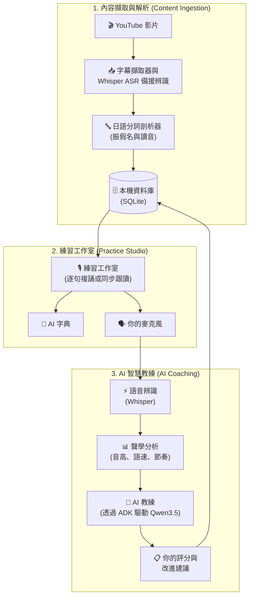

### 背景服務程序（EchoLearning 運行時的後台元件）

| 服務名稱 | 連接埠 (Port) | 用途職責 |
|:---|:---:|:---|
| llama-server | 8080 | 負責運行本機 AI 語言模型 (LLM) |
| whisper-server | 8081 | 負責處理本機即時語音辨識 (ASR) |
| FastAPI Backend | 3000 | 處理核心應用邏輯與資料存取 |
| Vite Frontend | 5173 | 提供前端網頁操作介面 |

---

## 執行測試（開發者專用）

```bash
# Python backend tests
./adk_backend/.venv/bin/pytest tests/ -v

# TypeScript linting
npm run lint

# Build production frontend
npm run build

# Check system health
curl -s http://127.0.0.1:3000/api/health | jq .
```

---

## 開源授權與特別鳴謝

EchoLearning 是一款依據 **Apache License 2.0** 開源釋出的免費自由軟體。

特別感謝以下優秀的開源專案與社群支持：
- [Google ADK](https://github.com/google/adk-python) — Agent 智慧代理協調框架
- [llama.cpp](https://github.com/ggml-org/llama.cpp) — 本機 AI 推論引擎
- [whisper.cpp](https://github.com/ggml-org/whisper.cpp) — 本機語音辨識引擎
- [Qwen3.5](https://github.com/QwenLM/Qwen2.5) — 多語言大型語言模型
- [Fugashi](https://github.com/polm/fugashi) & [UniDic](https://ccd.ninjal.ac.jp/unidic/) — 日語形態素分析
- [FastAPI](https://fastapi.tiangolo.com/) — Python 高效網頁框架
- [React 19](https://react.dev/) & [Tailwind CSS](https://tailwindcss.com/) — 現代化使用者介面
- [FastMCP](https://modelcontextprotocol.io/) — AI 工具協定整合
- [Tailscale](https://tailscale.com/) — 點對點私人安全網路

---

<p align="center">用 ❤️ 為全世界的語言學習者傾心打造。祝跟讀練習愉快！🎧</p>


---

<br/>
<br/>
<br/>

---

<a id="simplified-chinese"></a><a id="zh-cn"></a><a id="zh-hans"></a>
# 🇨🇳 简体中文版 (Simplified Chinese)

---
<center><a href="#english">English</a> ｜ <a href="#japanese">日本語版</a> ｜ <a href="#traditional-chinese">繁體中文版</a> ｜ <a href="#simplified-chinese">简体中文版</a></center>

---

# 🎧 EchoLearning — 你的专属 AI 语言教练

> **利用真实的 YouTube 视频轻松掌握英语和日语口语 —— 100% 离线、100% 免费、100% 保护隐私。**

---

## 📑 目录

- [第一部分：什么是 EchoLearning？](#part-1-what-is-echolearning)
  - [EchoLearning 的诞生初衷](#the-idea-behind-echolearning)
  - [EchoLearning 的独特亮点](#what-makes-echolearning-special)
  - [运作原理 —— 整体概览](#how-it-works--the-big-picture)
- [第二部分：快速入门指南](#part-2-quick-start-guide)
  - [准备工作（硬件与软件）](#what-you-need-hardware--software)
  - [安装方式 —— 简易安装（推荐）](#installation--the-easy-way-recommended)
  - [安装方式 —— 手动安装（适合喜欢掌控细节的用户）](#installation--manual-setup-for-those-who-prefer-control)
  - [启动 EchoLearning](#starting-echolearning)
  - [开始你的第一次练习](#your-first-practice-session)
  - [核心功能一览](#key-features-at-a-glance)
  - [关闭与退出](#shutting-down)
  - [卸载 EchoLearning](#uninstalling-echolearning)
  - [从 iPhone 和 iPad 远程访问（通过 Tailscale）](#remote-access-from-iphone--ipad-via-tailscale)
  - [连接 AI 编程助手（MCP）](#connecting-ai-coding-tools-mcp)
- [第三部分：附录](#part-3-appendix)
  - [故障排查与常见问题（FAQ）](#troubleshooting--faq)
  - [选择适合你的 AI 模型（详细硬件配置指南）](#choosing-your-ai-model-detailed-hardware-guide)
  - [MCP 工具速查表](#mcp-tools-reference-table)
  - [卸载脚本详细参数参考](#uninstaller-detailed-reference)
  - [术语表](#glossary)
  - [系统架构图](#architecture-diagram)
  - [运行测试（面向开发者）](#running-tests-for-developers)
  - [开源许可与鸣谢](#license--acknowledgments)

---

# 第一部分：什么是 EchoLearning？

## EchoLearning 的诞生初衷

**跟读训练**（Shadowing，影子跟读法）是一种深受多语种达人（Polyglots）推崇、并受到言语科学专家认可的高效语言学习方法。它的原理很简单：一边倾听母语者的发言，一边几乎无延迟地大声复述他们所说的内容，同时尽可能模仿他们的语速、节奏和语调。

这是掌握地道新语言表达最有效的方法之一 —— 但独自练习往往令人沮丧。你很难知道自己的发音是否标准？漏掉了哪些单词？说话的节奏听起来自然吗？

**EchoLearning** 正是为了解决这些痛点而生。它是一款免费且开源的应用程序，能够将任意一段 YouTube 视频转化为你的个性化语言课程，接着聆听你的跟读练习并给出详细的反馈 —— 这一切全由在你自己的 Mac 上本地运行的 AI 驱动。

## EchoLearning 的独特亮点

```text
┌──────────────────────────────────────────────────────────────────────┐
│                    为什么选择 ECHOLEARNING？                         │
├──────────────────────────────────────────────────────────────────────┤
│  🔒 100% 保护隐私       你的声音永远不会离开你的电脑。               │
│  💸 完全免费             没有订阅费，没有 API 费用，无任何限制。      │
│  ⚡ 实时即时反馈         开口说话时即刻进行语音识别。                 │
│  🇯🇵 深度支持英日双语     针对英语与日语口语深度优化。                 │
│  📚 随心保存与练习       随时生成课件，随时离线开展练习。             │
│  📱 移动端友好体验       配合 Tailscale，可在手机平板上便捷练习。     │
└──────────────────────────────────────────────────────────────────────┘
```

> [!NOTE]
> **为什么所有数据都留在你的电脑上？**
> 大声开口说话并犯错是语言学习的必经之路。EchoLearning 将你的语音录音和学习数据完全保存在你的 Mac 本地 —— 绝没有任何数据会被上传至互联网。

## 运作原理 —— 整体概览

以下是 EchoLearning 后台运作流程的简化概览：

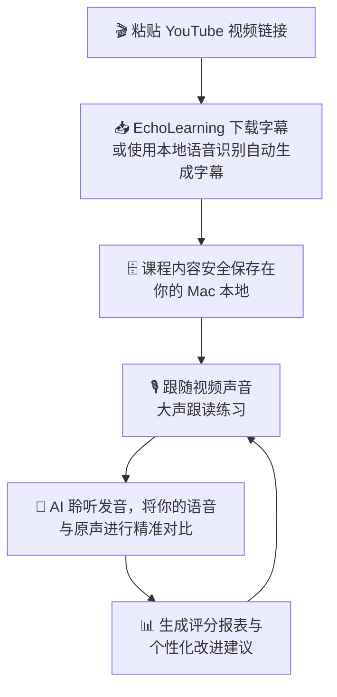

**通俗易懂的流程说明：**
1. **粘贴链接** —— 提供任意一段英语或日语的 YouTube 视频链接给 EchoLearning。
2. **生成课程** —— 应用会自动提取视频字幕（若没有字幕，则调用本地语音识别生成）。对于日语视频，它还会自动在较难的汉字上方标注假名注音（振假名 / Furigana）。
3. **开口练习** —— 在两种模式间自由选择：逐句听读跟读，或者跟随视频进行不间断的流式同步跟读。
4. **获取反馈** —— AI 会从发音、节奏、语速和语调四个维度分析你的表现，给出百分制评分及针对性的改进小技巧。
5. **巩固提升** —— 针对薄弱短语反复练习，见证你的分数不断攀升！

---

# 第二部分：快速入门指南

## 准备工作（硬件与软件）

### 电脑配置要求

| 需求项 | 详细说明 |
|:---|:---|
| **电脑** | Mac（Intel 芯片或 Apple Silicon M1/M2/M3/M4 系列） |
| **操作系统** | macOS 12 (Monterey) 或更新版本 |
| **内存（RAM）** | 最低 8 GB · 建议 16 GB · 运行高级 AI 模型推荐 32 GB 及以上 |
| **可用硬盘空间** | 至少 15 GB（AI 模型文件大小在 5–22 GB 之间，取决于你的选择） |
| **麦克风** | Mac 自带麦克风或任何 USB/蓝牙耳机麦克风 |
| **网络连接** | 仅在初次安装以及下载视频素材时需要联网。日常跟读练习 100% 完全离线！ |

### 你的 Mac 适合运行哪个 AI 模型？

```text
┌───────────────────────────────────────────────────────────────────────┐
│  🖥️  你的 MAC 设备                   →  推荐配置的 AI 模型           │
├───────────────────────────────────────────────────────────────────────┤
│  8 GB MacBook Air (M1/M2/M3)         →  Qwen3.5-4B（轻量快速）       │
│  16 GB Mac（Intel 或 Apple Silicon） →  Qwen3.5-9B（官方推荐 ⭐）    │
│  32 GB+ Mac（M 系列 Pro/Max）        →  Qwen3.5-27B 或 35B（高精度） │
└───────────────────────────────────────────────────────────────────────┘
```

> [!TIP]
> **不知道自己的 Mac 有多少内存？**
> 点击屏幕左上角的苹果图标（🍎）→ “关于本机” → 查看“内存”一项即可。

### 需提前安装的软件

在配置 EchoLearning 之前，你需要先在电脑上安装两款免费工具：

1. **Homebrew** —— Mac 上的包管理器（Package Manager，用于轻松安装各类工具与软件的实用工具）。
   - 如果尚未安装，请打开“终端”（Terminal）并粘贴以下命令运行：
     ```bash
     /bin/bash -c "$(curl -fsSL https://raw.githubusercontent.com/Homebrew/install/HEAD/install.sh)"
     ```

2. **Git** —— 用于从互联网下载代码的工具。
   - 在“终端”中运行以下命令即可安装：
     ```bash
     xcode-select --install
     ```

> [!NOTE]
> **什么是“终端”（Terminal）？**
> “终端”是 Mac 自带的命令行工具，用户可以在其中输入文本指令。按下 `Cmd + 空格键`，输入“Terminal”或“终端”，按回车键即可快速打开。

---

## 安装方式 —— 简易安装（推荐）

这是最快捷的上手方式。只需一条命令即可搞定一切：自动下载 EchoLearning、安装所需依赖项并配置 AI 模型。

### 步骤 1：打开终端 (Terminal)

按下 `Cmd + 空格键`，输入“Terminal”，按回车打开。

### 步骤 2：粘贴并执行此命令

```bash
curl -fsSL https://raw.githubusercontent.com/NinjaRoboticsEducation/EchoLearning/HEAD/scripts/install.sh | bash
```

### 步骤 3：选择你的 AI 模型

安装脚本会提示你选择想要下载的 AI 模型。如果不确定，直接按下 **回车键** 即可采用推荐的默认配置。

### 步骤 4：等待模型下载完成

AI 模型是较大的文件（5–20 GB）。下载所需时间取决于你的网速。如果不小心网络中断也不必担心 —— 重新运行该命令即可断点续传。

### 步骤 5：启动 EchoLearning

```bash
cd EchoLearning
./scripts/start_all.sh
```

你的浏览器将自动打开应用界面。现在就可以开始练习啦！🎉


---

## 安装方式 —— 手动安装（适合喜欢掌控细节的用户）

如果你希望一步一步查看每个安装细节：

### 步骤 1：下载 EchoLearning 代码仓库

```bash
git clone https://github.com/NinjaRoboticsEducation/EchoLearning.git
cd EchoLearning
```

### 步骤 2：运行环境配置脚本

```bash
./setup.sh
```

此操作将：
- 安装必要的系统工具（ffmpeg、Python、Node.js 以及 AI 推理引擎）
- 创建应用专用的运行环境
- 编译并构建前端网页界面
- 提示你选择并下载 AI 模型

### 步骤 3：启动 EchoLearning

```bash
./scripts/start_all.sh
```

浏览器将自动打开并访问 `http://localhost:5173`。

---

## 启动 EchoLearning

以后每次想要练习时，只需在终端中运行：

```bash
cd EchoLearning
./scripts/start_all.sh
```

> [!TIP]
> **想要更方便的桌面快捷方式？**
> 你可以在桌面上创建一个名为 `EchoLearning.command` 的文件，内容如下：
> ```bash
> #!/bin/bash
> cd "/path/to/EchoLearning"
> ./scripts/start_all.sh
> ```
> 然后在终端中运行 `chmod +x ~/Desktop/EchoLearning.command` 赋予其执行权限。之后只需双击该桌面图标就能一键启动！

---

## 开始你的第一次练习

### 1. 生成课程

1. 在首页中，粘贴一个 YouTube 视频链接（例如：`https://www.youtube.com/watch?v=...`）。
2. 选择学习语言：**英语**（English）或**日语**（Japanese）。
3. 点击 **生成学习课件**（Generate Learning Transcript）。
4. 课件生成后会自动保存 —— 以后随时都能练习，甚至完全不需要网络连接！

### 2. 进入练习工作台 (Practice Studio)

点击任意已保存的课程即可进入练习工作台。选择适合你的练习模式：

| 模式 | 运作方式 | 最佳适用场景 |
|:---|:---|:---|
| **🎯 逐句听读跟读 (Listen-Then-Repeat)** | 视频播放一句话后自动暂停，由你进行复述 | 初学者、追求精细纠音练习 |
| **🌊 流式同步跟读 (Simultaneous Shadowing)** | 视频不间断连续播放，你实时同步开口跟读（单次最长支持 60 分钟） | 中高阶学习者、强化语流与流利度 |

### 3. 开口练习并获取反馈

1. **开口发音** —— AI 会实时展示语音转文字的结果。
2. **点击“完成录音” (Finish Recording)** —— 系统将对你的完整发音进行转录。
3. **点击“分析跟读表现” (Analyze Shadowing Result)** —— 获取全面的评分报表。

### 4. 解读你的得分

你的综合成绩由 4 个维度构成：

```text
┌─────────────────────────────────────────────┐
│               你的跟读综合评分              │
├─────────────────────────────────────────────┤
│  📝 文本准确度 (35%)                        │
│     单词读对了吗？是否有漏词或加词？        │
│                                             │
│  🗣️ 发音标准度 (25%)                        │
│     每个音节的发音清晰度和准确度如何？      │
│                                             │
│  🏃 语流流利度 (25%)                        │
│     说话的节奏与语速是否自然连贯？          │
│                                             │
│  🎵 抑扬顿挫/韵律 (15%)                     │
│     声调起伏与重音分布是否地道自然？        │
│                                             │
│  🏆 综合得分：78/100                        │
│  💡 建议：“尝试在‘東京 (Tōkyō)’的长音部分   │
│      适当放慢节奏！”                        │
└─────────────────────────────────────────────┘
```

文本中每个单词均有颜色高亮标注：✅ 绿色（发音正确）、🔴 红色（遗漏跳过）、🟡 黄色（读错词汇）、🔵 蓝色（发音模糊不清）。

---

## 核心功能一览

### 📖 语境词典 (Contextual Dictionary)
点击学习课件中的任意单词，即可查看：
- 该单词**在当前句子具体语境下**的准确释义
- 读音指南（英语显示国际音标 IPA，日语显示假名标注 Furigana）
- 音调高低核对（日语声调 Pitch Accent 走向）
- 真人发音朗读（离线即时播放音频）
- 一键收藏至“生词本”（Vocabulary）

### ✏️ 可编辑的课件文本 (Editable Transcripts)
YouTube 自带字幕并不总是百分之百准确。只需点击任意句子旁边的编辑按钮，即可快速修正错别字或识别失误。对于日语文本，汉字上方的振假名注音会自动同步更新。

### 💾 随心保存，随时离线练习 (Save & Practice Later)
所有生成的课件都会完整保存在你的 Mac 本地。你可以在浏览到感兴趣的视频时随手生成课件，几天或几周之后随时打开练习 —— 全程无需网络连接。

### 🔄 随时切换 AI 模型 (Switch AI Models Anytime)
在应用首页，通过 **模型选择**（Model Selection）下拉菜单即可无缝切换已安装的不同 AI 模型 —— 无需重启任何服务。

---

## 关闭与退出

提供两种简便的退出方式：

1. **在网页界面中：** 点击顶部导航栏的 **SHUT DOWN**（关机/退出）按钮。
2. **在终端中：** 在 EchoLearning 项目目录下运行 `./scripts/stop.sh`。

两种方式都会安全优雅地停止所有后台服务，并彻底释放 Mac 的系统内存。

---

## 卸载 EchoLearning

### 快速决策指南

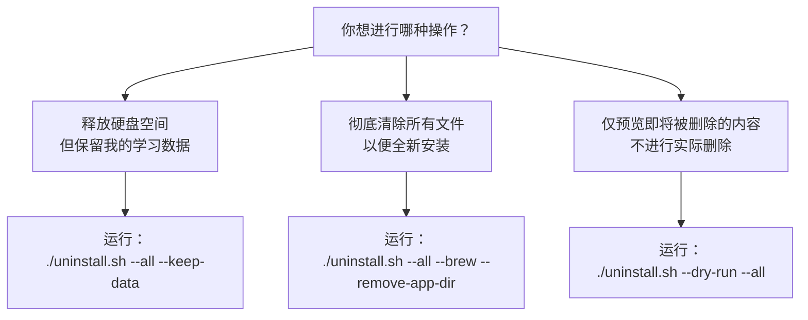

### 常用卸载命令速查

| 需求目标 | 执行命令 | 释放空间 |
|:---|:---|:---|
| 释放空间，**保留**学习记录与生词 | `./uninstall.sh --all --keep-data` | 7–25 GB |
| 完全重置，先**备份**学习数据 | `./uninstall.sh --all --backup-dir ~/Desktop` | 7–25 GB |
| **彻底删除**所有相关组件及应用目录 | `./uninstall.sh --all --brew --remove-app-dir` | 高达 26+ GB |
| **仅预览操作**（不删除任何文件） | `./uninstall.sh --dry-run --all` | 0 GB |
| **交互式向导**（按步骤逐项确认） | `./uninstall.sh` | 自主选择 |

> [!IMPORTANT]
> 除非你明确要求删除，否则你的学习数据（生词本、练习评分、录音文件）**绝不会被意外清理**。`--keep-data` 参数可以确保即使在移除体积庞大的 AI 模型时，你的宝贵数据也完好无损。

### 清理后的重新安装

- **如果你保留了项目文件夹：** 只需依次运行 `./setup.sh` 和 `./scripts/start_all.sh`。
- **如果你清除了所有文件：** 重新执行单行安装命令即可（参见 [安装方式 —— 简易安装](#installation--the-easy-way-recommended)）。

---

## 从 iPhone 和 iPad 远程访问（通过 Tailscale）

想在咖啡厅或沙发上用手机、平板练习，同时让家里的 Mac 承担全部 AI 计算工作？

**Tailscale** 可以在你的各台设备之间建立一条专属的加密虚拟隧道 —— 无需复杂的网络设置，也无需担心暴露公网带来的安全隐患。

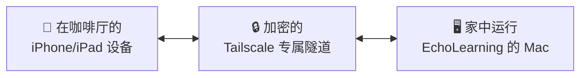

### 3 分钟极速配置流程

1. **在你的 Mac 上安装 Tailscale：**
   ```bash
   brew install --cask tailscale
   ```
   或者直接从 Mac App Store 下载安装。打开并登录你的账号。

2. **获取你的 Mac 的 Tailscale 局域网 IP 地址：**
   ```bash
   tailscale ip -4
   ```
   屏幕上会输出类似 `100.64.0.10` 的专属 IP 地址。

3. **在 iPhone/iPad 上安装 Tailscale**（在 App Store 中搜索并下载）。登录与 Mac 相同的账号。

4. **在手机或平板上打开 Safari 浏览器**，访问：
   ```
   http://100.64.0.10:3000
   ```
   （将其中的 IP 地址替换为你在第 2 步中查到的 Mac 地址。）

大功告成！现在你可以在任何地方随时展开口语跟读练习啦。🎉

> [!TIP]
> **在“设置”中随心掌控远程访问权限：**
> 在应用的“设置”（Settings）页面中，你可以一键开启或关闭 Tailscale 远程访问。一旦关闭，就只有本机的 Mac 能够连接 EchoLearning —— 所有外部远程设备将被立即阻断。

---

## 连接 AI 编程助手（MCP）

如果你正在使用 **Claude Code**、**OpenAI Codex** 或 **Google Antigravity** 等 AI 编程助手，可以通过 **MCP（模型上下文协议 / Model Context Protocol）** 将它们与 EchoLearning 连接起来。MCP 是一项开放标准，旨在让大模型能够安全调用外部应用与工具。

连接之后，你的 AI 助手便拥有了以下能力：
- 在对话中直接根据你给出的 YouTube 链接生成全新课件
- 调取你保存的生词本并为你进行词汇小测验
- 导出并整理你的历史学习轨迹与分析报告

### 主流 AI 助手的配置方法

**Claude Code:**
```bash
claude mcp add echolearning /path/to/EchoLearning/scripts/start_mcp.sh
```

**OpenAI Codex** (`~/.codex/config.toml`):
```toml
[mcp_servers.echolearning]
command = "/path/to/EchoLearning/scripts/start_mcp.sh"
```

**Google Antigravity** (`mcp_config.json`):
```json
{
  "mcpServers": {
    "echolearning": {
      "command": "/path/to/EchoLearning/scripts/start_mcp.sh"
    }
  }
}
```

如需查阅全部 13 项支持的 MCP 工具详情，请参阅附录中的 [MCP 工具速查表](#mcp-tools-reference-table)。

---

# 第三部分：附录

## 故障排查与常见问题（FAQ）

### 浏览器中无法使用麦克风

1. **检查 macOS 系统权限：** 进入 **系统设置 → 隐私与安全性 → 麦克风**，确保已允许你所使用的浏览器访问麦克风。
2. **检查浏览器站点权限：** 点击浏览器地址栏左侧的“小锁/设置”图标，确保麦克风权限已设为“允许”。
3. **关于远程访问时的麦克风说明：** 麦克风在访问 `http://localhost` 和 `http://127.0.0.1` 时默认处于受信任环境。如果通过 Tailscale 远程连接，请确保浏览器允许非 HTTPS 站点使用麦克风，或配置 Tailscale Serve 以启用私有 HTTPS 证书加密访问。

### 报错提示“端口 3000 / 8080 / 8081 / 5173 已被占用”（Port already in use）

在终端中执行以下命令：
```bash
./scripts/stop.sh
```
该命令会自动清理之前残留的后台进程。此外，每次重新启动 EchoLearning 时，系统也会自动检测并清理陈旧僵尸进程。

若问题仍未解决，可能是其他第三方应用程序占用了该端口。可通过以下命令定位占用程序：
```bash
lsof -i :3000 -i :8080 -i :8081 -i :5173
```

### AI 模型下载过程中断

完全不必担心！下载脚本支持断点续传。只需在终端中重新执行：
```bash
./scripts/download_models.sh
```
程序会自动检测已下载的内容并继续剩余部分的下载。

### 8 GB 内存的 Mac 可以运行 EchoLearning 吗？

完全可以！在初次配置时选择轻量级的 **Qwen3.5-4B** 模型即可。它仅占用约 4 GB 运行内存，在 8 GB 的 Mac 设备上表现十分流畅。

### 无字幕的日语视频报错无法提取

对于未自带现成字幕的视频，EchoLearning 需要依赖 `ffmpeg` 与 `yt-dlp` 来下载音频并调用本地语音识别模型转写文本。请通过终端补充安装：
```bash
brew install ffmpeg yt-dlp
```
注意：部分受到数字版权保护（DRM）或特殊限制的音乐 MV 与直播流可能无法正常下载。日常对话、播客访谈以及新闻短片的效果最为理想。

### 我的学习数据保存在哪里？

你的全部学习资料都存放在 EchoLearning 项目目录下的 `data/` 文件夹中：
- **核心数据库：** `data/echolearning.sqlite3`
- **语音录音文件：** `data/audio/`

如需备份数据，可选择以下任意一种方式：
- 在网页界面中进入 **设置 → 学习数据备份 → 生成备份文件**（Generate Backup）
- 手动将整个 `data/` 文件夹复制到其他安全位置保存

---

## 选择适合你的 AI 模型（详细硬件配置指南）

EchoLearning 在本地协同运行两套 AI 模型：一套是**大语言模型**（LLM，负责对话辅导、语境释义与点评），另一套是**语音识别模型**（ASR，负责精准听辨你的口语发音）。其中语音识别模型对所有配置均保持统一；你可以根据自己 Mac 的内存规格，挑选最契合的语言模型：

| 模型型号 | 下载大小 | 所需内存 (RAM) | 适用场景 | 表现品质 |
|:---|:---:|:---:|:---|:---|
| **Qwen3.5-4B** (Q6_K) | 3.3 GB | 约 4 GB | 8–16 GB 内存的 Mac，响应速度极快 | 良好 —— 适合快速查词与基础释义 |
| **Qwen3.5-9B** (Q4_K_M) | 5.3 GB | 约 6 GB | 追求更低内存开销的 16 GB Mac 设备 | 非常优秀 —— 兼顾性能与画质的均衡之选 |
| **Qwen3.5-9B** (Q6_K) ⭐ | 7.0 GB | 约 8 GB | 16–24 GB 内存的 Mac（官方推荐默认选项） | 卓越绝伦 —— 绝大多数用户的理想之选 |
| **Qwen3.5-27B** (Q4_K_M) | 15.6 GB | 约 17 GB | 32 GB 及以上内存的 Mac 高配机型 | 专业旗舰 —— 深刻理解细腻的日语音调与复杂语法 |
| **Qwen3.5-35B-A3B** (Q4_K_M) | 20.5 GB | 约 22 GB | 32–64 GB+ 内存的顶级 M 系列芯片设备 | 终极巅峰 —— 规模庞大且运算速度飞快 |
| **Whisper Large-v3-Turbo** (语音识别) | 1.5 GB | 约 1.6 GB | 适配所有机型（系统安装时自动配置） | — |

> [!TIP]
> 你可以在电脑中同时安装多个模型，并在应用首页的下拉菜单中即时自由切换，无需重启任何进程。后续如需下载额外模型，只需运行 `./scripts/download_models.sh` 即可。

---

## MCP 工具速查表

EchoLearning 共对外提供 13 项专有 MCP 工具，支持本地 stdio 以及 HTTP 协议调用（HTTP 接口地址：`http://127.0.0.1:3000/mcp`）：

| 工具名称 (Tool) | 功能说明 |
|:---|:---|
| `get_capabilities` | 检测系统运行状态及当前已加载的活跃 AI 模型 |
| `fetch_transcript` | 输入 YouTube 链接并自动提取/生成学习课件 |
| `start_transcript_job` | 在后台启动长视频的耗时字幕转录任务 |
| `get_job_status` | 查询指定后台长视频转写任务的执行进度 |
| `cancel_job` | 取消正在运行中的后台转写任务 |
| `retokenize_text` | 对文本进行重新分词，生成语法标记与振假名注音 |
| `lookup_word` | 查询目标单词在当前具体上下文语境中的精准释义 |
| `save_vocabulary` | 将生词及其例句释义一键收藏至生词本 |
| `list_vocabulary` | 浏览与检索已保存的全部生词卡片 |
| `list_materials` | 获取本地已保存的所有学习课件列表 |
| `list_history` | 查看以往所有的跟读练习历史记录与评分报表 |
| `pronounce_text` | 为任意指定单词或长句生成离线语音示范朗读 |
| `export_study_data` | 将个人学习数据整体导出为 JSON 或 CSV 文件 |

---

## 卸载脚本详细参数参考

### 完整命令行选项 (Flags)

| 选项参数 | 作用说明 |
|:---|:---|
| `--dry-run` | 仅演练预览即将被清理的目标（不会执行任何实际删除） |
| `--deps-only` | 仅清除开发依赖与虚拟环境（保留 AI 模型与个人学习数据） |
| `--all` | 彻底清除依赖环境、下载的 AI 模型以及所有学习数据 |
| `--keep-data` | 与 `--all` 连用，在清除其他内容时强制保留个人学习数据 |
| `--keep-models` | 与 `--all` 连用，在清除其他内容时强制保留已下载的 AI 模型 |
| `--backup-dir <folder>` | 在执行清除操作之前，自动将学习数据完整备份至指定目录 |
| `--brew` | 同步卸载通过 Homebrew 安装的 AI 推理底层引擎（llama.cpp、whisper-cpp） |
| `--remove-app-dir` | 在完成清理后，顺便将 EchoLearning 整个项目文件夹从磁盘中删除 |
| `-y` / `--yes` | 跳过所有确认提示，直接静默执行 |
| `--non-interactive` | 非交互模式运行，适用于自动化脚本 |
| `--project-root <dir>` | 手动指定需要卸载的 EchoLearning 项目根目录绝对路径 |

### 内置安全防护机制

- **受保护系统路径白名单：** 严禁对系统关键路径（如 `/`、`/System`、`/Applications` 等）执行清理操作。
- **项目特征签名核验：** 在执行任何删除前，严格验证目标目录是否确实属于 EchoLearning 项目。
- **安全的 Homebrew 清理逻辑：** 仅精确卸载 `llama.cpp` 和 `whisper-cpp` —— 绝不会触碰系统中的 `ffmpeg`、`node`、`git` 或 `python`。
- **学习数据物理隔离保护：** 除非使用者显式传参或在向导中主动确认，否则绝不擅自删除任何宝贵的学习记录与录音。

---

## 术语表

| 术语 | 详细释义 |
|:---|:---|
| **Shadowing（影子跟读）** | 一种高效口语训练方法：一边听母语者说话，一边以几乎重合的极短延迟大声模仿复述，精准拿捏语速与语调 |
| **Furigana（振假名）** | 标注在日本汉字上方的小字平假名，用于提示汉字的准确读法与发音 |
| **Pitch Accent（声调高低音）** | 日语中通过音高升降变化来区分不同词义的语音高低音律模式 |
| **IPA（国际音标）** | International Phonetic Alphabet —— 一套用于精准记录人类语言发音的世界通用标音符号系统 |
| **Mora（拍 / 音拍）** | 日语发音中基本的等长韵律节奏单位。例如“东京”（とうきょう）共包含 4 拍：と・う・きょ・う |
| **LLM（大语言模型）** | Large Language Model —— 具备深度语言理解与生成能力的 AI 核心（例如 Qwen3.5） |
| **GGUF** | 一种专为在个人本地电脑上高效率运行 AI 模型而设计的通用量化文件格式 |
| **Quantization（模型量化）** | 一种模型压缩技术，可在几乎不损耗模型能力的前提下显著降低内存占用与硬件消耗 |
| **ASR（自动语音识别）** | Automatic Speech Recognition —— 将人类发出的声音信号转化为电子文字的技术（如 Whisper 所具备的能力） |
| **MCP（模型上下文协议）** | Model Context Protocol —— 一项使 AI 助手能够规范调用外部各类工具与数据的开放协议标准 |
| **SQLite** | 一种嵌入式轻量级数据库，将所有应用数据整合存储在本地单一数据文件中 |
| **Tailscale** | 一款安全便捷的组网工具，可在你的手机、电脑等私有设备之间搭建点对点加密局域网 |
| **ADK（智能体开发框架）** | Agent Development Kit —— Google 推出的用于构建协同智能体应用的开源框架 |
| **Homebrew** | macOS 平台最广泛使用的开源包管理器，允许用户在终端中便捷安装各种软件与开发依赖 |

---

## 系统架构图

如果你对底层的技术架构与实现原理感兴趣，以下是各模块之间的协同工作关系：

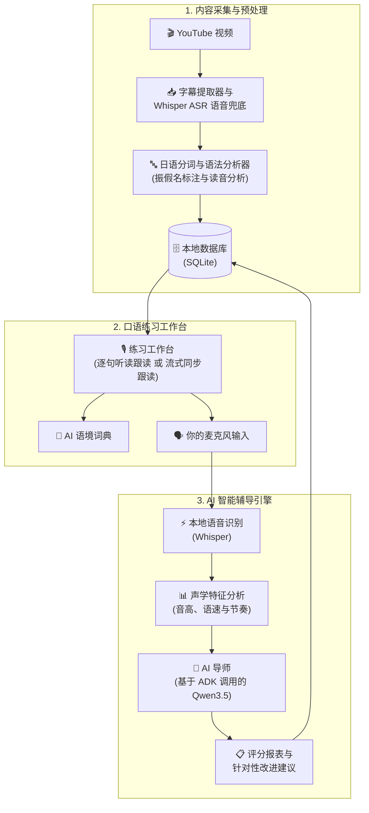

### 后台服务一览（EchoLearning 运行时各端口所承载的服务）

| 服务名称 | 端口 | 功能作用 |
|:---|:---:|:---|
| llama-server | 8080 | 承载本地 AI 大语言模型的推理运算 |
| whisper-server | 8081 | 承载本地语音识别（ASR）的实时推理转录 |
| FastAPI 后端 | 3000 | 调度核心应用业务逻辑、处理音频数据并管理存储 |
| Vite 前端 | 5173 | 提供优雅流畅的 Web 用户交互界面 |

---

## 运行测试（面向开发者）

```bash
# Python 后端测试套件
./adk_backend/.venv/bin/pytest tests/ -v

# TypeScript 代码规范检查
npm run lint

# 构建生产环境前端资源
npm run build

# 检查系统健康运行状态
curl -s http://127.0.0.1:3000/api/health | jq .
```

---

## 开源许可与鸣谢

EchoLearning 遵循 **Apache License 2.0** 开源许可证，完全免费且向所有人开放源代码。

本项目衷心感谢以下优秀的开源技术与社区项目：
- [Google ADK](https://github.com/google/adk-python) — 智能体协同编排
- [llama.cpp](https://github.com/ggml-org/llama.cpp) — 本地 AI 高性能推理
- [whisper.cpp](https://github.com/ggml-org/whisper.cpp) — 本地语音识别
- [Qwen3.5](https://github.com/QwenLM/Qwen2.5) — 多语言大语言模型
- [Fugashi](https://github.com/polm/fugashi) 与 [UniDic](https://ccd.ninjal.ac.jp/unidic/) — 日语分词与形态学分析
- [FastAPI](https://fastapi.tiangolo.com/) — Python Web API 框架
- [React 19](https://react.dev/) 与 [Tailwind CSS](https://tailwindcss.com/) — 前端现代化用户界面
- [FastMCP](https://modelcontextprotocol.io/) — AI 助手标准工具集成
- [Tailscale](https://tailscale.com/) — 零配置私有安全组网

---

<p align="center">用心制作 ❤️，献给全世界每一位语言学习者。祝你跟读愉快，口语更上一层楼！🎧</p>
