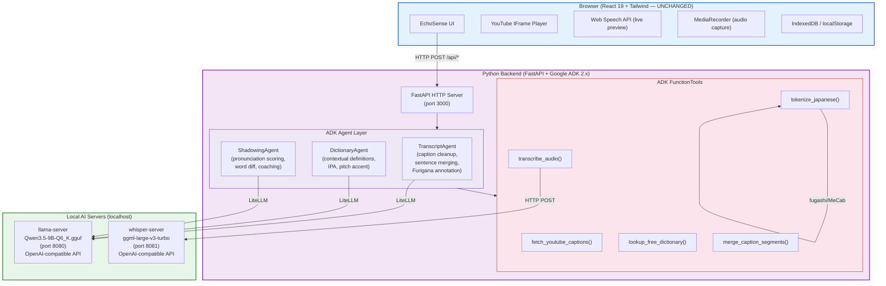
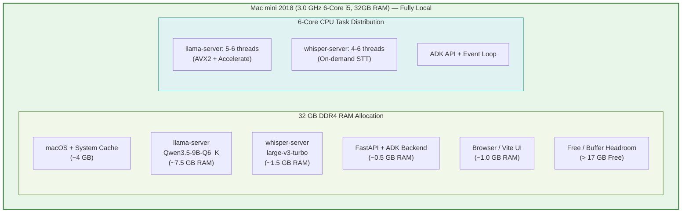
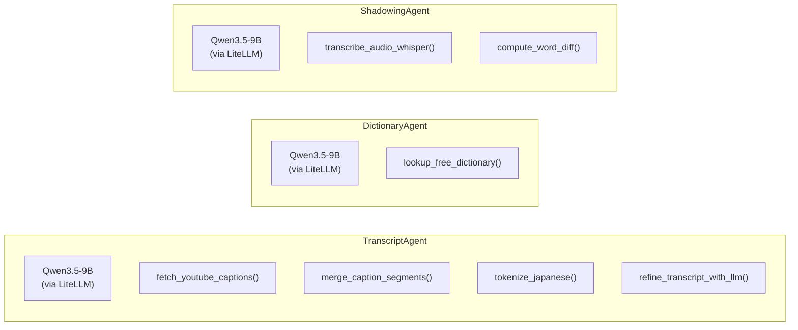

# EchoSense — Local ADK Transition Plan

**Transitioning from Cloud Gemini to Local AI with Google ADK 2.x, Qwen3.5-9B & Whisper**

> [!NOTE]
> This plan transitions the existing EchoSense web application — an English & Japanese YouTube shadowing studio — from cloud-hosted Gemini API calls (`gemini-3.8-flash` & `gemini-3.5-transcribe`) to a fully local AI stack powered by Google's Agent Development Kit (ADK) 2.x framework, a locally-running Qwen3.5-9B language model (via `llama.cpp`), and local Whisper speech-to-text (via `whisper.cpp`). Every existing feature is preserved; the app will run entirely on `localhost` with zero cloud API dependencies for AI inference.

---

## Table of Contents

1. [Executive Summary](#1-executive-summary)
2. [Glossary — Key Terms Explained](#2-glossary--key-terms-explained)
3. [What We Have Today — Current Architecture](#3-what-we-have-today--current-architecture)
4. [Where We're Going — Target Architecture](#4-where-were-going--target-architecture)
5. [Side-by-Side Comparison — Before vs. After](#5-side-by-side-comparison--before-vs-after)
6. [Prerequisites & Environment Setup](#6-prerequisites--environment-setup)
   - [Target Hardware Specification & Capacity](#target-hardware-specification--capacity)
   - [Hardware Requirements & Capability Profile](#hardware-requirements--capability-profile)
   - [Scope & Architectural Clarifications](#scope--architectural-clarifications)
   - [Software Requirements](#software-requirements)
   - [Model Files to Download](#model-files-to-download)
7. [Phased Implementation Plan](#7-phased-implementation-plan)
   - [Phase 0: Project Scaffolding & Local Infrastructure](#phase-0-project-scaffolding--local-infrastructure)
   - [Phase 1: Local LLM Server — llama.cpp + Qwen3.5-9B](#phase-1-local-llm-server--llamacpp--qwen35-9b)
   - [Phase 2: Local STT Server — whisper.cpp](#phase-2-local-stt-server--whispercpp)
   - [Phase 3: Google ADK 2.x Agent Layer — Python Backend](#phase-3-google-adk-2x-agent-layer--python-backend)
   - [Phase 4: FastAPI Bridge — Connecting ADK Agents to the Frontend](#phase-4-fastapi-bridge--connecting-adk-agents-to-the-frontend)
   - [Phase 5: Frontend Integration & API Migration](#phase-5-frontend-integration--api-migration)
   - [Phase 6: End-to-End Testing & Validation](#phase-6-end-to-end-testing--validation)
   - [Phase 7: Performance Tuning & Polish](#phase-7-performance-tuning--polish)
8. [Risk Register & Mitigations](#8-risk-register--mitigations)
9. [File Structure — Final Project Layout](#9-file-structure--final-project-layout)
10. [Appendix: Launch Commands Cheat Sheet](#10-appendix-launch-commands-cheat-sheet)

---

## 1. Executive Summary

EchoSense currently runs as a Node.js/Express + React web app that talks to Google's cloud Gemini models for four core AI tasks:

1. **Transcript refinement** — merging and punctuating raw YouTube captions into natural sentences
2. **Contextual dictionary lookup** — providing bilingual word definitions with Furigana, IPA, and pitch accent
3. **Speech-to-text transcription** — converting the learner's recorded audio into a verbatim text transcript
4. **Multimodal shadowing assessment** — scoring the learner's pronunciation, fluency, prosody, and content accuracy

The goal of this transition is to replace every cloud Gemini call with local AI inference while wrapping the intelligence layer in Google's ADK 2.x agent framework. This gives us:

- **Full offline operation** — no internet needed for AI inference (YouTube playback still requires internet)
- **Zero recurring API costs** — the Gemini API key is no longer needed for core AI tasks
- **Privacy** — all audio and text processing stays on the user's machine
- **ADK-native architecture** — organized, testable agents with proper tool definitions, ready for future multi-agent expansion

The frontend (React 19 + Tailwind CSS) and all browser-side features (YouTube IFrame Player, `MediaRecorder`, `Web Speech API`, `IndexedDB` storage) remain completely unchanged.

---

## 2. Glossary — Key Terms Explained

Before diving in, here are the technical terms used throughout this plan, explained in plain English:

| Term | What It Means |
|:---|:---|
| **ADK (Agent Development Kit)** | Google's open-source Python framework for building AI agents. Think of it as a toolkit that helps you organize AI logic into reusable "agents" that can call "tools" (functions) to get things done. |
| **LLM (Large Language Model)** | The AI brain — a neural network trained on text that can understand and generate language. Qwen3.5-9B is one such model. |
| **llama.cpp** | A lightweight C++ program that can run LLM models locally on your computer without needing cloud servers or expensive GPUs. It loads model files in GGUF format. |
| **GGUF** | A file format for storing compressed AI models. The "Q6_K" in `Qwen3.5-9B-Q6_K.gguf` means the model is quantized (compressed) to use about 6 bits per parameter instead of 16, making it much smaller and faster while keeping most of its intelligence. |
| **whisper.cpp** | A C++ implementation of OpenAI's Whisper speech recognition model. It converts spoken audio into text entirely on your local machine. |
| **STT (Speech-to-Text)** | The process of converting spoken audio into written text. Whisper does this. |
| **OpenAI-Compatible API** | A standardized way to talk to AI models over HTTP. Both `llama.cpp` and `whisper.cpp` can expose endpoints that look exactly like OpenAI's cloud API, so any software designed for OpenAI can talk to your local models instead. |
| **LiteLLM** | A Python library that acts as a universal translator between different AI model providers. ADK uses it to connect to non-Google models like our local Qwen via llama.cpp. |
| **FastAPI** | A modern Python web framework for building REST APIs quickly. We use it to serve the ADK agents to our React frontend. |
| **FunctionTool** | An ADK concept — a regular Python function that an agent can "call" when it needs to perform a specific task (like looking up a word in a dictionary or sending audio to Whisper for transcription). |
| **LlmAgent** | An ADK concept — an AI agent powered by a language model that can reason about user requests and decide which tools to use. |
| **Kuromoji / fugashi** | Japanese text analysis libraries that break sentences into individual words and provide readings — essential for generating Furigana (the small reading characters above Kanji). |
| **Furigana (振り仮名)** | Small Hiragana characters placed above Kanji characters to show how to read them. For example: 漢字 → 漢(かん)字(じ). |
| **IPA (International Phonetic Alphabet)** | A standardized set of symbols for representing speech sounds. For example, the English word "think" is written as /θɪŋk/ in IPA. |

---

## 3. What We Have Today — Current Architecture

```mermaid
graph TB
    subgraph Browser ["Browser (React 19 + Tailwind CSS)"]
        UI["EchoSense UI"]
        YT["YouTube IFrame Player"]
        WS["Web Speech API (live preview)"]
        MR["MediaRecorder (audio capture)"]
        IDB["IndexedDB / localStorage"]
    end

    subgraph Server ["Node.js + Express Backend (server.ts)"]
        TR["/api/transcript/fetch"]
        DI["/api/dictionary/lookup"]
        TTS["/api/tts/pronounce"]
        SH["/api/shadowing/evaluate"]
        KU["Kuromoji Tokenizer"]
    end

    subgraph Cloud ["Google Cloud (Gemini API)"]
        GF["gemini-3.8-flash<br/>(text reasoning, audio eval,<br/>Furigana, dictionary)"]
        GT["gemini-3.5-transcribe<br/>(verbatim speech-to-text)"]
        GTTS["gemini-3.8-flash-lite-tts<br/>(reference pronunciation)"]
    end

    UI -->|HTTP POST| TR
    UI -->|HTTP POST| DI
    UI -->|HTTP POST| TTS
    UI -->|HTTP POST| SH

    TR -->|@google/genai| GF
    DI -->|@google/genai| GF
    TTS -->|@google/genai| GTTS
    SH -->|@google/genai| GT
    SH -->|@google/genai| GF
    TR --> KU

    style Cloud fill:#fce4ec,stroke:#e53935,stroke-width:2px
    style Browser fill:#e3f2fd,stroke:#1565c0,stroke-width:2px
    style Server fill:#fff3e0,stroke:#ef6c00,stroke-width:2px
```

### Current Files & Their Roles

| File | Size | Role |
|:---|:---|:---|
| `server.ts` | ~50 KB, 1507 lines | Express backend: YouTube caption fetching, Gemini API calls, Kuromoji tokenization, all 5 API endpoints |
| `src/App.tsx` | ~44 KB | Main React app: state management, API call orchestration, UI routing |
| `src/types.ts` | ~3.7 KB | TypeScript interfaces for all data models |
| `src/components/YouTubePlayer.tsx` | ~14 KB | YouTube IFrame Player wrapper with sync hooks |
| `src/components/TranscriptReader.tsx` | ~24 KB | Synchronized transcript display with Furigana and click-to-seek |
| `src/components/DictionaryPopover.tsx` | ~11 KB | Floating dictionary card with contextual definitions |
| `src/components/ShadowingStudio.tsx` | ~31 KB | Dual-mode recording studio with waveform, Web Speech API, audio capture |
| `src/components/PerformanceReport.tsx` | ~17 KB | 4-pillar assessment scorecard and word diff display |
| `src/components/VocabularyAndHistoryViews.tsx` | ~15 KB | Vocabulary vault and session history views |
| `src/services/storage.ts` | ~6 KB | localStorage/IndexedDB persistence, CSV/JSON export |
| `src/utils/youtube.ts` | ~1.1 KB | YouTube URL/ID extraction utility |

### Current API Endpoints — What Each Does

| Endpoint | Gemini Model Used | What It Does |
|:---|:---|:---|
| `POST /api/transcript/fetch` | `gemini-3.8-flash` | Fetches YouTube captions, merges fragments into sentences, OR does full multimodal video transcription for uncaptioned videos |
| `POST /api/transcript/retokenize` | None (Kuromoji only) | Re-tokenizes edited transcript text to regenerate Furigana readings |
| `POST /api/dictionary/lookup` | `gemini-3.8-flash` | Returns contextual word definition, IPA/Furigana, pitch accent, usage examples |
| `POST /api/tts/pronounce` | `gemini-3.8-flash-lite-tts` | Generates reference pronunciation audio for a word or sentence |
| `POST /api/shadowing/evaluate` | `gemini-3.5-transcribe` + `gemini-3.8-flash` | Transcribes learner audio verbatim, then evaluates pronunciation/fluency/prosody with a structured 4-dimension rubric |

---

## 4. Where We're Going — Target Architecture



### Key Design Decisions

1. **The React frontend stays exactly as-is.** We only change the backend that serves the `/api/*` endpoints. The frontend doesn't know or care whether the AI is running in the cloud or on localhost — it just sends the same HTTP requests and gets the same JSON responses.

2. **Three specialized ADK agents** replace the monolithic Gemini calls:
   - **TranscriptAgent** — handles transcript generation, sentence boundary cleanup, and Furigana annotation
   - **DictionaryAgent** — handles contextual word lookups with bilingual definitions
   - **ShadowingAgent** — handles speech evaluation with 4-dimension scoring

3. **ADK FunctionTools** encapsulate deterministic logic (YouTube caption fetching, Japanese tokenization, Free Dictionary API calls, Whisper transcription) so the LLM agents can call them as needed.

4. **Two local AI servers** run as background processes:
   - `llama-server` (port 8080) — serves Qwen3.5-9B for all text generation, reasoning, and structured JSON output
   - `whisper-server` (port 8081) — serves Whisper for audio-to-text transcription

5. **FastAPI** replaces Express as the HTTP server, keeping the same endpoint paths (`/api/transcript/fetch`, `/api/dictionary/lookup`, etc.) so the React frontend needs zero changes.

---

## 5. Side-by-Side Comparison — Before vs. After

| Aspect | Current (Cloud Gemini) | After (Local ADK) |
|:---|:---|:---|
| **AI Backend Language** | TypeScript (Node.js + Express) | Python (FastAPI + Google ADK 2.x) |
| **Text/Reasoning Model** | `gemini-3.8-flash` (cloud API) | Qwen3.5-9B-Q6_K via `llama-server` (local, port 8080) |
| **Speech-to-Text Model** | `gemini-3.5-transcribe` (cloud API) | Whisper large-v3-turbo via `whisper-server` (local, port 8081) |
| **TTS (Text-to-Speech)** | `gemini-3.8-flash-lite-tts` (cloud API) | Deferred (see Phase 7 notes) — browser `SpeechSynthesis` as interim fallback |
| **Japanese Tokenizer** | `kuromoji` (Node.js) | `fugashi` + `unidic-lite` (Python — same MeCab engine, better accuracy) |
| **Agent Framework** | None (raw Gemini SDK calls) | Google ADK 2.x with LlmAgent + FunctionTools |
| **API Key Required?** | Yes (`GEMINI_API_KEY`) | No (fully local inference) |
| **Internet for AI?** | Yes (every AI call hits Google's servers) | No (all AI runs on localhost) |
| **Frontend Changes** | — | **None** (same React app, same API endpoints) |
| **Cost per 1,000 sessions** | ~$1.90–$3.30 | **$0.00** (electricity only) |

> [!IMPORTANT]
> **TTS Transition Note:** The current app uses `gemini-3.8-flash-lite-tts` for reference pronunciation audio. There is no direct local equivalent with the same quality in `llama.cpp`. Phase 7 explores options including browser-native `SpeechSynthesis` API (decent for English, limited for Japanese), local TTS models like Piper or Coqui, or retaining the cloud Gemini TTS as an optional enhancement. The core shadowing and dictionary features work perfectly without TTS.

---

## 6. Prerequisites & Environment Setup

### Target Hardware Specification & Capacity

The designated hardware configuration for this application is:
- **Device**: Mac mini 2018
- **Processor**: 3.0 GHz 6-Core Intel Core i5 (i5-8500B, Coffee Lake architecture, 6 physical cores / 6 threads, AVX2 SIMD vector instructions)
- **Memory**: 32 GB 2666 MHz DDR4 RAM
- **Graphics**: Integrated Intel UHD Graphics 630
- **Operating System**: macOS

### Hardware Requirements & Capability Profile

This 32GB 6-core Intel configuration is exceptionally well-suited to running the entire local AI stack simultaneously:

| Resource | Minimum Requirement | Target Setting (Mac mini 2018) | Headroom & Status |
|:---|:---|:---|:---|
| **RAM** | 16 GB | **32 GB DDR4** | **+23 GB headroom.** Qwen3.5-9B (~7.5 GB) + Whisper Large (~1.5 GB) use ~9 GB total, leaving >20 GB free for macOS, Python runtime, and browser with zero swap. |
| **CPU** | 6-core x86_64 / ARM64 with AVX2 | **3.0 GHz 6-Core Intel Core i5** | AVX2 SIMD acceleration provides fast quantized tensor math across all 6 physical cores. |
| **GPU** | Optional (CPU inference native) | Integrated Intel UHD 630 | CPU-based inference via Apple Accelerate framework + AVX2. |
| **Disk** | 20 GB free | Fast PCIe SSD | Model weights (~9 GB) load in < 5 seconds into RAM. |



### Scope & Architectural Clarifications

1. **Fully Local Workstation Deployment**: All AI models, agents, background servers, and the web interface run on `localhost`. There is no cloud dependency for inference.
2. **Exclusion of Constrained Edge Devices**: Edge platforms with severely constrained memory (e.g., Raspberry Pi Zero 2W with 512MB RAM) are explicitly out of scope for this architecture. The application is built to fully capitalize on 6-core x86_64 CPU compute and generous 32GB RAM capacity.
3. **Core Engineering Guidelines**:
   - **No Automated Shell Installations:** Never use shell scripts or automated routines to silently run package managers (`pip`, `npm`, `brew`). All installations must be presented clearly for user review and explicit confirmation.
   - **Strict Relative Path Discipline:** All file paths, configuration settings, model file locators, and audio buffers MUST resolve relatively (e.g., using `Path(__file__).parent` or `./models/...`). Never hardcode absolute paths like `/Users/...` or `/Volumes/...`.

### Software Requirements

| Software | Version | Purpose |
|:---|:---|:---|
| **Python** | 3.11+ | ADK framework, FastAPI server, tools |
| **Node.js** | 18+ | Frontend dev server (Vite), unchanged |
| **llama.cpp** | Latest (`llama-server` binary) | Local LLM inference server |
| **whisper.cpp** | Latest (`whisper-server` binary) | Local speech-to-text server |
| **CMake** | 3.14+ | Building llama.cpp and whisper.cpp from source |

### Model Files to Download

| Model | File Size | Download Source | Purpose |
|:---|:---|:---|:---|
| `Qwen3.5-9B-Q6_K.gguf` | ~7.5 GB | [Hugging Face](https://huggingface.co/Qwen) | Text reasoning, structured JSON output, dictionary, assessment |
| `ggml-large-v3-turbo.bin` | ~1.5 GB | whisper.cpp models script, or [Hugging Face](https://huggingface.co/ggerganov/whisper.cpp) | Speech-to-text transcription |

---

## 7. Phased Implementation Plan

---

### Phase 0: Project Scaffolding & Local Infrastructure

**Goal:** Create the Python project structure alongside the existing Node.js/React app, and prepare startup scripts.

**Why This Comes First:** Before writing any agent code, we need the folder structure, virtual environment, and configuration files in place. This is pure scaffolding with no AI logic yet.

#### Tasks

**0.1 — Create the Python backend directory structure**

Create a new `adk_backend/` directory at the project root that will house all Python code:

```
EchoLearningV1/
├── adk_backend/                    # NEW — Python ADK backend
│   ├── __init__.py
│   ├── main.py                     # FastAPI app entry point
│   ├── config.py                   # Configuration (ports, model paths)
│   ├── requirements.txt            # Python dependencies
│   ├── .env                        # Local environment variables
│   ├── agents/                     # ADK agent definitions
│   │   ├── __init__.py
│   │   ├── transcript_agent.py
│   │   ├── dictionary_agent.py
│   │   └── shadowing_agent.py
│   ├── tools/                      # ADK FunctionTools
│   │   ├── __init__.py
│   │   ├── youtube_tools.py        # Caption fetching, URL parsing
│   │   ├── tokenizer_tools.py      # Japanese tokenization (fugashi)
│   │   ├── whisper_tools.py        # Local Whisper STT calls
│   │   ├── dictionary_tools.py     # Free Dictionary API lookup
│   │   └── transcript_tools.py     # Caption merging, segment building
│   ├── routes/                     # FastAPI route handlers
│   │   ├── __init__.py
│   │   ├── transcript_routes.py
│   │   ├── dictionary_routes.py
│   │   ├── tts_routes.py
│   │   └── shadowing_routes.py
│   └── utils/                      # Shared utilities
│       ├── __init__.py
│       └── html_utils.py           # HTML entity decoding, text cleanup
├── models/                         # NEW — Local AI model files
│   ├── .gitkeep
│   └── README.md                   # Instructions for downloading models
├── scripts/                        # NEW — Startup & utility scripts
│   ├── start_llama.sh
│   ├── start_whisper.sh
│   └── start_all.sh
├── server.ts                       # EXISTING — will be kept but unused
├── src/                            # EXISTING — React frontend (NO CHANGES)
├── doc/
├── package.json
└── ...
```

**0.2 — Create `requirements.txt`**

```
google-adk>=2.0.0
litellm>=1.84
fastapi>=0.115.0
uvicorn[standard]>=0.30.0
python-dotenv>=1.0.0
fugashi>=1.4.0
unidic-lite>=1.0.8
httpx>=0.27.0
python-multipart>=0.0.9
```

**0.3 — Create `config.py`**

```python
import os
from dotenv import load_dotenv

load_dotenv()

# Local AI server endpoints
LLAMA_SERVER_URL = os.getenv("LLAMA_SERVER_URL", "http://localhost:8080/v1")
WHISPER_SERVER_URL = os.getenv("WHISPER_SERVER_URL", "http://localhost:8081")
LLAMA_MODEL_NAME = os.getenv("LLAMA_MODEL_NAME", "qwen3.5-9b")

# Server configuration
API_PORT = int(os.getenv("API_PORT", "3000"))
FRONTEND_DEV_PORT = int(os.getenv("FRONTEND_DEV_PORT", "5173"))

# Model file paths (relative to project root)
LLAMA_MODEL_PATH = os.getenv("LLAMA_MODEL_PATH", "./models/Qwen3.5-9B-Q6_K.gguf")
WHISPER_MODEL_PATH = os.getenv(
    "WHISPER_MODEL_PATH", "./models/ggml-large-v3-turbo.bin"
)
```

**0.4 — Create startup scripts**

`scripts/start_llama.sh`:
```bash
#!/bin/bash
# Start the local LLM server with Qwen3.5-9B
# The --jinja flag is critical for proper tool/function calling support
llama-server \
  --model ./models/Qwen3.5-9B-Q6_K.gguf \
  --port 8080 \
  --ctx-size 32768 \
  --jinja \
  --threads 6 \
  -ngl 999
```

`scripts/start_whisper.sh`:
```bash
#!/bin/bash
# Start the local Whisper speech-to-text server
whisper-server \
  --model ./models/ggml-large-v3-turbo.bin \
  --host 0.0.0.0 \
  --port 8081 \
  --inference-path "/v1/audio/transcriptions" \
  --threads 4
```

#### Validation Checklist
- [ ] `adk_backend/` directory structure created with all `__init__.py` files
- [ ] `requirements.txt` includes all dependencies
- [ ] Virtual environment created: `python -m venv adk_backend/.venv`
- [ ] Dependencies installed: `pip install -r adk_backend/requirements.txt`
- [ ] Import test passes: `python -c "from google.adk.agents import LlmAgent; print('ADK OK')"`
- [ ] `fugashi` tokenizer test passes: `python -c "import fugashi; t = fugashi.Tagger(); print([w.surface for w in t('東京は晴れです')])"`

---

### Phase 1: Local LLM Server — llama.cpp + Qwen3.5-9B

**Goal:** Get `llama-server` running locally with the Qwen3.5-9B model and verify it can produce structured JSON responses with function/tool calling.

**Why This Matters:** Everything depends on the LLM server working correctly. If Qwen3.5 can't reliably produce structured JSON and handle tool calls through llama.cpp, we need to know immediately before building agent code on top of it.

#### Tasks

**1.1 — Build llama.cpp from source (or install pre-built binary)**

```bash
# Build from source optimized for Mac mini 2018 (Intel x86_64, 6-Core i5):
git clone https://github.com/ggml-org/llama.cpp.git
cd llama.cpp
# On macOS x86_64, Apple's Accelerate Framework and Intel AVX2 instructions are enabled:
cmake -B build -DGGML_NATIVE=ON -DGGML_ACCELERATE=ON
cmake --build build --config Release -j 6

# The binary will be at: build/bin/llama-server
```

> [!TIP]
> On the Mac mini 2018 (3.0 GHz 6-Core Intel Core i5), building with native flags (`-DGGML_NATIVE=ON`) enables hardware AVX2 SIMD vector instructions and Apple's Accelerate framework for high-throughput BLAS math. With 32GB of RAM, the ~7.5GB Q6_K model and full context reside completely in fast physical RAM with over 20GB of headroom.

**1.2 — Download the Qwen3.5-9B-Q6_K GGUF model**

Place the model file at `./models/Qwen3.5-9B-Q6_K.gguf` relative to the project root.

**1.3 — Start the server and verify**

```bash
./llama-server \
  --model ./models/Qwen3.5-9B-Q6_K.gguf \
  --port 8080 \
  --ctx-size 32768 \
  --jinja \
  -ngl 999
```

**1.4 — Validate structured JSON output**

Test that the model can produce JSON matching our assessment schema:

```bash
curl -s http://localhost:8080/v1/chat/completions \
  -H "Content-Type: application/json" \
  -d '{
    "model": "qwen3.5-9b",
    "messages": [
      {"role": "system", "content": "You are a language assessment engine. Respond with valid JSON only."},
      {"role": "user", "content": "Evaluate: target=\"Hello world\", spoken=\"Hello word\". Return JSON with overallScore (0-100), dimensions (contentAccuracy, pronunciation, fluency, prosody each 0-100)."}
    ],
    "response_format": {"type": "json_object"},
    "temperature": 0.3
  }'
```

**1.5 — Validate function/tool calling**

```bash
curl -s http://localhost:8080/v1/chat/completions \
  -H "Content-Type: application/json" \
  -d '{
    "model": "qwen3.5-9b",
    "messages": [
      {"role": "user", "content": "Look up the word \"走る\" in the sentence \"彼は毎朝走る\""}
    ],
    "tools": [{
      "type": "function",
      "function": {
        "name": "lookup_word",
        "description": "Look up a Japanese or English word with contextual meaning",
        "parameters": {
          "type": "object",
          "properties": {
            "word": {"type": "string"},
            "sentence": {"type": "string"},
            "language": {"type": "string", "enum": ["en", "ja"]}
          },
          "required": ["word", "sentence", "language"]
        }
      }
    }],
    "tool_choice": "auto"
  }'
```

#### Validation Checklist
- [ ] `llama-server` starts without errors and loads the model
- [ ] `/v1/chat/completions` returns valid responses
- [ ] Structured JSON output (via `response_format`) produces well-formed JSON
- [ ] Tool/function calling returns proper `tool_calls` objects in the response
- [ ] Response latency is acceptable: < 5 seconds for short prompts on target hardware

---

### Phase 2: Local STT Server — whisper.cpp

**Goal:** Get `whisper-server` running locally and verify it can transcribe English and Japanese audio accurately.

**Why This Matters:** The shadowing assessment relies heavily on accurate speech-to-text transcription of the learner's recorded audio. We need to confirm that local Whisper produces quality comparable to `gemini-3.5-transcribe` for both English and Japanese.

#### Tasks

**2.1 — Build whisper.cpp from source**

```bash
# Build from source optimized for Mac mini 2018 (Intel x86_64, 6-Core i5):
git clone https://github.com/ggml-org/whisper.cpp.git
cd whisper.cpp
cmake -B build -DGGML_NATIVE=ON -DGGML_ACCELERATE=ON
cmake --build build --config Release -j 6

# The binary will be at: build/bin/whisper-server
```

**2.2 — Download the Whisper model**

```bash
# Using the provided download script
bash ./models/download-ggml-model.sh large-v3-turbo

# The model will be at: models/ggml-large-v3-turbo.bin
```

Move or symlink the model file to `./models/ggml-large-v3-turbo.bin` in the EchoSense project root.

**2.3 — Start the Whisper server**

```bash
./whisper-server \
  --model ./models/ggml-large-v3-turbo.bin \
  --host 0.0.0.0 \
  --port 8081 \
  --inference-path "/v1/audio/transcriptions" \
  --threads 4
```

**2.4 — Validate English transcription**

Test with a sample audio file:

```bash
curl --request POST \
  --url http://localhost:8081/v1/audio/transcriptions \
  --header 'Content-Type: multipart/form-data' \
  --form file=@"./test_audio/sample_en.wav" \
  --form model="large-v3-turbo" \
  --form language="en"
```

**2.5 — Validate Japanese transcription**

```bash
curl --request POST \
  --url http://localhost:8081/v1/audio/transcriptions \
  --header 'Content-Type: multipart/form-data' \
  --form file=@"./test_audio/sample_ja.wav" \
  --form model="large-v3-turbo" \
  --form language="ja"
```

#### Validation Checklist
- [ ] `whisper-server` starts and loads the model without errors
- [ ] English audio transcription returns accurate text
- [ ] Japanese audio transcription returns text in Kanji/Kana (not Romaji)
- [ ] Transcription latency is acceptable: < 3 seconds for a 10-second audio clip
- [ ] Server handles `audio/webm` and `audio/wav` input formats

---

### Phase 3: Google ADK 2.x Agent Layer — Python Backend

**Goal:** Implement the three core ADK agents (`TranscriptAgent`, `DictionaryAgent`, `ShadowingAgent`) with their associated FunctionTools, all connected to the local Qwen3.5 model via LiteLLM.

**Why This Is the Core Phase:** This is where we rebuild the AI intelligence layer. Each Gemini API call in the current `server.ts` becomes a combination of an ADK agent (for reasoning and structured output) and FunctionTools (for deterministic operations like YouTube fetching and Japanese tokenization).

#### Architecture of Each Agent



#### Tasks

**3.1 — Create shared LLM configuration (`agents/__init__.py`)**

```python
import os
from google.adk.models.lite_llm import LiteLlm

# Point LiteLLM to the local llama-server
os.environ["OPENAI_API_BASE"] = os.getenv(
    "LLAMA_SERVER_URL", "http://localhost:8080/v1"
)
os.environ["OPENAI_API_KEY"] = "not-needed-for-local"

def get_local_model() -> LiteLlm:
    """Returns the LiteLLM wrapper pointing to our local Qwen3.5 model."""
    return LiteLlm(model="openai/qwen3.5-9b")
```

**3.2 — Implement YouTube & Transcript FunctionTools (`tools/youtube_tools.py`)**

Port the following logic from `server.ts` into Python FunctionTools:

| TypeScript Function (server.ts) | Python FunctionTool | Notes |
|:---|:---|:---|
| `extractYouTubeId()` | `extract_youtube_id()` | Direct port — regex URL parsing |
| `fetchYouTubeOEmbed()` | `fetch_youtube_oembed()` | HTTP call to YouTube oEmbed API |
| `fetchYouTubeCaptionsAndDetails()` | `fetch_youtube_captions()` | Multi-strategy InnerTube caption extraction |
| `parseTimedTextPayload()` | `parse_timed_text()` | XML/JSON caption payload parser |
| `decodeHtmlEntities()` | `decode_html_entities()` | HTML entity cleanup |
| `mergeCaptionLinesIntoCompleteSegments()` | `merge_caption_segments()` | Deterministic segment merging algorithm |

> [!IMPORTANT]
> The YouTube caption fetching and segment merging logic is **deterministic** (no AI needed). It must be ported as-is from the TypeScript to Python, preserving the exact same timing thresholds (`maxChars`, `maxDurationSec`, `minDurationSec`) to ensure identical transcript output. These functions become FunctionTools so the TranscriptAgent can invoke them.

**3.3 — Implement Japanese tokenizer tool (`tools/tokenizer_tools.py`)**

Replace the Node.js `kuromoji` tokenizer with Python's `fugashi` (which uses the same MeCab engine under the hood):

```python
import fugashi

_tagger = None

def get_tagger() -> fugashi.Tagger:
    """Lazy-initialize the MeCab/fugashi Japanese tokenizer."""
    global _tagger
    if _tagger is None:
        _tagger = fugashi.Tagger()
    return _tagger

def tokenize_japanese(text: str) -> list[dict]:
    """Tokenize Japanese text into words with Furigana readings.

    Args:
        text: The Japanese sentence to tokenize.

    Returns:
        A list of word tokens, each with surface form, reading, lemma,
        part of speech, and whether the token contains Kanji.
    """
    tagger = get_tagger()
    tokens = []
    for word in tagger(text):
        surface = word.surface
        has_kanji = any('\u4e00' <= c <= '\u9faf' for c in surface)

        # fugashi provides readings in Katakana; convert to Hiragana
        katakana_reading = word.feature.kana or ""
        hiragana_reading = (
            katakana_to_hiragana(katakana_reading) if has_kanji else ""
        )

        tokens.append({
            "surface": surface,
            "reading": hiragana_reading if has_kanji else None,
            "lemma": word.feature.lemma or surface,
            "pos": word.feature.pos1 or "",
            "isKanji": has_kanji,
        })
    return tokens

def katakana_to_hiragana(text: str) -> str:
    """Convert Katakana characters to Hiragana."""
    return ''.join(
        chr(ord(c) - 0x60) if '\u30a1' <= c <= '\u30f6' else c
        for c in text
    )
```

**3.4 — Implement Whisper STT tool (`tools/whisper_tools.py`)**

```python
import httpx
import base64
import tempfile
import os
from ..config import WHISPER_SERVER_URL

async def transcribe_audio_whisper(
    audio_base64: str,
    mime_type: str = "audio/webm",
    language: str = "en"
) -> str:
    """Transcribe audio using the local Whisper server.

    Converts base64-encoded audio to a temporary file, sends it to the
    local whisper-server for transcription, and returns the text.

    Args:
        audio_base64: The recorded audio encoded as a base64 string.
        mime_type: The MIME type of the audio (e.g., audio/webm, audio/wav).
        language: The language code (en for English, ja for Japanese).

    Returns:
        The verbatim transcription text from Whisper.
    """
    # Decode base64 audio to a temporary file
    ext = ".webm" if "webm" in mime_type else ".wav"
    audio_bytes = base64.b64decode(audio_base64)

    with tempfile.NamedTemporaryFile(suffix=ext, delete=False) as tmp:
        tmp.write(audio_bytes)
        tmp_path = tmp.name

    try:
        async with httpx.AsyncClient(timeout=60.0) as client:
            with open(tmp_path, "rb") as f:
                response = await client.post(
                    f"{WHISPER_SERVER_URL}/v1/audio/transcriptions",
                    files={"file": (f"audio{ext}", f, mime_type)},
                    data={
                        "model": "large-v3-turbo",
                        "language": language,
                        "response_format": "json",
                    },
                )
            response.raise_for_status()
            result = response.json()
            return result.get("text", "").strip()
    finally:
        os.unlink(tmp_path)
```

**3.5 — Implement Free Dictionary API tool (`tools/dictionary_tools.py`)**

```python
import httpx

async def lookup_free_dictionary(word: str) -> dict:
    """Look up an English word in the Free Dictionary API.

    Returns IPA pronunciation, part of speech, and definitions for the
    given English word. This provides verified linguistic data that the
    LLM agent can reference when building contextual dictionary entries.

    Args:
        word: The English word to look up (will be lowercased).

    Returns:
        A dictionary with keys phonetic, definitions, and found.
    """
    try:
        async with httpx.AsyncClient(timeout=10.0) as client:
            resp = await client.get(
                f"https://api.dictionaryapi.dev/api/v2/entries/en/{word.lower()}"
            )
            if resp.status_code == 200:
                data = resp.json()
                first = data[0] if data else {}
                phonetic = (
                    first.get("phonetic", "")
                    or next(
                        (p.get("text", "")
                         for p in first.get("phonetics", [])
                         if p.get("text")),
                        "",
                    )
                )
                defs = []
                for meaning in first.get("meanings", [])[:3]:
                    pos = meaning.get("partOfSpeech", "")
                    definition = (
                        meaning.get("definitions", [{}])[0].get("definition", "")
                    )
                    defs.append(f"{pos}: {definition}")

                return {
                    "found": True,
                    "phonetic": phonetic,
                    "definitions": defs,
                }
    except Exception:
        pass

    return {"found": False, "phonetic": "", "definitions": []}
```

**3.6 — Implement TranscriptAgent (`agents/transcript_agent.py`)**

```python
from google.adk.agents import LlmAgent
from . import get_local_model
from ..tools.youtube_tools import (
    extract_youtube_id,
    fetch_youtube_captions,
    merge_caption_segments,
)
from ..tools.tokenizer_tools import tokenize_japanese

transcript_agent = LlmAgent(
    name="transcript_agent",
    model=get_local_model(),
    description=(
        "Processes YouTube video URLs into clean, timestamped, "
        "tokenized transcripts."
    ),
    instruction="""You are a precise bilingual transcript processor for the
EchoSense language learning application. Your job is to take raw YouTube
caption data and produce clean, naturally segmented transcripts suitable
for language learning.

When processing transcripts:
1. Use the fetch_youtube_captions tool to get raw caption data from YouTube.
2. Use the merge_caption_segments tool to combine fragments into natural sentences.
3. For Japanese text, use the tokenize_japanese tool to add Furigana readings.
4. If captions are auto-generated (ASR), clean up punctuation and sentence boundaries.
5. Preserve exact timestamps — never invent or approximate timing data.

Always respond with structured JSON containing the processed transcript segments.""",
    tools=[
        extract_youtube_id,
        fetch_youtube_captions,
        merge_caption_segments,
        tokenize_japanese,
    ],
)
```

**3.7 — Implement DictionaryAgent (`agents/dictionary_agent.py`)**

```python
from google.adk.agents import LlmAgent
from . import get_local_model
from ..tools.dictionary_tools import lookup_free_dictionary

dictionary_agent = LlmAgent(
    name="dictionary_agent",
    model=get_local_model(),
    description=(
        "Provides contextual bilingual dictionary lookups "
        "with IPA, Furigana, and pitch accent."
    ),
    instruction="""You are an authoritative bilingual English-Japanese
lexicographer and phonetics coach for the EchoSense language learning app.

When a user asks about a word:
1. For English words, use the lookup_free_dictionary tool first to get
   verified IPA and definitions.
2. Then provide YOUR contextual analysis: the exact meaning in the given
   sentence, part of speech, usage example, and pronunciation tip.

For Japanese words, provide:
- reading: Full Hiragana reading (Furigana) matching the exact usage
- romaji: Hepburn Romaji transcription
- ipa: Narrow IPA transcription
- pitchAccent: Standard Tokyo pitch accent pattern
- contextualMeaning: English explanation of meaning in this sentence

For English words, provide:
- reading: Syllable breakdown with primary stress marker
- ipa: Standard IPA transcription
- pitchAccent: Word stress pattern description
- contextualMeaning: Explanation of the exact sense used in the sentence

Always respond with structured JSON matching the dictionary entry format.""",
    tools=[lookup_free_dictionary],
)
```

**3.8 — Implement ShadowingAgent (`agents/shadowing_agent.py`)**

```python
from google.adk.agents import LlmAgent
from . import get_local_model
from ..tools.whisper_tools import transcribe_audio_whisper

shadowing_agent = LlmAgent(
    name="shadowing_agent",
    model=get_local_model(),
    description=(
        "Evaluates language shadowing performance with "
        "multi-dimensional scoring."
    ),
    instruction="""You are an expert language phonetics, prosody, and
shadowing coach for the EchoSense language learning application.

When evaluating a shadowing attempt:
1. First, use the transcribe_audio_whisper tool to get a verbatim
   transcription of the learner's recorded audio.
2. Compare the transcription against the target script word-by-word.
3. Score the performance across 4 dimensions (each 0-100):
   - contentAccuracy: How closely the spoken words match the target script
   - pronunciation: Clarity of individual phonemes/moras
   - fluency: Pacing consistency, absence of unnatural pauses
   - prosody: Rhythm, stress timing, and intonation naturalness
4. Generate a word-by-word diff marking each word as:
   correct / omitted / substituted / inserted / stt_uncertain
5. Provide 2-4 specific, actionable pronunciation feedback items.

CRITICAL RULES:
- If the audio is silent or contains no recognizable speech, set ALL scores to 0.
- Use stt_uncertain when a mismatch is likely a transcription artifact.
- Calculate speech rate (WPM for English, Moras/min for Japanese).
- Weight the overall score: 35% Content, 30% Pronunciation, 20% Fluency,
  15% Prosody.

Always respond with structured JSON matching the assessment report format.""",
    tools=[transcribe_audio_whisper],
)
```

**3.9 — Implement the ADK 2.x Agent Execution Adapter (`agents/runner.py`)**

In Google ADK 2.x, agents are orchestrated asynchronously using `Runner` combined with a session service (such as `InMemorySessionService`). The adapter below provides a reusable, robust interface that FastAPI route handlers call to execute an agent, handle events, and cleanly extract structured JSON results:

```python
import json
import logging
import uuid
from typing import Any, Dict
from google.adk.agents import LlmAgent
from google.adk.runners import Runner
from google.adk.sessions import InMemorySessionService
from google.genai import types

logger = logging.getLogger(__name__)

APP_NAME = "echosense"
_session_service = InMemorySessionService()

async def execute_adk_agent(
    agent: LlmAgent,
    prompt: str,
    user_id: str = "local_user"
) -> str:
    """Executes an ADK 2.x agent with an InMemorySession and Runner.

    Handles the async event stream, allows the agent to dynamically invoke
    FunctionTools, and captures the final text response.

    Args:
        agent: The LlmAgent instance to execute.
        prompt: The user query or task instruction.
        user_id: Identifier for the current session.

    Returns:
        The agent's final text output.
    """
    session_id = f"sess_{uuid.uuid4().hex[:12]}"
    await _session_service.create_session(
        app_name=APP_NAME,
        user_id=user_id,
        session_id=session_id
    )

    runner = Runner(
        agent=agent,
        app_name=APP_NAME,
        session_service=_session_service
    )

    content = types.Content(
        role="user",
        parts=[types.Part(text=prompt)]
    )

    final_text = ""
    async for event in runner.run_async(
        user_id=user_id,
        session_id=session_id,
        new_message=content
    ):
        # Capture final agent response
        if (
            event.is_final_response()
            and event.content
            and event.content.parts
            and event.content.parts[0].text
        ):
            final_text = event.content.parts[0].text.strip()

    if not final_text:
        logger.warning(f"Agent {agent.name} completed without final text response.")

    return final_text

def parse_agent_json(raw_text: str) -> Dict[str, Any]:
    """Robustly parses JSON from LLM output, safely stripping Markdown code fences."""
    clean = raw_text.strip()
    if clean.startswith("```json"):
        clean = clean[7:]
    elif clean.startswith("```"):
        clean = clean[3:]
    if clean.endswith("```"):
        clean = clean[:-3]
    return json.loads(clean.strip())
```

#### Validation Checklist
- [ ] All FunctionTools execute correctly in isolation (unit tests)
- [ ] `tokenize_japanese("東京は今日も晴れです")` returns tokens with correct Furigana
- [ ] `transcribe_audio_whisper()` calls local Whisper server and returns text
- [ ] `lookup_free_dictionary("think")` returns IPA and definitions
- [ ] Each ADK agent instantiates without errors
- [ ] ADK Runner execution (`agents/runner.py`) correctly creates sessions and streams responses
- [ ] Agent-to-LLM connectivity: each agent sends a prompt to Qwen3.5 via LiteLLM and gets a response

---

### Phase 4: FastAPI Bridge — Connecting ADK Agents to the Frontend

**Goal:** Build the FastAPI HTTP server that exposes the same REST API endpoints the React frontend already calls, routing each request to the appropriate ADK agent.

**Why This Design:** By keeping the exact same endpoint paths and request/response JSON shapes, the React frontend requires **zero changes**. The frontend doesn't know it's talking to Python/ADK instead of Node.js/Express — it just sends the same POSTs and gets the same JSONs back.

#### Tasks

**4.1 — Create the main FastAPI application (`main.py`)**

```python
import uvicorn
from fastapi import FastAPI
from fastapi.middleware.cors import CORSMiddleware
from .config import API_PORT
from .routes import (
    transcript_routes,
    dictionary_routes,
    tts_routes,
    shadowing_routes,
)

app = FastAPI(title="EchoSense Local ADK Backend")

app.add_middleware(
    CORSMiddleware,
    allow_origins=["*"],
    allow_methods=["*"],
    allow_headers=["*"],
)

# Register API routes — same paths as the original Express backend
app.include_router(transcript_routes.router, prefix="/api")
app.include_router(dictionary_routes.router, prefix="/api")
app.include_router(tts_routes.router, prefix="/api")
app.include_router(shadowing_routes.router, prefix="/api")

@app.get("/api/health")
async def health():
    return {"status": "ok", "engine": "local-adk"}

if __name__ == "__main__":
    uvicorn.run(
        "adk_backend.main:app",
        host="0.0.0.0",
        port=API_PORT,
        reload=True,
    )
```

**4.2 — Implement transcript routes (`routes/transcript_routes.py`)**

This is the most complex route because it needs to support both:
- The fast path (YouTube captions available → deterministic processing)
- The streaming NDJSON path (for progressive transcription updates)

The route handler will:
1. Accept the same request body: `{ urlOrId, preferredLanguage, stream }`
2. Call the TranscriptAgent or use deterministic tools directly
3. Return the same response shape: `{ status, video: VideoMaterial }`

**4.3 — Implement dictionary routes (`routes/dictionary_routes.py`)**

Map `POST /api/dictionary/lookup` to the DictionaryAgent:
1. Accept: `{ word, sentence, language }`
2. Invoke the DictionaryAgent with the word and context
3. Return: same `DictionaryLookupResult` JSON shape

**4.4 — Implement shadowing routes (`routes/shadowing_routes.py`)**

Map `POST /api/shadowing/evaluate` to the ShadowingAgent:
1. Accept: `{ audioBase64, mimeType, targetText, language, mode, webSpeechTranscript, durationSec, targetDurationSec }`
2. Invoke the ShadowingAgent which will:
   - Call `transcribe_audio_whisper()` tool to get verbatim transcript
   - Evaluate pronunciation, fluency, prosody, and content accuracy
   - Return structured 4-dimension assessment
3. Return: same assessment JSON shape the frontend expects

**4.5 — Implement TTS routes (`routes/tts_routes.py`)**

Map `POST /api/tts/pronounce` — interim implementation:
1. Return a graceful "TTS not available locally" response, or
2. Use browser `SpeechSynthesis` API fallback (frontend-side)

**4.6 — Implement retokenize route**

Map `POST /api/transcript/retokenize` directly to the `tokenize_japanese()` tool (no LLM needed — pure deterministic):
1. Accept: `{ text, language }`
2. Run fugashi tokenization
3. Return: `{ tokens: [...] }`

**4.7 — Static file serving for production**

For production builds, serve the Vite-built `dist/` folder:

```python
import os
from fastapi.staticfiles import StaticFiles

# After all API routes are registered:
dist_path = os.path.join(os.path.dirname(__file__), "..", "dist")
if os.path.exists(dist_path):
    app.mount("/", StaticFiles(directory=dist_path, html=True), name="static")
```

#### Validation Checklist
- [ ] `uvicorn adk_backend.main:app --port 3000` starts without errors
- [ ] `curl -X POST http://localhost:3000/api/health` returns `{"status": "ok"}`
- [ ] `POST /api/transcript/retokenize` with Japanese text returns tokens with Furigana
- [ ] `POST /api/dictionary/lookup` returns a valid dictionary entry JSON
- [ ] `POST /api/shadowing/evaluate` with test audio returns a 4-dimension assessment
- [ ] All response JSON shapes match what the React frontend expects

---

### Phase 5: Frontend Integration & API Migration

**Goal:** Point the React frontend to the new Python backend and verify all features work end-to-end.

**Why This Is Mostly Configuration:** Because we deliberately kept the same API endpoint paths and response shapes, the frontend migration is minimal. The main work is updating the dev proxy configuration and handling the TTS fallback.

#### Tasks

**5.1 — Update Vite proxy configuration**

Update `vite.config.ts` to proxy API calls to the Python backend:

```typescript
// In vite.config.ts, add proxy configuration:
server: {
  proxy: {
    '/api': {
      target: 'http://localhost:3000',
      changeOrigin: true,
    },
  },
}
```

**5.2 — Add TTS fallback in the frontend**

Since we don't have a local TTS model, add a graceful fallback using the browser's built-in `SpeechSynthesis` API in the DictionaryPopover component. The existing API call is tried first; if it fails, the browser speaks the word natively.

**5.3 — Update `package.json` dev script**

Change the `dev` script to start only the Vite frontend dev server (the Python backend is started separately):

```json
{
  "scripts": {
    "dev": "vite",
    "dev:legacy": "tsx server.ts",
    "build": "vite build",
    "preview": "vite preview"
  }
}
```

**5.4 — Create a unified startup script**

`scripts/start_all.sh` — starts all four services (llama-server, whisper-server, FastAPI backend, Vite frontend) with a single command.

#### Validation Checklist
- [ ] Frontend loads at `http://localhost:5173` without errors
- [ ] YouTube URL submission triggers transcript generation through the Python backend
- [ ] Japanese transcript displays correct Furigana readings
- [ ] Clicking a word opens the dictionary popover with contextual definitions
- [ ] Shadowing recording works in Listen-Then-Repeat mode
- [ ] Shadowing evaluation returns 4-dimension scores and word diff
- [ ] TTS fallback plays pronunciation audio via browser SpeechSynthesis
- [ ] Vocabulary Vault save/load works (localStorage — unchanged)
- [ ] Session History save/load works (localStorage — unchanged)
- [ ] CSV and JSON export buttons function correctly

---

### Phase 6: End-to-End Testing & Validation

**Goal:** Systematically verify every feature of the application works correctly with the local AI stack, catching any regressions or quality differences.

#### Test Matrix

| Test Area | English Test | Japanese Test | Edge Case |
|:---|:---|:---|:---|
| **Transcript Fetch** | Load a TED Talk with English captions — verify sentence boundaries and timing | Load an NHK clip with Japanese captions — verify Furigana on all Kanji | Enter a video with no captions — verify fallback message appears |
| **Transcript Sync** | Click a transcript line — video seeks to correct time | Auto-scroll follows video playhead | Rapidly click different segments |
| **Dictionary** | Click "approach" — verify IPA and contextual meaning | Click "走る" — verify Furigana, Romaji, pitch accent | Click multiple words rapidly — verify no race conditions |
| **Shadowing (L&R)** | Record "Hello world" — verify auto-pause and recording flow | Record a Japanese sentence — verify ja-JP Web Speech API preview | Deny microphone — verify error banner |
| **Assessment** | Intentionally omit 2 words — verify omission badges and score | Drop a particle — verify particle omission in word diff | Submit silent audio — verify "no speech detected" response |
| **Vocabulary** | Save an English word — verify it appears in Vocabulary Vault | Save a Japanese word — verify reading and pitch accent saved | Export to CSV — open in Excel and verify encoding |
| **History** | Complete a session — verify it appears in Session History | Replay recorded audio from history | Export JSON backup and re-import |

#### Automated Validation Scripts

Create a Python test script at `adk_backend/tests/test_integration.py` with tests for:
- Health check endpoint
- Japanese retokenization with Furigana verification
- English dictionary lookup with IPA verification
- Japanese dictionary lookup with reading verification

Run with: `pytest adk_backend/tests/ -v`

#### Validation Checklist
- [ ] All integration tests pass
- [ ] Python lint check passes
- [ ] Frontend TypeScript lint passes: `npm run lint`
- [ ] Full user journey test completed for both English and Japanese
- [ ] Memory usage stays reasonable (< 12 GB total with both AI servers running)

---

### Phase 7: Performance Tuning & Polish

**Goal:** Optimize response times, resource usage, and user experience for the local AI stack.

#### Tasks

**7.1 — LLM Response Time Optimization**

| Technique | What It Does | Expected Impact |
|:---|:---|:---|
| Adjust `--ctx-size` | Reduce context window for dictionary lookups | 20-40% faster for short prompts |
| Use `temperature: 0.2` | Lower temperature = more deterministic output | Slightly faster + more consistent JSON |
| Batch tokenization | Process all transcript segments in one call | 2-3x faster transcript processing |
| Connection pooling | Reuse `httpx.AsyncClient` across requests | Eliminates TCP handshake overhead |

**7.2 — Implement response caching**

Cache dictionary lookups to avoid redundant LLM calls for the same word in the same sentence.

**7.3 — TTS Enhancement Options**

| Option | Quality | Setup Effort | Language Support |
|:---|:---|:---|:---|
| **Browser SpeechSynthesis** (current fallback) | Moderate | Zero | English: Good, Japanese: Varies |
| **Piper TTS** (local neural TTS) | Good | Medium | English: Excellent, Japanese: Limited |
| **Coqui TTS** (local deep learning TTS) | Very Good | High | English: Excellent, Japanese: Moderate |
| **Keep cloud Gemini TTS as optional** | Excellent | Minimal | Both: Excellent |

> [!TIP]
> **Recommended approach:** Keep browser `SpeechSynthesis` as the default local fallback, and add an optional `.env` flag like `ENABLE_CLOUD_TTS=true` for users who have a Gemini API key and want premium pronunciation audio.

**7.4 — Graceful server health monitoring**

Add frontend health checks so the UI can display a helpful status indicator when local AI servers aren't running.

#### Validation Checklist
- [ ] Dictionary lookup responds in < 5 seconds for cached words
- [ ] Dictionary lookup responds in < 15 seconds for new words
- [ ] Shadowing assessment completes in < 20 seconds for a 10-second audio clip
- [ ] Total RAM usage stays under 14 GB with all services running
- [ ] No memory leaks after 10+ consecutive shadowing sessions
- [ ] Frontend health indicator correctly shows server status

---

## 8. Risk Register & Mitigations

| # | Risk | Likelihood | Impact | Mitigation |
|:---|:---|:---|:---|:---|
| 1 | **Qwen3.5-9B produces malformed JSON** — local models are sometimes less reliable at structured output than Gemini | Medium | High | Use `response_format: json_object` in llama-server; add Python-side JSON validation with fallback retry; keep prompts explicit about expected schema |
| 2 | **Whisper Japanese transcription accuracy** — local Whisper may be less accurate than `gemini-3.5-transcribe` for Japanese | Medium | Medium | Use `large-v3-turbo` model (best accuracy); pass `language: "ja"` explicitly; supplement with browser Web Speech API |
| 3 | **CPU inference latency on 6-core Intel i5** — Without a discrete GPU, Qwen3.5-9B token generation runs on CPU cores | Medium | Medium | Compile with AVX2 SIMD and Apple Accelerate framework (`-DGGML_NATIVE=ON -DGGML_ACCELERATE=ON`); dedicate `--threads 6` to leverage all physical cores; ample 32GB RAM eliminates memory swapping completely |
| 4 | **llama.cpp tool calling bugs** — some model/server version combinations have parsing edge cases | Low | Medium | Pin a known-good llama.cpp release; test tool calling thoroughly in Phase 1; omit `strict: true` if issues arise |
| 5 | **YouTube caption extraction changes** — YouTube periodically changes their InnerTube API | Medium | Low | Logic is unchanged from the current app; Python port preserves all multi-strategy fallback paths |
| 6 | **fugashi/MeCab tokenization differences from kuromoji** — different dictionaries may produce slightly different word boundaries | Low | Low | Both use similar dictionary data; run parallel comparisons during Phase 3 |
| 7 | **No local TTS equivalent** — browser SpeechSynthesis quality varies | High | Low | TTS is an enhancement, not core functionality; offer optional cloud TTS flag |
| 8 | **Whisper and LLM CPU core contention during shadowing** — Simultaneous STT transcription and LLM scoring could contend for the 6 CPU cores | Medium | Medium | Pipeline execution sequentially: Whisper transcribes recorded audio first, and only upon completion does `ShadowingAgent` evaluate the transcript, preventing thread thrashing on the 6 physical cores |

---

## 9. File Structure — Final Project Layout

```
EchoLearningV1/
├── adk_backend/                        # Python ADK backend (NEW)
│   ├── __init__.py
│   ├── main.py                         # FastAPI entry point
│   ├── config.py                       # Server/model configuration
│   ├── requirements.txt                # Python dependencies
│   ├── .env                            # Local environment variables
│   ├── agents/
│   │   ├── __init__.py                 # Shared LLM config (LiteLLM)
│   │   ├── runner.py                   # ADK 2.x async runner & session adapter
│   │   ├── transcript_agent.py         # TranscriptAgent definition
│   │   ├── dictionary_agent.py         # DictionaryAgent definition
│   │   └── shadowing_agent.py          # ShadowingAgent definition
│   ├── tools/
│   │   ├── __init__.py
│   │   ├── youtube_tools.py            # YouTube caption fetching
│   │   ├── tokenizer_tools.py          # Japanese tokenization (fugashi)
│   │   ├── whisper_tools.py            # Local Whisper STT integration
│   │   ├── dictionary_tools.py         # Free Dictionary API lookup
│   │   └── transcript_tools.py         # Caption merging & segment building
│   ├── routes/
│   │   ├── __init__.py
│   │   ├── transcript_routes.py        # POST /api/transcript/*
│   │   ├── dictionary_routes.py        # POST /api/dictionary/*
│   │   ├── tts_routes.py               # POST /api/tts/*
│   │   └── shadowing_routes.py         # POST /api/shadowing/*
│   ├── utils/
│   │   ├── __init__.py
│   │   └── html_utils.py              # HTML entity decoding
│   └── tests/
│       ├── __init__.py
│       └── test_integration.py         # Integration test suite
│
├── models/                             # Local AI model files (NEW)
│   ├── Qwen3.5-9B-Q6_K.gguf          # ~7.5 GB LLM model
│   ├── ggml-large-v3-turbo.bin        # ~1.5 GB Whisper model
│   └── README.md                       # Download instructions
│
├── scripts/                            # Startup scripts (NEW)
│   ├── start_llama.sh                  # Start llama-server
│   ├── start_whisper.sh                # Start whisper-server
│   └── start_all.sh                    # Start everything
│
├── server.ts                           # PRESERVED — original Express backend
├── src/                                # React frontend (UNCHANGED)
│   ├── App.tsx
│   ├── main.tsx
│   ├── index.css
│   ├── types.ts
│   ├── components/
│   │   ├── YouTubePlayer.tsx
│   │   ├── TranscriptReader.tsx
│   │   ├── DictionaryPopover.tsx
│   │   ├── ShadowingStudio.tsx
│   │   ├── PerformanceReport.tsx
│   │   └── VocabularyAndHistoryViews.tsx
│   ├── services/
│   │   └── storage.ts
│   └── utils/
│       └── youtube.ts
├── doc/
│   ├── implementation_plan.md          # Original plan
│   └── ADKTransitionPlan.md            # This document
├── index.html
├── package.json
├── tsconfig.json
├── vite.config.ts
└── .gitignore                          # Updated to exclude models/
```

---

## 10. Appendix: Launch Commands Cheat Sheet

### Starting Everything (One Command)

```bash
# From the project root:
chmod +x scripts/*.sh
./scripts/start_all.sh
```

### Starting Services Individually

```bash
# Terminal 1: LLM Server
llama-server --model ./models/Qwen3.5-9B-Q6_K.gguf --port 8080 --ctx-size 32768 --jinja -ngl 999

# Terminal 2: Whisper Server
whisper-server --model ./models/ggml-large-v3-turbo.bin --port 8081 --threads 4

# Terminal 3: Python ADK Backend
cd adk_backend && python -m uvicorn main:app --host 0.0.0.0 --port 3000 --reload

# Terminal 4: React Frontend (dev mode)
npm run dev
```

### Verifying Services Are Running

```bash
# Check LLM server
curl http://localhost:8080/health

# Check Whisper server
curl http://localhost:8081/health

# Check ADK backend
curl http://localhost:3000/api/health

# Open the app
open http://localhost:5173
```

### Running Tests

```bash
# Python integration tests
cd adk_backend && pytest tests/ -v

# Frontend TypeScript lint
npm run lint

# Build frontend for production
npm run build
```

---

> [!NOTE]
> **About the original `server.ts`:** The original Express backend is intentionally preserved in the project (not deleted) as a reference and fallback. If you ever need to revert to the cloud Gemini-powered version — for example, for a demo on a machine without local AI capabilities — you can simply run `npm run dev:legacy` with a valid `GEMINI_API_KEY` and everything works as before.

---

*This transition plan was drafted on October 21, 2026. It reflects the latest Google ADK 2.x API surface, llama.cpp server capabilities, and whisper.cpp OpenAI-compatible endpoint support as of this date.*
